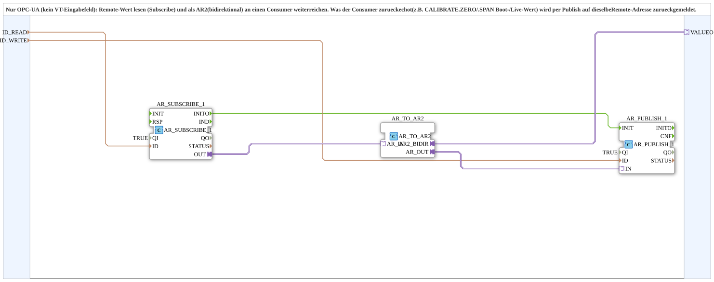

# OPC_TO_AR2

* * * * * * * * * *

## Einleitung

`OPC_TO_AR2` ist der reine OPC-UA-Zwilling von [`NumericValue_TO_AR2`](./NumericValue_TO_AR2.md) - kein VT-Eingabefeld beteiligt. Ein remote geschriebener Wert wird per `AR_SUBSCRIBE_1` abonniert und als AR2-Adapter (`VALUEO`) an einen Consumer weitergereicht (z. B. `CALIBRATE.ZERO`/`.SPAN`). Was der Consumer zurueckechot (aktueller/persistierter Wert) wird per `AR_PUBLISH_1` auf dieselbe Remote-Adresse zurueckgemeldet.

## Schnittstelle und Initialisierung

- Ereignisse: `INIT` (EInit, Eingang) und `INITO` (EInit, Ausgang, kommt von `AR_PUBLISH_1.INITO`).
- Daten: `QI` (BOOL, Vorgabe `TRUE`) sowie `ID_READ` und `ID_WRITE` (WSTRING) als Eingänge, `QO` (BOOL) als Ausgang; Adapter-Plug `VALUEO` (`AR2`).
- Initialisierung: `INIT` → `AR_SUBSCRIBE_1.INIT`, `AR_SUBSCRIBE_1.INITO` → `AR_PUBLISH_1.INIT`, `AR_PUBLISH_1.INITO` → `INITO` und → `AND_QO.REQ`.
- Qualität: `QI` → `AR_SUBSCRIBE_1.QI` und `AR_PUBLISH_1.QI` (kein fester `QI`=TRUE mehr); `AR_SUBSCRIBE_1.QO` → `AND_QO.IN1`, `AR_PUBLISH_1.QO` → `AND_QO.IN2` (`AND_BOOL_2`), `AND_QO.OUT` → `QO`.

## Technische Besonderheiten

- `AR_PUBLISH_1` wird von `AR_SUBSCRIBE_1.INITO` getriggert, damit der Boot-Wert sofort publiziert wird, nicht erst bei der ersten Aenderung.

## Zusammenfassung

Rein remote (OPC-UA) betriebene AR2-Bruecke ohne jeden VT-Bezug - fuer Consumer, die ausschliesslich per Leitwarte parametriert werden.

---

### 🌐 Passende Themen-Unterseiten auf ms-muc-docs.de

- [🌐 Eclipse 4diac IDE & Farb-Referenz auf ms-muc-docs.de](https://www.ms-muc-docs.de/iec-61499/eclipse-4diac/)
