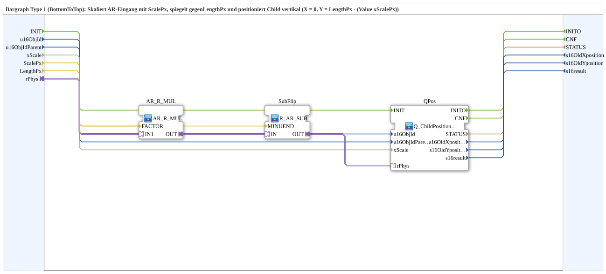

# Q_ChildPosition_AR_Bargraph_BottomToTop

* * * * * * * * * *

## Einleitung

`Q_ChildPosition_AR_Bargraph_BottomToTop` ist ein **Bargraph Typ 1 (von unten nach oben)**: Der AR-Eingang wird mit `ScalePx` skaliert, an `LengthPx` gespiegelt und als vertikale Position des Child-Objekts im VT ausgegeben (`X = 0`, `Y = LengthPx - (Wert × ScalePx)`). Ein größerer Wert schiebt das Child damit nach oben.

## Schnittstellenstruktur

### **Ereignis-Eingänge**

- **INIT** (`EInit`): Initialisierung (an `QPos.INIT`)

### **Ereignis-Ausgänge**

- **INITO** (`EInit`): Initialisierungsbestätigung (von `QPos.INITO`)
- **CNF**: Bestätigung des angeforderten Dienstes (von `QPos.CNF`)

### **Daten-Eingänge**

- **u16ObjId** (`UINT`, Vorgabe `ID_NULL`): Object-ID des Child-Objekts
- **u16ObjIdParent** (`UINT`, Vorgabe `ID_NULL`): Object-ID des Parent-Objekts
- **xScale** (`BOOL`, Vorgabe `TRUE`): `FALSE` = Bypass; `TRUE` = Skalierung mit dem DM/SKM-Faktor für `u16ObjIdParent`
- **ScalePx** (`REAL`, Vorgabe `1.0`): Pixel pro Werteinheit (Multiplikationsfaktor)
- **LengthPx** (`REAL`, Vorgabe `100.0`): Gesamtlänge des Bargraphs in Pixeln (zur Spiegelung)

### **Daten-Ausgänge**

- **STATUS** (`STRING`): Dienststatus (Durchreichung vom inneren `Q_ChildPosition`)
- **s16OldXposition** (`INT`): Alte X-Position (Durchreichung)
- **s16OldYposition** (`INT`): Alte Y-Position (Durchreichung)
- **s16result** (`INT`): Rückgabewert (Durchreichung, siehe `Q_ChildPosition`)

### **Adapter**

- **rPhys** (Socket, `adapter::types::unidirectional::AR`): Physikalischer `REAL`-Eingangswert (wird skaliert, gespiegelt und auf die Y-Position abgebildet)

## Verwendete Funktionsbausteine (FBs)

- **AR_R_MUL**: SubApp `MyLib::sys::AR_R_MUL` – multipliziert den Wert mit `ScalePx` (`FACTOR`)
- **SubFlip**: SubApp `MyLib::sys::R_AR_SUB` – subtrahiert vom `MINUEND` (`LengthPx`) und spiegelt damit
- **QPos**: SubApp `MyLib::sys::Q_ChildPosition_AR_Vertikal` – setzt die vertikale Child-Position

## Programmablauf und Verbindungen

1. `rPhys` → `AR_R_MUL.IN1`; `ScalePx` → `AR_R_MUL.FACTOR`.
2. `AR_R_MUL.OUT` → `SubFlip.IN`; `LengthPx` → `SubFlip.MINUEND`.
3. `SubFlip.OUT` → `QPos.rPhys`.
4. `INIT` → `QPos.INIT`; `QPos.INITO` → `INITO`; `QPos.CNF` → `CNF`.
5. `u16ObjId`, `u16ObjIdParent`, `xScale` → `QPos`; `STATUS`, `s16OldXposition`, `s16OldYposition`, `s16result` von `QPos` nach außen.

## Technische Besonderheiten

- Die Spiegelung ist nötig, weil die VT-Y-Koordinate von oben nach unten wächst.
- `xScale` hat hier die Vorgabe `TRUE` (bei `Q_ChildPosition_AR_Horizontal` dagegen `FALSE`).

## Anwendungsszenarien

- Senkrechter Balken/Füllstandsanzeige, der von unten nach oben wächst

## Fazit

`Q_ChildPosition_AR_Bargraph_BottomToTop` bildet einen AR-Wert über Skalierung und Spiegelung auf die vertikale Position eines VT-Child-Objekts ab.
