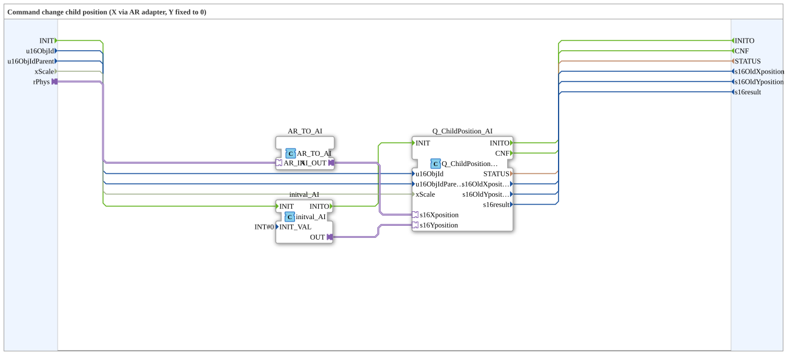

# Q_ChildPosition_AR_Horizontal

* * * * * * * * * *

## Einleitung

`Q_ChildPosition_AR_Horizontal` ändert die Position eines VT-Child-Objekts (Kommando *Change Child Position*): Die **X-Position** kommt über einen AR-Adapter, die **Y-Position ist fest 0**. Der `REAL`-Wert wird dazu in `INT` gewandelt und auf die X-Position abgebildet.

## Schnittstellenstruktur

### **Ereignis-Eingänge**

- **INIT** (`EInit`): Initialisierung (an `initval_AI.INIT`)

### **Ereignis-Ausgänge**

- **INITO** (`EInit`): Initialisierungsbestätigung (von `Q_ChildPosition_AI.INITO`)
- **CNF**: Bestätigung des angeforderten Dienstes (von `Q_ChildPosition_AI.CNF`)

### **Daten-Eingänge**

- **u16ObjId** (`UINT`, Vorgabe `ID_NULL`): Object-ID des Child-Objekts
- **u16ObjIdParent** (`UINT`, Vorgabe `ID_NULL`): Object-ID des Parent-Objekts
- **xScale** (`BOOL`, Vorgabe `FALSE`): `FALSE` = Bypass, X-/Y-Position werden unverändert gesendet; `TRUE` = Skalierung mit dem DM/SKM-Faktor für `u16ObjIdParent`

### **Daten-Ausgänge**

- **STATUS** (`STRING`): Dienststatus (Durchreichung vom inneren `Q_ChildPosition`)
- **s16OldXposition** (`INT`): Alte X-Position (Durchreichung)
- **s16OldYposition** (`INT`): Alte Y-Position (Durchreichung)
- **s16result** (`INT`): Rückgabewert (Durchreichung, siehe `Q_ChildPosition`)

### **Adapter**

- **rPhys** (Socket, `adapter::types::unidirectional::AR`): Physikalischer `REAL`-Eingangswert (wird in `INT` gewandelt und auf die X-Position abgebildet)

## Verwendete Funktionsbausteine (FBs)

- **AR_TO_AI**: `adapter::conversion::unidirectional::AR_TO_AI` – wandelt `REAL` in `INT`
- **initval_AI**: `adapter::types::unidirectional::AI::initval::initval_AI` (`INIT_VAL=0`) – liefert die konstante Y-Position 0
- **Q_ChildPosition_AI**: `isobus::UT::Q::Q_ChildPosition_AI` – sendet die Positionsänderung

## Programmablauf und Verbindungen

1. `rPhys` → `AR_TO_AI.AR_IN`; `AR_TO_AI.AI_OUT` → `Q_ChildPosition_AI.s16Xposition`.
2. `initval_AI.OUT` → `Q_ChildPosition_AI.s16Yposition` (konstant 0).
3. `INIT` → `initval_AI.INIT`; `initval_AI.INITO` → `Q_ChildPosition_AI.INIT`; `Q_ChildPosition_AI.INITO` → `INITO`; `Q_ChildPosition_AI.CNF` → `CNF`.
4. `u16ObjId`, `u16ObjIdParent`, `xScale` → `Q_ChildPosition_AI`; Statusausgänge von dort nach außen.

## Technische Besonderheiten

- Die Initialisierung läuft in Reihe: erst `initval_AI`, dann `Q_ChildPosition_AI`.
- Im Gegensatz zu `Q_ChildPosition_AR_Bargraph_BottomToTop` erfolgt keine Skalierung/Spiegelung; `xScale` hat die Vorgabe `FALSE`.

## Anwendungsszenarien

- Horizontales Verschieben eines VT-Objekts (z. B. Zeiger oder Balken) abhängig von einem `REAL`-Wert

## Fazit

`Q_ChildPosition_AR_Horizontal` verschiebt ein VT-Child-Objekt horizontal anhand eines AR-Werts bei fester Y-Position 0.
