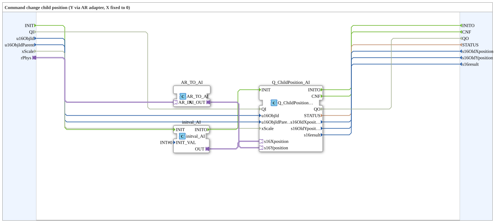
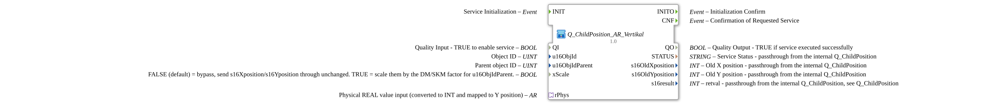

# Q_ChildPosition_AR_Vertikal

* * * * * * * * * *

## Einleitung

`Q_ChildPosition_AR_Vertikal` setzt die Position eines Kind-Objekts im VT: Die Y-Position kommt über einen AR-Adapter (`rPhys`, in INT umgewandelt), die X-Position ist fest 0.

## Schnittstellenstruktur

### **Ereignis-Eingänge**

- **INIT**: Service-Initialisierung (`EInit`)

### **Ereignis-Ausgänge**

- **INITO**: Initialisierungs-Bestätigung (`EInit`)
- **CNF**: Bestätigung des angeforderten Service

### **Daten-Eingänge**

- **u16ObjId** (UINT): Object ID des Kind-Objekts (Default `ID_NULL`)
- **u16ObjIdParent** (UINT): Object ID des Eltern-Objekts (Default `ID_NULL`)
- **xScale** (BOOL): FALSE (Default) = Bypass, X/Y-Position unverändert senden; TRUE = mit dem DM/SKM-Faktor für `u16ObjIdParent` skalieren

### **Daten-Ausgänge**

- **STATUS** (STRING): Service-Status, durchgereicht vom internen `Q_ChildPosition`
- **s16OldXposition** (INT): alte X-Position, durchgereicht
- **s16OldYposition** (INT): alte Y-Position, durchgereicht
- **s16result** (INT): Rückgabewert, durchgereicht (siehe `Q_ChildPosition`)

### **Adapter**

- **rPhys** (Socket, `adapter::types::unidirectional::AR`): physikalischer REAL-Wert (wird in INT umgewandelt und auf die Y-Position abgebildet)

## Funktionsweise

Das Netzwerk besteht aus drei Bausteinen:

- `AR_TO_AI` (`adapter::conversion::unidirectional::AR_TO_AI`): `rPhys` → `AR_TO_AI.AR_IN`; wandelt den REAL-Wert in einen INT-Adapterwert.
- `initval_AI` (`adapter::types::unidirectional::AI::initval::initval_AI`, `INIT_VAL = 0`): liefert den festen Wert 0 für die X-Position.
- `Q_ChildPosition_AI` (`isobus::UT::Q::Q_ChildPosition_AI`): `initval_AI.OUT` → `s16Xposition`, `AR_TO_AI.AI_OUT` → `s16Yposition`.

Initialisierung: `INIT` → `initval_AI.INIT`, `initval_AI.INITO` → `Q_ChildPosition_AI.INIT`, `Q_ChildPosition_AI.INITO` → `INITO`. `Q_ChildPosition_AI.CNF` → `CNF`. `u16ObjId`, `u16ObjIdParent`, `xScale` und die vier Ausgänge gehen direkt von bzw. nach `Q_ChildPosition_AI`.

## Technische Besonderheiten

- Die Initialisierung läuft in Reihe: zuerst `initval_AI`, danach `Q_ChildPosition_AI`
- `xScale` hat hier den Default FALSE (Bypass); im Gegensatz dazu hat [`Q_ChildPosition_AR_Bargraph_LeftToRight`](Q_ChildPosition_AR_Bargraph_LeftToRight.md) den Default TRUE
- Es erfolgt keine Skalierung des AR-Werts: `rPhys` wird nur in INT umgewandelt und direkt als Y-Position verwendet

## Anwendungsszenarien

- Vertikales Verschieben eines VT-Objekts (z. B. Marker) proportional zu einem Messwert, X-Position fest links

## Fazit

`Q_ChildPosition_AR_Vertikal` bildet einen AR-Wert über `AR_TO_AI` auf die Y-Position eines Kind-Objekts ab und hält die X-Position fest bei 0.
