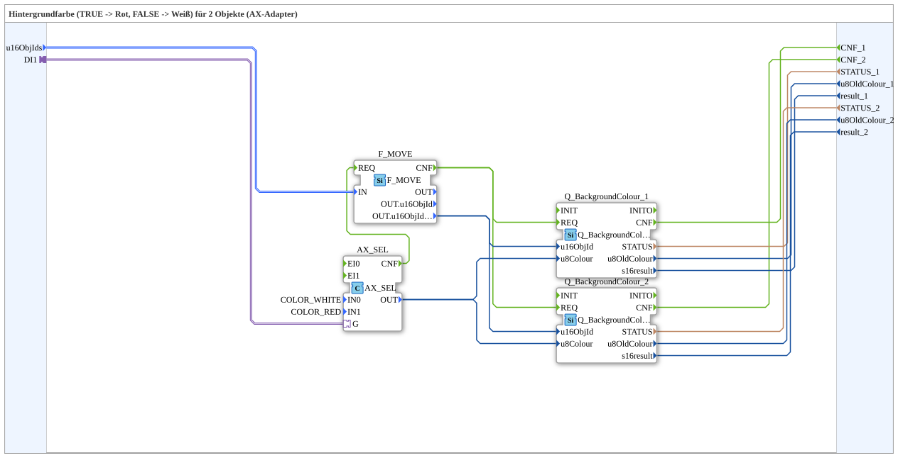

# RedWhiteBackground2_AXS

* * * * * * * * * *

## Einleitung

`RedWhiteBackground2_AXS` schaltet die VT-Hintergrundfarbe von 2 Objekten anhand eines booleschen Selector-Signals: `TRUE` → **Rot**, `FALSE` → **Weiß**. Das Selector-Signal kommt über einen `AX`-Adapter-Socket (`DI1`). Die Objekt-ID wird über den strukturierten Typ `s1ObjectID` (`u16ObjIds`) übergeben.

| Position | Objekt-ID-Quelle       | Baustein                                            |
| -------- | ---------------------- | --------------------------------------------------- |
| 1        | `F_MOVE.OUT.u16ObjIdA` | `Q_BackgroundColour` (normales Objekt)              |
| 2        | `F_MOVE.OUT.u16ObjIdA` | `Q_BackgroundColourAux` (Auxiliary-Function-Objekt) |

Allgemeines Muster (Selector → `AX_SEL`/`F_SEL` → `Q_BackgroundColour`) siehe [Background-Farbbausteine (gemeinsames Muster)](./Background-Farbbausteine.md).

## Initialisierung und Status (INIT/INITO, QI/QO)

- **Ereignis-Eingang** `INIT` (`EInit`, Initialization Request) und **Ereignis-Ausgang** `INITO` (`EInit`, Initialization Confirm)
- **Daten-Eingang** `QI` (`BOOL`, Vorgabe `TRUE`, Quality Input) wird an `Q_BackgroundColour_1.QI` und `Q_BackgroundColour_2.QI` weitergegeben
- **Daten-Ausgang** `QO` (`BOOL`, Quality Output): UND (`AND_QO`, Typ `iec61131::booleanOperators::AND_BOOL_2`) der `QO`-Ausgänge von `Q_BackgroundColour_1.QO` und `Q_BackgroundColour_2.QO`
- **Initialisierungskette**: `INIT` → `Q_BackgroundColour_1.INIT`, `Q_BackgroundColour_1.INITO` → `Q_BackgroundColour_2.INIT`, `Q_BackgroundColour_2.INITO` → `INITO`
- `E_MERGE_QO` (Typ `iec61499::events::E_MERGE_3`) führt `Q_BackgroundColour_2.INITO`, `Q_BackgroundColour_1.CNF` und `Q_BackgroundColour_2.CNF` zusammen und löst `AND_QO.REQ` aus

## Zusammenfassung

Eine von vielen Varianten der Background-Farbbausteine-Familie: Farbpaar Rot/Weiß, 2 Objekte, Adapter-Selector, struct. Objekt-ID.

---

### 🌐 Passende Themen-Unterseiten auf ms-muc-docs.de

- [🌐 Eclipse 4diac IDE & Farb-Referenz auf ms-muc-docs.de](https://www.ms-muc-docs.de/iec-61499/eclipse-4diac/)
