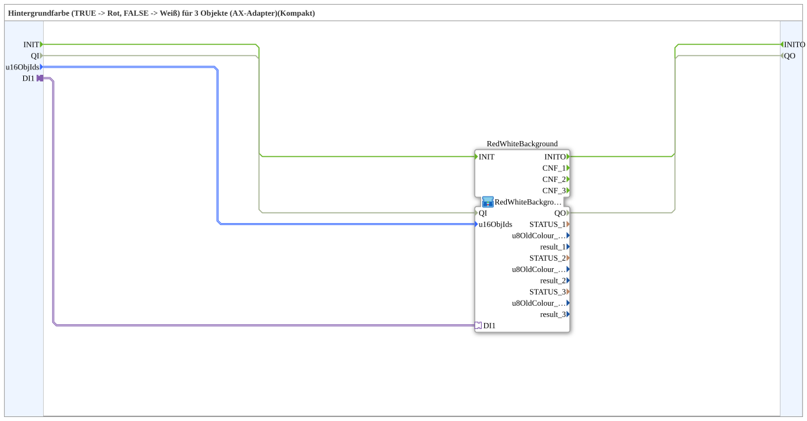

# RedWhiteBackground3_AXSC

* * * * * * * * * *

## Einleitung

`RedWhiteBackground3_AXSC` ist ein **Kompakt-Wrapper** um [`RedWhiteBackground3_AXS`](RedWhiteBackground3_AXS.md) — reicht `u16ObjId`s und den Selector durch, ohne die `CNF`-Ereignisausgänge und Diagnosewerte (`STATUS_n`, `u8OldColour_n`, `result_n`) nach außen zu führen.

Details zum gemeinsamen Muster siehe [Background-Farbbausteine (gemeinsames Muster)](./Background-Farbbausteine.md).

## Initialisierung und Qualität

- **Ereignis-Eingang `INIT`** (`EInit`) und **Ereignis-Ausgang `INITO`** (`EInit`) werden durchgereicht: `INIT` → `RedWhiteBackground.INIT`; `RedWhiteBackground.INITO` → `INITO`.
- **Dateneingang `QI`** (`BOOL`, Vorgabe `TRUE`) → `RedWhiteBackground.QI`; **Datenausgang `QO`** (`BOOL`) ← `RedWhiteBackground.QO`.

Die innere SubApp-Instanz `RedWhiteBackground` ist vom Typ `RedWhiteBackground3_AXS`.

## Zusammenfassung

Reine Weiterleitung an `RedWhiteBackground3_AXS` für den Regelfall, in dem die Diagnosewerte nicht gebraucht werden.

---

### 🌐 Passende Themen-Unterseiten auf ms-muc-docs.de

- [🌐 Eclipse 4diac IDE & Farb-Referenz auf ms-muc-docs.de](https://www.ms-muc-docs.de/iec-61499/eclipse-4diac/)
