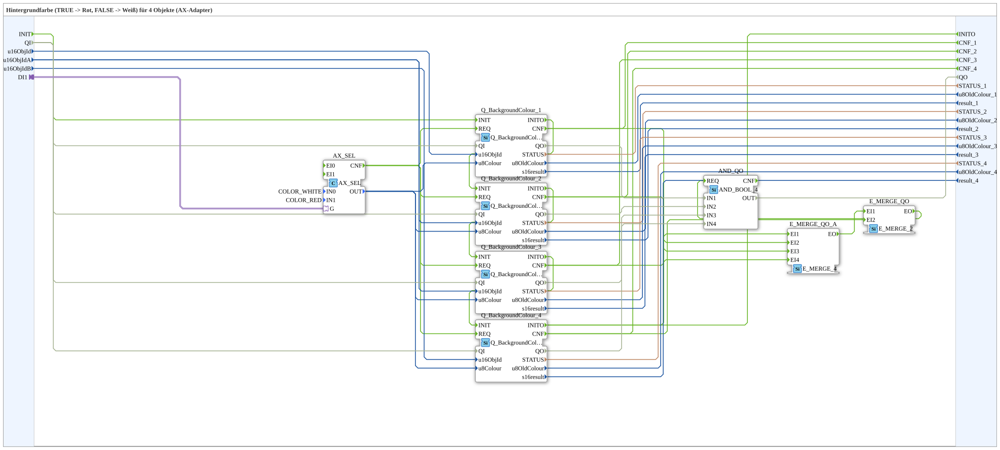
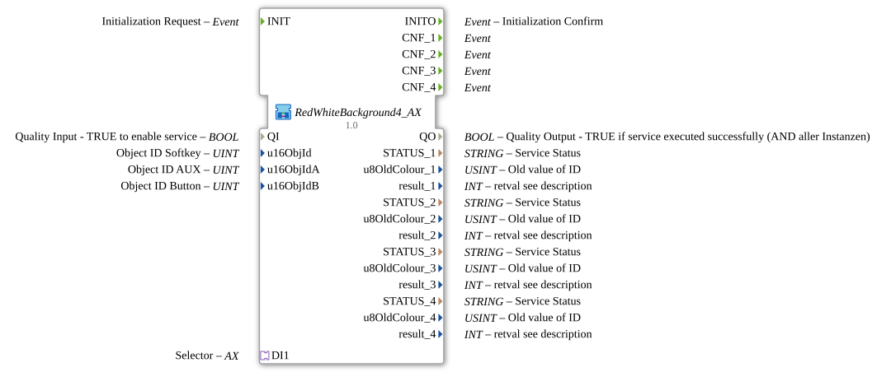

# RedWhiteBackground4_AX

* * * * * * * * * *

## Einleitung

`RedWhiteBackground4_AX` schaltet die VT-Hintergrundfarbe von 4 Objekten anhand eines booleschen Selector-Signals: `TRUE` → **Rot**, `FALSE` → **Weiß**. Das Selector-Signal kommt über einen `AX`-Adapter-Socket (`DI1`). Die Objekt-ID wird über die Eingänge `u16ObjId, u16ObjIdA, u16ObjIdB` übergeben.

| Position | Objekt-ID-Quelle | Baustein                                            |
| -------- | ---------------- | --------------------------------------------------- |
| 1        | `u16ObjId`       | `Q_BackgroundColour` (normales Objekt)              |
| 2        | `u16ObjIdA`      | `Q_BackgroundColour` (normales Objekt)              |
| 3        | `u16ObjIdA`      | `Q_BackgroundColourAux` (Auxiliary-Function-Objekt) |
| 4        | `u16ObjIdB`      | `Q_BackgroundColour` (normales Objekt)              |

Schnittstelle (Quality-Muster): Ereignis-Eingang `INIT` und Ereignis-Ausgang `INITO` (je `EInit`), Dateneingang `QI` (`BOOL`, Vorgabe `TRUE`) und Datenausgang `QO` (`BOOL`, UND aller Instanzen). Initialisierung: `INIT` → `Q_BackgroundColour_1.INIT`; `Q_BackgroundColour_1.INITO` → `Q_BackgroundColour_2.INIT`; `Q_BackgroundColour_2.INITO` → `Q_BackgroundColour_3.INIT`; `Q_BackgroundColour_3.INITO` → `Q_BackgroundColour_4.INIT`; `Q_BackgroundColour_4.INITO` → `INITO`. Qualität: `QI` → `Q_BackgroundColour_1.QI`, `Q_BackgroundColour_2.QI`, `Q_BackgroundColour_3.QI`, `Q_BackgroundColour_4.QI`; `Q_BackgroundColour_1.QO`, `Q_BackgroundColour_2.QO`, `Q_BackgroundColour_3.QO`, `Q_BackgroundColour_4.QO` → `AND_QO.IN1` bis `AND_QO.IN4` (`AND_QO`: `iec61131::booleanOperators::AND_BOOL_4`); `AND_QO.OUT` → `QO`. Der Trigger `AND_QO.REQ` kommt über zwei Merge-Bausteine: `E_MERGE_QO_A` (`E_MERGE_4`) führt `Q_BackgroundColour_4.INITO` und die `CNF` von `Q_BackgroundColour_1` bis `_3` zusammen, `E_MERGE_QO` (`E_MERGE_2`) dessen Ausgang und `Q_BackgroundColour_4.CNF`; `E_MERGE_QO.EO` → `AND_QO.REQ`.

Allgemeines Muster (Selector → `AX_SEL`/`F_SEL` → `Q_BackgroundColour`) siehe [Background-Farbbausteine (gemeinsames Muster)](./Background-Farbbausteine.md).

## Zusammenfassung

Eine von vielen Varianten der Background-Farbbausteine-Familie: Farbpaar Rot/Weiß, 4 Objekte, Adapter-Selector.

---

### 🌐 Passende Themen-Unterseiten auf ms-muc-docs.de

* [🌐 Eclipse 4diac IDE & Farb-Referenz auf ms-muc-docs.de](https://www.ms-muc-docs.de/iec-61499/eclipse-4diac/)
