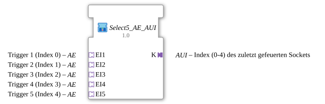

# Select5_AE_AUI

* * * * * * * * * *

## Einleitung

`Select5_AE_AUI` nimmt fünf `AE`-Sockets (je ein Trigger, z. B. von `AE_AX_TO_AE_SPLIT.IN`) entgegen und liefert über den Plug `K` den Index (0-4) des zuletzt gefeuerten Sockets. Der Baustein bündelt `AUI_MUX_5` und fünf `AE_E_TO_EVENT` (Adapter-zu-Event-Entpacker) zu einem wiederverwendbaren Baustein.

## Verwendete Funktionsbausteine (FBs)

### Sub-Bausteine: Select5_AE_AUI

- **Typ**: SubAppType
- **Verwendete interne FBs**:
    - **AE_E_TO_EVENT_1** bis **AE_E_TO_EVENT_5**: je `adapter::conversion::unidirectional::AE_E_TO_EVENT` – wandelt ein `AE`-Adapterereignis in ein normales Ereignis (`CNF`)
    - **AUI_MUX_5**: `adapter::events::unidirectional::AUI_MUX_5` – liefert den Index des zuletzt aktiven Eingangs auf `K`

## Schnittstellenstruktur

### **Ereignis-Eingänge / Ereignis-Ausgänge**

Keine – Ereignisse laufen über die Adapter.

### **Daten-Eingänge / Daten-Ausgänge**

Keine direkten Daten-Ports.

### **Adapter**

- **EI1** (Socket, `adapter::types::unidirectional::AE`): Trigger 1 (Index 0)
- **EI2** (Socket, `AE`): Trigger 2 (Index 1)
- **EI3** (Socket, `AE`): Trigger 3 (Index 2)
- **EI4** (Socket, `AE`): Trigger 4 (Index 3)
- **EI5** (Socket, `AE`): Trigger 5 (Index 4)
- **K** (Plug, `adapter::types::unidirectional::AUI`): Index (0-4) des zuletzt gefeuerten Sockets

## Programmablauf und Verbindungen

- `EI1`…`EI5` → `AE_E_TO_EVENT_1`…`AE_E_TO_EVENT_5` (`AE_IN`)
- `AE_E_TO_EVENT_n.CNF` → `AUI_MUX_5.EIn` (n = 1…5)
- `AUI_MUX_5.K` → `K`

## Technische Besonderheiten

- Index-Zuordnung: `EI1` → 0, `EI2` → 1, `EI3` → 2, `EI4` → 3, `EI5` → 4
- Version 1.0 (2026-09-12): gekapselt für die exklusive TECU-Geschwindigkeitsquellen-Auswahl (5x `AE_AX_TO_AE_SPLIT.IN` als Quelle)

## Anwendungsszenarien

- Exklusive Quellenauswahl: der zuletzt aktivierte von fünf Triggern bestimmt den gewählten Index (z. B. TECU-Geschwindigkeitsquelle)

## Zusammenfassung

`Select5_AE_AUI` wandelt fünf `AE`-Trigger in den Index des zuletzt gefeuerten Triggers als `AUI`-Signal um.
