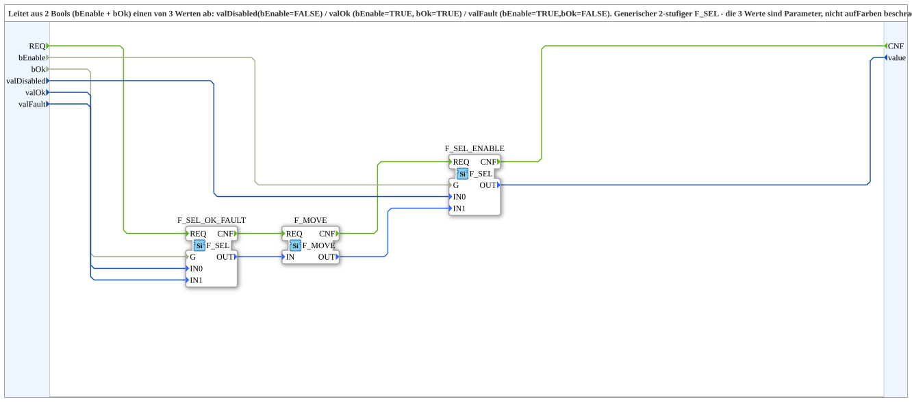

# Select_EnableOk_a

* * * * * * * * * *

## Einleitung

`Select_EnableOk_a` leitet aus zwei `BOOL`-Werten (`bEnable` und `bOk`) einen von drei Werten ab: `valDisabled` (`bEnable = FALSE`), `valOk` (`bEnable = TRUE`, `bOk = TRUE`) oder `valFault` (`bEnable = TRUE`, `bOk = FALSE`). Es ist ein generischer, zweistufiger `F_SEL`; die drei Werte sind Parameter und nicht auf Farben beschränkt.

## Schnittstellenstruktur

### **Ereignis-Eingänge**

- **REQ**: Neu auswerten – `bEnable` und `bOk` werden zusammen mitgegeben

### **Ereignis-Ausgänge**

- **CNF**: Wert berechnet

### **Daten-Eingänge**

- **bEnable** (`BOOL`): Aktiviert
- **bOk** (`BOOL`): OK-Zustand (nur relevant, wenn `bEnable = TRUE`)
- **valDisabled** (`USINT`): Ausgabewert bei `bEnable = FALSE`; einmalig bei Instanziierung per Parameter gesetzt
- **valOk** (`USINT`): Ausgabewert bei `bEnable = TRUE` und `bOk = TRUE`; einmalig bei Instanziierung per Parameter gesetzt
- **valFault** (`USINT`): Ausgabewert bei `bEnable = TRUE` und `bOk = FALSE`; einmalig bei Instanziierung per Parameter gesetzt

### **Daten-Ausgänge**

- **value** (`USINT`): Ausgewählter Wert

### **Adapter**

Dieser Funktionsblock verwendet keine Adapter.

## Verwendete Funktionsbausteine (FBs)

- **F_SEL_OK_FAULT**: `iec61131::selection::F_SEL` – wählt mit `G = bOk` zwischen `IN0 = valFault` und `IN1 = valOk`
- **F_MOVE**: `iec61131::selection::F_MOVE` (`DataType=USINT`) – reicht das Ergebnis weiter
- **F_SEL_ENABLE**: `iec61131::selection::F_SEL` – wählt mit `G = bEnable` zwischen `IN0 = valDisabled` und `IN1 =` Ergebnis von `F_MOVE`

## Programmablauf und Verbindungen

1. `REQ` → `F_SEL_OK_FAULT.REQ` → `F_MOVE.REQ` → `F_SEL_ENABLE.REQ` → `CNF` (Ereigniskette).
2. `bOk` → `F_SEL_OK_FAULT.G`; `valFault` → `IN0`; `valOk` → `IN1`.
3. `F_SEL_OK_FAULT.OUT` → `F_MOVE.IN` → `F_SEL_ENABLE.IN1`.
4. `bEnable` → `F_SEL_ENABLE.G`; `valDisabled` → `F_SEL_ENABLE.IN0`.
5. `F_SEL_ENABLE.OUT` → `value`.

## Technische Besonderheiten

- Die Wertetabelle:

| bEnable | bOk | value |
| --- | --- | --- |
| FALSE | beliebig | `valDisabled` |
| TRUE | TRUE | `valOk` |
| TRUE | FALSE | `valFault` |

- Die drei Werte sind `USINT` und können z. B. Farbcodes, aber auch beliebige andere Zustandswerte sein.
- Die AX-Variante des Bausteins ist `Select_EnableOk_AX`.

## Anwendungsszenarien

- Dreistufige Statusanzeige (aus/ok/Fehler), z. B. Farbwahl für ein VT-Objekt

## Fazit

`Select_EnableOk_a` wählt aus Freigabe und OK-Zustand einen von drei parametrierbaren `USINT`-Werten.
