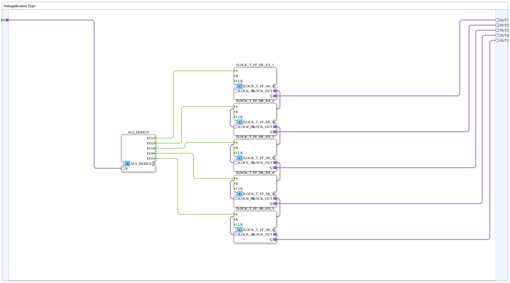
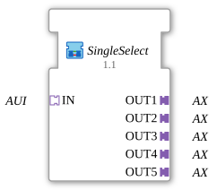

# SingleSelect

* * * * * * * * * *

## Einleitung

`SingleSelect` ist eine Einfachauswahl (Radio-Button-Verhalten) mit fünf Ausgängen: Ein Auswahlindex am AUI-Socket `IN` aktiviert genau einen der fünf AX-Ausgänge `OUT1`..`OUT5`; die übrigen werden dabei zurückgesetzt. Die Verriegelung übernimmt eine Kette aus fünf `ILOCK_T_FF_SR_AX`.

## Schnittstellenstruktur

### **Ereignis-Eingänge**

Der Funktionsblock verfügt über keine direkten Ereignis-Eingänge.

### **Ereignis-Ausgänge**

Der Funktionsblock verfügt über keine direkten Ereignis-Ausgänge.

### **Daten-Eingänge**

Der Funktionsblock verfügt über keine direkten Daten-Eingänge.

### **Daten-Ausgänge**

Der Funktionsblock verfügt über keine direkten Daten-Ausgänge.

### **Adapter**

- **IN** (Socket, `adapter::types::unidirectional::AUI`): Auswahlindex (UINT)
- **OUT1**..**OUT5** (Plugs, `adapter::types::unidirectional::AX`): Zustand der fünf Auswahlpositionen

## Funktionsweise

- `IN` → `AUI_DEMUX.K`: `AUI_DEMUX` ([`adapter::events::unidirectional::AUI_DEMUX_5`](../../adapter/events/unidirectional/UINT/AUI_DEMUX_5.md)) leitet das Ereignis abhängig vom Index weiter: `K = 0` → `EO1`, `K = 1` → `EO2`, `K = 2` → `EO3`, `K = 3` → `EO4`, `K = 4` → `EO5`.
- `AUI_DEMUX.EOn` → `ILOCK_T_FF_SR_AX_n.S` (n = 1..5): Das gewählte Flipflop wird gesetzt.
- `ILOCK_T_FF_SR_AX_n.Q` → `OUTn`: Der Zustand jedes Flipflops erscheint am zugehörigen Ausgang.
- `ILOCK_T_FF_SR_AX_n.ILOCK_OUT` → `ILOCK_T_FF_SR_AX_(n+1).ILOCK_IN` (n = 1..4): Die fünf Flipflops sind über ihre bidirektionalen `AE2`-Verriegelungs-Adapter zu einer Kette verbunden. Setzt ein Glied seinen Ausgang, meldet es dies über die Kette, und die anderen Glieder werden zurückgesetzt (siehe [`ILOCK_T_FF_SR_AX`](../../logiBUS/signalprocessing/interlock/ILOCK_T_FF_SR_AX.md)).

## Technische Besonderheiten

- Der Baustein hat keine Ereignis- oder Datenports; alles läuft über Adapter
- Version 1.1 räumte das Layout auf: `AUI_DEMUX_4` wurde in `AUI_DEMUX` umbenannt (das `_4` hatte keine Bedeutung)
- Gültige Indizes sind 0 bis 4; die Zuordnung zwischen Index und Ausgang ist `K = n - 1` ↔ `OUTn`

## Anwendungsszenarien

- Auswahlmenüs oder Betriebsartenwahl, bei denen immer nur eine von fünf Optionen aktiv sein darf (z. B. per VT-Auswahlliste)

## Fazit

`SingleSelect` setzt einen Auswahlindex mit Hilfe eines Demultiplexers und einer Interlock-Kette aus fünf `ILOCK_T_FF_SR_AX` in eine Einfachauswahl mit fünf AX-Ausgängen um.
