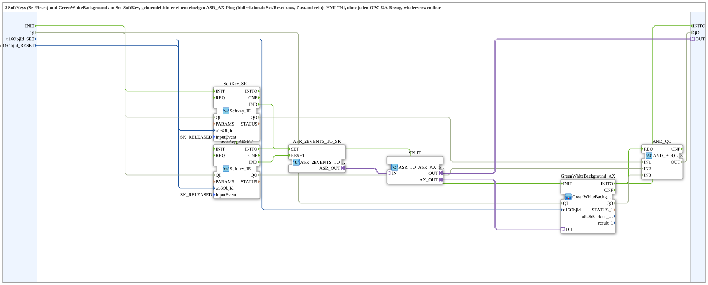

# SoftKeySR_ASR_AX

* * * * * * * * * *

## Einleitung

`SoftKeySR_ASR_AX` buendelt 2 SoftKeys (Set/Reset) und ein `GreenWhiteBackground1_AX` (am Set-SoftKey) hinter einem einzigen `ASR_AX`-Plug (bidirektional: Set/Reset gehen raus, Zustand kommt rein). Reiner HMI-Baustein ohne jeden OPC-UA-Bezug.

## Schnittstelle

- **Ereignis-Eingang**: `INIT` (`EInit`, Initialization Request)
- **Ereignis-Ausgang**: `INITO` (`EInit`, Initialization Confirm)
- **Daten-Eingänge**: `QI` (`BOOL`, Vorgabe `TRUE`, Quality Input), `u16ObjId_SET`, `u16ObjId_RESET` (`UINT`, Vorgabe `ID_NULL`)
- **Daten-Ausgang**: `QO` (`BOOL`, Quality Output)
- **Plug**: `OUT` (`adapter::types::bidirectional::ASR_AX`)

## Verwendete Funktionsbausteine (FBs)

- **SoftKey_SET / SoftKey_RESET** (`isobus::UT::io::Softkey::Softkey_IE`, `InputEvent=SK_RELEASED`): die beiden physischen SoftKeys.
- **ASR_2EVENTS_TO_SR** (`adapter::conversion::unidirectional::ASR_2EVENTS_TO_SR`): wandelt die 2 SoftKey-Events in ein ASR-Adapter-Ereignispaar.
- **SPLIT** (`adapter::events::bidirectional::ASR_TO_ASR_AX_SPLIT`): verzweigt den bidirektionalen `ASR_AX`-Verkehr auf `OUT` und auf das Background-Element.
- **GreenWhiteBackground_AX** (SubApp, Typ `MyLib::sys::GreenWhiteBackground1_AX`): Statusfarbe am Set-SoftKey.
- **AND_QO** (`iec61131::booleanOperators::AND_BOOL_3`): verknüpft die `QO`-Ausgänge von `SoftKey_SET`, `SoftKey_RESET` und `GreenWhiteBackground_AX` per UND zum Baustein-Ausgang `QO`.

## Initialisierung und Status

- Initialisierungskette: `INIT` → `SoftKey_SET.INIT`, `SoftKey_SET.INITO` → `SoftKey_RESET.INIT`, `SoftKey_RESET.INITO` → `GreenWhiteBackground_AX.INIT`, `GreenWhiteBackground_AX.INITO` → `INITO` und → `AND_QO.REQ`
- `QI` → `SoftKey_SET.QI`, `SoftKey_RESET.QI` und `GreenWhiteBackground_AX.QI`
- `SoftKey_SET.QO` → `AND_QO.IN1`, `SoftKey_RESET.QO` → `AND_QO.IN2`, `GreenWhiteBackground_AX.QO` → `AND_QO.IN3`; `AND_QO.OUT` → `QO`

## Zusammenfassung

Wiederverwendbarer Set/Reset-mit-Statusanzeige-Baustein, gebuendelt hinter einem `ASR_AX`-Adapter - das HMI-Gegenstueck zu [`SoftKeySR_PC_A_OPC_Adapter`](./SoftKeySR_PC_A_OPC_Adapter.md)/[`SoftKeySR_PC_B_OPC_Adapter`](./SoftKeySR_PC_B_OPC_Adapter.md).

---

### 🌐 Passende Themen-Unterseiten auf ms-muc-docs.de

- [🌐 Eclipse 4diac IDE & Farb-Referenz auf ms-muc-docs.de](https://www.ms-muc-docs.de/iec-61499/eclipse-4diac/)
