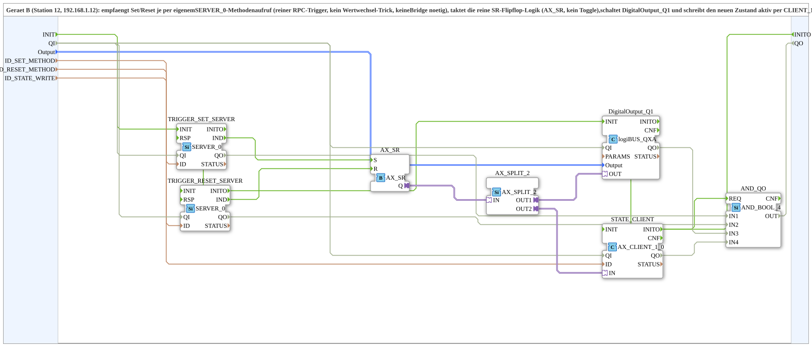

# SoftKeySR_PC_B_OPC

* * * * * * * * * *

## Einleitung

`SoftKeySR_PC_B_OPC` ist die Geraet-B-Seite (Station 12, 192.168.1.12): empfaengt Set/Reset je per eigenem `SERVER_0`-Methodenaufruf (reiner RPC-Trigger, kein Wertwechsel-Trick, keine Bridge noetig), taktet die reine SR-Flipflop-Logik (`AX_SR`, kein Toggle), schaltet `DigitalOutput_Q1` und schreibt den neuen Zustand aktiv per `AX_CLIENT_1_0` zurueck auf Geraet A. Gegenstueck: [`SoftKeySR_PC_A_OPC`](./SoftKeySR_PC_A_OPC.md).

## Verwendete Funktionsbausteine (FBs)

- **TRIGGER_SET_SERVER / TRIGGER_RESET_SERVER** (`iec61499::net::SERVER_0`): empfangen je einen eigenen Methodenaufruf (`ID_SET_METHOD`/`ID_RESET_METHOD`).
- **AX_SR** (`adapter::events::unidirectional::AX_SR`): reine Set/Reset-Flipflop-Logik, kein Toggle.
- **AX_SPLIT_2** (`adapter::events::unidirectional::AX_SPLIT_2`): verzweigt den Zustand auf physischen Ausgang + Rueckmeldung.
- **DigitalOutput_Q1** (`logiBUS::io::DQ::logiBUS_QXA`): physischer Ausgang.
- **STATE_CLIENT** (`adapter::net::AX_CLIENT_1_0`): schreibt den Zustand aktiv auf Geraet A unter `ID_STATE_WRITE`.

## Initialisierung und Qualität

Die SubApp besitzt den Ereigniseingang `INIT`, den Ereignisausgang `INITO` (je `EInit`), den Dateneingang `QI` (`BOOL`, Default `TRUE`) und den Datenausgang `QO` (`BOOL`). Die Initialisierung läuft als Kette: `INIT` → `TRIGGER_SET_SERVER.INIT`, `TRIGGER_SET_SERVER.INITO` → `TRIGGER_RESET_SERVER.INIT`, `TRIGGER_RESET_SERVER.INITO` → `DigitalOutput_Q1.INIT`, `DigitalOutput_Q1.INITO` → `STATE_CLIENT.INIT`, `STATE_CLIENT.INITO` → `INITO` (und → `AND_QO.REQ`). `QI` geht an `TRIGGER_SET_SERVER`, `TRIGGER_RESET_SERVER`, `DigitalOutput_Q1` und `STATE_CLIENT`. `QO` ist der Ausgang der Instanz `AND_QO` (`iec61131::booleanOperators::AND_BOOL_4`), die die `QO` dieser vier Instanzen verknüpft.

## Zusammenfassung

Geraet-B-Seite: empfaengt Set/Reset per RPC, haelt die reine SR-Flipflop-Logik und meldet den Zustand aktiv zurueck.

---

### 🌐 Passende Themen-Unterseiten auf ms-muc-docs.de

- [🌐 Eclipse 4diac IDE & Farb-Referenz auf ms-muc-docs.de](https://www.ms-muc-docs.de/iec-61499/eclipse-4diac/)
