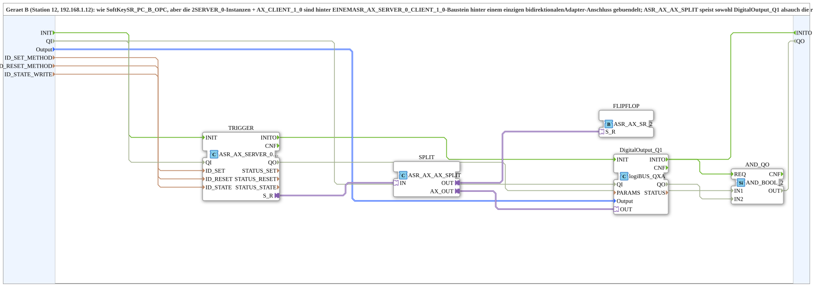

# SoftKeySR_PC_B_OPC_Adapter

* * * * * * * * * *

## Einleitung

`SoftKeySR_PC_B_OPC_Adapter` ist die adapter-gebuendelte Variante von [`SoftKeySR_PC_B_OPC`](./SoftKeySR_PC_B_OPC.md) (Geraet B, Station 12): die 2 `SERVER_0`-Instanzen + `AX_CLIENT_1_0` sind hinter EINEM `ASR_AX_SERVER_0_CLIENT_1_0`-Baustein hinter einem einzigen bidirektionalen Adapter-Anschluss gebuendelt; `ASR_AX_AX_SPLIT` speist sowohl `DigitalOutput_Q1` als auch die reine SR-Flipflop-Logik (`ASR_AX_SR_2`, kein Toggle). Gegenstueck: [`SoftKeySR_PC_A_OPC_Adapter`](./SoftKeySR_PC_A_OPC_Adapter.md).

## Verwendete Funktionsbausteine (FBs)

- **TRIGGER** (`adapter::net::ASR_AX_SERVER_0_CLIENT_1_0`): buendelt Server-Empfang (`ID_SET_METHOD`/`ID_RESET_METHOD`) und Zustands-Rueckmeldung (`ID_STATE_WRITE`).
- **SPLIT** (`adapter::events::bidirectional::ASR_AX_AX_SPLIT`): verzweigt auf physischen Ausgang + Flipflop-Logik.
- **FLIPFLOP** (`adapter::events::bidirectional::ASR_AX_SR_2`): reine SR-Flipflop-Logik als Adapter-Baustein, kein Toggle.
- **DigitalOutput_Q1** (`logiBUS::io::DQ::logiBUS_QXA`): physischer Ausgang.
- **AND_QO** (`iec61131::booleanOperators::AND_BOOL_2`): verknüpft `TRIGGER.QO` und `DigitalOutput_Q1.QO` zum `QO` der SubApp.

## Initialisierung und Qualität

- **Ereignis-Eingang `INIT`** (`EInit`) und **Ereignis-Ausgang `INITO`** (`EInit`): `INIT` → `TRIGGER.INIT`; `TRIGGER.INITO` → `DigitalOutput_Q1.INIT`; `DigitalOutput_Q1.INITO` → `INITO` (und → `AND_QO.REQ`).
- **Dateneingang `QI`** (`BOOL`, Vorgabe `TRUE`) → `TRIGGER.QI` und `DigitalOutput_Q1.QI`.
- **Datenausgang `QO`** (`BOOL`): `TRIGGER.QO` → `AND_QO.IN1`; `DigitalOutput_Q1.QO` → `AND_QO.IN2`; `AND_QO.OUT` → `QO`.

## Zusammenfassung

Adapter-gebuendelte Variante von `SoftKeySR_PC_B_OPC`: Netzwerkprotokoll und SR-Flipflop-Logik als wiederverwendbare Adapter-Bausteine.

---

### 🌐 Passende Themen-Unterseiten auf ms-muc-docs.de

- [🌐 Eclipse 4diac IDE & Farb-Referenz auf ms-muc-docs.de](https://www.ms-muc-docs.de/iec-61499/eclipse-4diac/)
