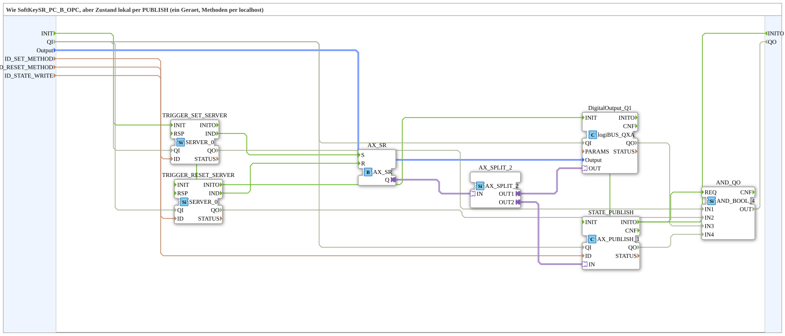

# SoftKeySR_PC_B_OPC_LOC

* * * * * * * * * *

## Einleitung

`SoftKeySR_PC_B_OPC_LOC` ist die lokale Variante von [`SoftKeySR_PC_B_OPC`](./SoftKeySR_PC_B_OPC.md): Statt den Zustand per Remote-Write über einen `AX_CLIENT_1_0` zu schreiben, wird er lokal per `AX_PUBLISH_1` geschrieben (ein Gerät, Methoden per `localhost`, kein Endpunkt). Die SubApp empfängt Set und Reset je per eigenem `SERVER_0`-Methodenaufruf, taktet die reine SR-Flipflop-Logik (`AX_SR`, kein Toggle), schaltet `DigitalOutput_Q1` und veröffentlicht den neuen Zustand lokal unter `ID_STATE_WRITE`.

## Schnittstellenstruktur

### **Ereignis-Eingänge**

- `INIT` (`EInit`): Initialization Request

### **Ereignis-Ausgänge**

- `INITO` (`EInit`): Initialization Confirm

### **Daten-Eingänge**

| Name | Typ | Beschreibung |
|------|-----|--------------|
| `QI` | `BOOL` | Quality Input - TRUE, um den Dienst freizugeben. Initialwert `TRUE`. |
| `Output` | `logiBUS::io::DQ::logiBUS_DO_S` | Identifiziert den Ausgang `Output_Q1..Q8`. Initialwert `logiBUS_DO::Invalid`. |
| `ID_SET_METHOD` | `WSTRING` | Lokale Methodenadresse (`ACTION=CREATE_METHOD`) für den Set-Methodenaufruf, wird von Gerät A per `CALL_METHOD` aufgerufen. |
| `ID_RESET_METHOD` | `WSTRING` | Lokale Methodenadresse (`ACTION=CREATE_METHOD`) für den Reset-Methodenaufruf, wird von Gerät A per `CALL_METHOD` aufgerufen. |
| `ID_STATE_WRITE` | `WSTRING` | Lokale Knotenadresse (`BOOL`, `ACTION=WRITE`) für den Zustand. |

### **Daten-Ausgänge**

| Name | Typ | Beschreibung |
|------|-----|--------------|
| `QO` | `BOOL` | Quality Output - TRUE, wenn der Dienst erfolgreich ausgeführt wurde. |

### **Adapter**

Keine vorhanden.

## Verwendete Funktionsbausteine (FBs)

- **TRIGGER_SET_SERVER / TRIGGER_RESET_SERVER** (`iec61499::net::SERVER_0`): empfangen je einen eigenen Methodenaufruf (`ID_SET_METHOD` / `ID_RESET_METHOD`).
- **AX_SR** (`adapter::events::unidirectional::AX_SR`): reine Set/Reset-Flipflop-Logik, kein Toggle.
- **AX_SPLIT_2** (`adapter::events::unidirectional::AX_SPLIT_2`): verzweigt den Zustand auf physischen Ausgang und lokales Publish.
- **DigitalOutput_Q1** (`logiBUS::io::DQ::logiBUS_QXA`): physischer Ausgang.
- **STATE_PUBLISH** (`adapter::net::AX_PUBLISH_1`): schreibt den Zustand lokal unter `ID_STATE_WRITE`.
- **AND_QO** (`iec61131::booleanOperators::AND_BOOL_4`): verknüpft die `QO` der beiden Server, von `DigitalOutput_Q1` und von `STATE_PUBLISH`.

## Programmablauf und Verbindungen

1. Flipflop-Ansteuerung: `TRIGGER_SET_SERVER.IND` → `AX_SR.S`; `TRIGGER_RESET_SERVER.IND` → `AX_SR.R`.
2. Antwort: `TRIGGER_SET_SERVER.IND` → `TRIGGER_SET_SERVER.RSP`; `TRIGGER_RESET_SERVER.IND` → `TRIGGER_RESET_SERVER.RSP`.
3. Initialisierungskette: `INIT` → `TRIGGER_SET_SERVER.INIT`; `TRIGGER_SET_SERVER.INITO` → `TRIGGER_RESET_SERVER.INIT`; `TRIGGER_RESET_SERVER.INITO` → `DigitalOutput_Q1.INIT`; `DigitalOutput_Q1.INITO` → `STATE_PUBLISH.INIT`; `STATE_PUBLISH.INITO` → `INITO` und → `AND_QO.REQ`.
4. Zustand: `AX_SR.Q` → `AX_SPLIT_2.IN`; `AX_SPLIT_2.OUT1` → `DigitalOutput_Q1.OUT`; `AX_SPLIT_2.OUT2` → `STATE_PUBLISH.IN`.
5. Daten: `Output` → `DigitalOutput_Q1.Output`; `ID_SET_METHOD` → `TRIGGER_SET_SERVER.ID`; `ID_RESET_METHOD` → `TRIGGER_RESET_SERVER.ID`; `ID_STATE_WRITE` → `STATE_PUBLISH.ID`.
6. Qualifier: `QI` → `TRIGGER_SET_SERVER.QI`, `TRIGGER_RESET_SERVER.QI`, `DigitalOutput_Q1.QI` und `STATE_PUBLISH.QI`.
7. Qualitätsauswertung: `TRIGGER_SET_SERVER.QO` → `AND_QO.IN1`; `TRIGGER_RESET_SERVER.QO` → `AND_QO.IN2`; `DigitalOutput_Q1.QO` → `AND_QO.IN3`; `STATE_PUBLISH.QO` → `AND_QO.IN4`; `AND_QO.OUT` → `QO`.

## Technische Besonderheiten

- Gegenüber der Remote-Variante ersetzt `STATE_PUBLISH` (`AX_PUBLISH_1`) den `STATE_CLIENT` (`AX_CLIENT_1_0`).
- Die `RSP`-Ereignisse der beiden Server sind direkt mit den jeweiligen `IND`-Ereignissen verbunden.

## Anwendungsszenarien

- Lokale Übung auf einem Gerät: Set und Reset werden per OPC-UA-Methodenaufruf (`localhost`) ausgelöst, der Zustand wird lokal veröffentlicht.
- Testaufbau ohne zweites Gerät als Gegenstück zu [`SoftKeySR_PC_B_OPC`](./SoftKeySR_PC_B_OPC.md).

## Zusammenfassung

`SoftKeySR_PC_B_OPC_LOC` steuert ein reines SR-Flipflop per zwei Methodenaufrufen, schaltet `DigitalOutput_Q1` und veröffentlicht den Zustand lokal per `AX_PUBLISH_1`.

## 🛠️ Zugehörige Übungen

- [Uebung_OPC_L05_AX](https://meisterschulen-am-ostbahnhof-munchen-docs.readthedocs.io/projects/4diac-exercises-docs/de/latest/Uebungen/test_AX/Meins/OPC_UA_Lokal/Uebung_OPC_L05_AX/)

---

### 🌐 Passende Themen-Unterseiten auf ms-muc-docs.de

- [🌐 Eclipse 4diac IDE & Farb-Referenz auf ms-muc-docs.de](https://www.ms-muc-docs.de/iec-61499/eclipse-4diac/)
