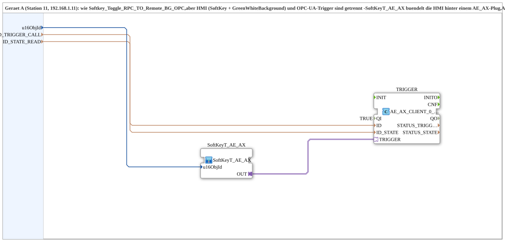

# SoftKeyT_PC_A_OPC_Adapter

* * * * * * * * * *

## Einleitung

`SoftKeyT_PC_A_OPC_Adapter` ist die adapter-gebuendelte Variante von [`Uebung_010d_PC_A_OPC`](./Uebung_010d_PC_A_OPC.md) (Geraet A, Station 11): HMI (SoftKey + `GreenWhiteBackground`) und OPC-UA-Trigger sind getrennt. [`SoftKeyT_AE_AX`](./SoftKeyT_AE_AX.md) buendelt die HMI hinter einem `AE_AX`-Plug; `AE_AX_CLIENT_0_SUBSCRIBE_1` buendelt `CLIENT_0` + `AX_SUBSCRIBE_1` hinter einem `AE_AX`-Socket. "SUB style": das Protokoll steckt weiterhin im `MyLib::sys`-Composite. Gegenstueck: [`SoftKeyT_PC_B_OPC_Adapter`](./SoftKeyT_PC_B_OPC_Adapter.md).

## Schnittstelle

- **Ereignis-Eingang**: `INIT` (`EInit`, Initialization Request)
- **Ereignis-Ausgang**: `INITO` (`EInit`, Initialization Confirm)
- **Daten-Eingänge**: `QI` (`BOOL`, Vorgabe `TRUE`, Quality Input), `u16ObjId`, `ID_TRIGGER_CALL`, `ID_STATE_READ`
- **Daten-Ausgang**: `QO` (`BOOL`, Quality Output)

## Verwendete Funktionsbausteine (FBs)

- **SoftKeyT_AE_AX** (SubApp, Typ `MyLib::sys::SoftKeyT_AE_AX`): SoftKey + Statusanzeige, gebuendelt hinter einem `AE_AX`-Plug.
- **TRIGGER** (`adapter::net::AE_AX_CLIENT_0_SUBSCRIBE_1`): buendelt Methodenaufruf (`ID_TRIGGER_CALL`) und Zustands-Abo (`ID_STATE_READ`) hinter einem einzigen `AE_AX`-Socket.
- **AND_QO** (`iec61131::booleanOperators::AND_BOOL_2`): verknüpft `TRIGGER.QO` und `SoftKeyT_AE_AX.QO` per UND zum Baustein-Ausgang `QO`.

## Programmablauf und Verbindungen

`SoftKeyT_AE_AX.OUT` -> `TRIGGER.TRIGGER` (bidirektional: Trigger raus, Zustand zurueck an die HMI-SubApp).

Initialisierungskette: `INIT` -> `TRIGGER.INIT`, `TRIGGER.INITO` -> `SoftKeyT_AE_AX.INIT`, `SoftKeyT_AE_AX.INITO` -> `INITO` und -> `AND_QO.REQ`. `QI` -> `TRIGGER.QI` und `SoftKeyT_AE_AX.QI`; `TRIGGER.QO` -> `AND_QO.IN1`, `SoftKeyT_AE_AX.QO` -> `AND_QO.IN2`, `AND_QO.OUT` -> `QO`.

## Zusammenfassung

Adapter-gebuendelte Variante von `Uebung_010d_PC_A_OPC`: dieselbe Funktion, aber HMI und Netzwerkprotokoll sind sauber in 2 wiederverwendbare Bausteine getrennt statt in einem einzigen Composite verdrahtet.

---

### 🌐 Passende Themen-Unterseiten auf ms-muc-docs.de

- [🌐 Eclipse 4diac IDE & Farb-Referenz auf ms-muc-docs.de](https://www.ms-muc-docs.de/iec-61499/eclipse-4diac/)
