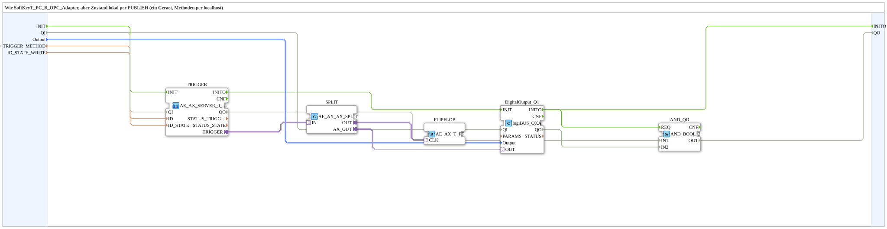

# SoftKeyT_PC_B_OPC_Adapter_LOC

* * * * * * * * * *

## Einleitung

`SoftKeyT_PC_B_OPC_Adapter_LOC` ist die lokale Variante von [`SoftKeyT_PC_B_OPC_Adapter`](./SoftKeyT_PC_B_OPC_Adapter.md): Statt den Zustand per Remote-Write über einen `AX_CLIENT_1_0` zu schreiben, wird er lokal per `AX_PUBLISH_1` geschrieben (ein Gerät, Methoden per `localhost`, kein Endpunkt). Server und Publish sind in der SubApp [`MyLib::net::AE_AX_SERVER_0_PUBLISH_1`](../net/AE_AX_SERVER_0_PUBLISH_1.md) hinter einem einzigen bidirektionalen Adapter-Anschluss (`TRIGGER`) gebündelt; `AE_AX_AX_SPLIT` speist sowohl `DigitalOutput_Q1` als auch die Toggle-Flipflop-Logik (`AE_AX_T_FF`).

## Schnittstellenstruktur

### **Ereignis-Eingänge**

- `INIT` (`EInit`): Initialization Request

### **Ereignis-Ausgänge**

- `INITO` (`EInit`): Initialization Confirm

### **Daten-Eingänge**

| Name | Typ | Beschreibung |
|------|-----|--------------|
| `QI` | `BOOL` | Quality Input - TRUE, um den Dienst freizugeben. Initialwert `TRUE`. |
| `Output` | `logiBUS::io::DQ::logiBUS_DO_S` | Identifiziert den Ausgang `Output_Q1..Q8`. Initialwert `logiBUS_DO::Invalid`. |
| `ID_TRIGGER_METHOD` | `WSTRING` | Lokale Methodenadresse (`ACTION=CREATE_METHOD`) für den argumentlosen Trigger-Methodenaufruf, wird von Gerät A per `CALL_METHOD` aufgerufen. |
| `ID_STATE_WRITE` | `WSTRING` | Lokale Knotenadresse (`BOOL`, `ACTION=WRITE`) für den Zustand. |

### **Daten-Ausgänge**

| Name | Typ | Beschreibung |
|------|-----|--------------|
| `QO` | `BOOL` | Quality Output - TRUE, wenn der Dienst erfolgreich ausgeführt wurde. |

### **Adapter**

Keine vorhanden.

## Verwendete Funktionsbausteine (FBs)

- **TRIGGER** (SubApp `MyLib::net::AE_AX_SERVER_0_PUBLISH_1`): bündelt den Methoden-Server (`ID`) und das lokale Publish des Zustands (`ID_STATE`); Plug `TRIGGER` (`adapter::types::bidirectional::AE_AX`).
- **SPLIT** (`adapter::events::bidirectional::AE_AX_AX_SPLIT`): verzweigt den Trigger auf physischen Ausgang und Flipflop-Logik.
- **FLIPFLOP** (`adapter::events::bidirectional::AE_AX_T_FF`): Toggle-Flipflop-Logik als Adapter-Baustein (Eingang `CLK`).
- **DigitalOutput_Q1** (`logiBUS::io::DQ::logiBUS_QXA`): physischer Ausgang.
- **AND_QO** (`iec61131::booleanOperators::AND_BOOL_2`): verknüpft `TRIGGER.QO` und `DigitalOutput_Q1.QO` zu `QO`.

## Programmablauf und Verbindungen

1. Initialisierung: `INIT` → `TRIGGER.INIT`; `TRIGGER.INITO` → `DigitalOutput_Q1.INIT`; `DigitalOutput_Q1.INITO` → `INITO` und → `AND_QO.REQ`.
2. Adapter: `TRIGGER.TRIGGER` → `SPLIT.IN`; `SPLIT.OUT` → `FLIPFLOP.CLK`; `SPLIT.AX_OUT` → `DigitalOutput_Q1.OUT`.
3. Daten: `Output` → `DigitalOutput_Q1.Output`; `ID_TRIGGER_METHOD` → `TRIGGER.ID`; `ID_STATE_WRITE` → `TRIGGER.ID_STATE`.
4. Qualifier: `QI` → `TRIGGER.QI` und `DigitalOutput_Q1.QI`.
5. Qualitätsauswertung: `TRIGGER.QO` → `AND_QO.IN1`; `DigitalOutput_Q1.QO` → `AND_QO.IN2`; `AND_QO.OUT` → `QO`.

## Technische Besonderheiten

- Das lokale Publish des Zustands liegt innerhalb der SubApp `MyLib::net::AE_AX_SERVER_0_PUBLISH_1` (dort `STATE_PUBLISH`, `AX_PUBLISH_1`, Eingang `ID_STATE`), nicht in dieser SubApp.
- Die enthaltene SubApp [`MyLib::net::AE_AX_SERVER_0_PUBLISH_1`](../net/AE_AX_SERVER_0_PUBLISH_1.md) verdrahtet `IND` → `RSP` an jedem `SERVER_0`; Regel siehe [SERVER_0](../../../StandardLibraries/net/SERVER_0.md).

## Anwendungsszenarien

- Lokale Übung auf einem Gerät mit adapter-gebündelter Toggle-Logik und lokalem Zustands-Publish.

## Zusammenfassung

Adapter-gebündelte lokale Variante von [`SoftKeyT_PC_B_OPC_Adapter`](./SoftKeyT_PC_B_OPC_Adapter.md): Methoden-Server, Toggle-Flipflop-Logik und lokales Zustands-Publish hinter dem Adapter `TRIGGER`.

## 🛠️ Zugehörige Übungen

- [Uebung_OPC_L09_AX](https://meisterschulen-am-ostbahnhof-munchen-docs.readthedocs.io/projects/4diac-exercises-docs/de/latest/Uebungen/test_AX/Meins/OPC_UA_Lokal/Uebung_OPC_L09_AX/)

---

### 🌐 Passende Themen-Unterseiten auf ms-muc-docs.de

- [🌐 Eclipse 4diac IDE & Farb-Referenz auf ms-muc-docs.de](https://www.ms-muc-docs.de/iec-61499/eclipse-4diac/)
