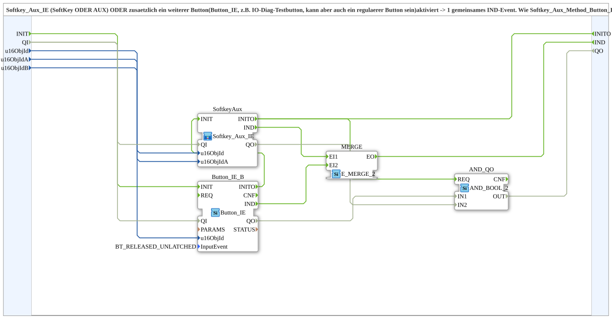

# Softkey_Aux_Button_IE

* * * * * * * * * *

## Einleitung

`Softkey_Aux_Button_IE` fasst `Softkey_Aux_IE` (SoftKey ODER AUX) und zusätzlich einen weiteren Button (`Button_IE`, z. B. den IO-Diag-Testbutton, es kann aber auch ein regulärer Button sein) zu **einem** gemeinsamen `IND`-Ereignis zusammen. Er entspricht `Softkey_Aux_Method_Button_IE`, aber ohne die lokale OPC-UA-Methode, und ist für Fälle gedacht, die nur SoftKey, AUX und Button gleichberechtigt brauchen.

## Schnittstellenstruktur

### **Ereignis-Eingänge**

- **INIT** (`EInit`): Initialization Request

### **Ereignis-Ausgänge**

- **INITO** (`EInit`): Initialization Confirm
- **IND**: feuert, wenn SoftKey, AUX **oder** der Button aktiviert wird

### **Daten-Eingänge**

- **QI** (`BOOL`, Vorgabe `TRUE`): Quality Input, TRUE aktiviert den Dienst
- **u16ObjId** (UINT): Object ID des SoftKeys
- **u16ObjIdA** (UINT): Object ID der AuxFunction2
- **u16ObjIdB** (UINT): Object ID eines weiteren Buttons (z. B. IO-Diag-Testbutton), gleichberechtigt zu SoftKey/AUX

### **Daten-Ausgänge**

- **QO** (`BOOL`): Quality Output, UND-Verknüpfung (`AND_QO`) der `QO`-Ausgänge von `Button_IE_B` und `SoftkeyAux`

### **Adapter**

Es werden keine Adapter verwendet.

## Funktionsweise

Das Netzwerk enthält vier Bausteine:

- `SoftkeyAux` (`MyLib::sys::Softkey_Aux_IE`): `u16ObjId` → `SoftkeyAux.u16ObjId`, `u16ObjIdA` → `SoftkeyAux.u16ObjIdA`; sein `IND` geht an `MERGE.EI1`.
- `Button_IE_B` (`isobus::UT::io::Button::Button_IE`, `InputEvent = BT_RELEASED_UNLATCHED`): `u16ObjIdB` → `Button_IE_B.u16ObjId`; sein `IND` geht an `MERGE.EI2`.
- `MERGE` (`iec61499::events::E_MERGE_2`): `MERGE.EO` → `IND`.
- `AND_QO` (`iec61131::booleanOperators::AND_BOOL_2`): verknüpft `Button_IE_B.QO` (`IN1`) und `SoftkeyAux.QO` (`IN2`) zu `QO`.

Initialisierung: `INIT` → `Button_IE_B.INIT`; `Button_IE_B.INITO` → `SoftkeyAux.INIT`; `SoftkeyAux.INITO` → `INITO` und → `AND_QO.REQ`. Qualität: `QI` → `Button_IE_B.QI` und `SoftkeyAux.QI`; `AND_QO.OUT` → `QO`.

## Technische Besonderheiten

- Der zusätzliche Button löst beim Loslassen (`BT_RELEASED_UNLATCHED`) aus
- Herausgelöst aus `Baender_Individual_Toggle.SUB`, wo dieselbe Kombination (`Softkey_Aux_IE` + `Button_IE` + `E_MERGE_2`) dreimal für Igel, Elevator und Querband verdrahtet war
- Zustandslos

## Anwendungsszenarien

- Ein Ausgang, der gleichberechtigt per SoftKey, Joystick-Zuweisung und zusätzlichem Button (z. B. IO-Diag-Testbutton) ausgelöst werden soll

## Fazit

`Softkey_Aux_Button_IE` vereinigt SoftKey, AUX und einen weiteren Button zu einem einzigen `IND`-Ereignis.
