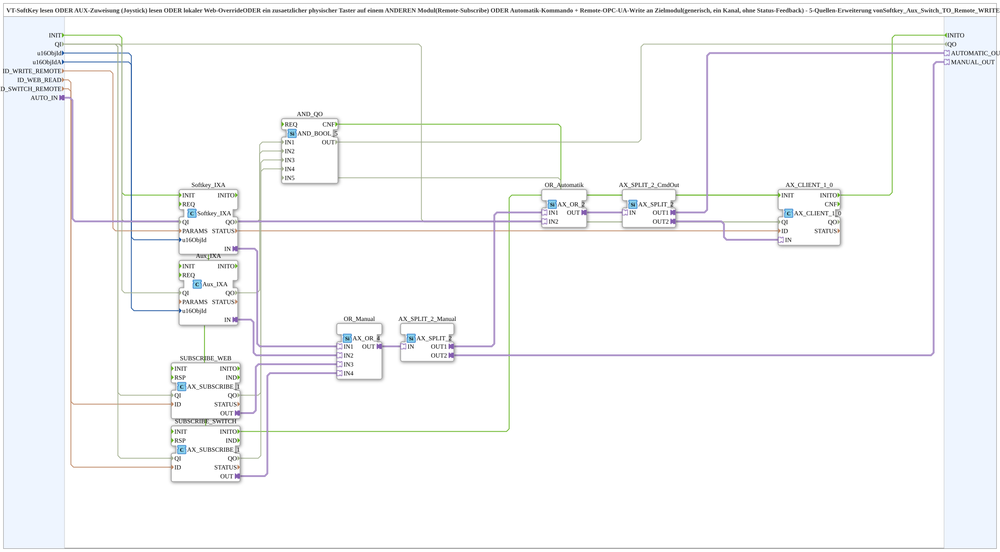

# Softkey_Aux_Switch_Auto_TO_Remote_WRITE

* * * * * * * * * *

## Einleitung

`Softkey_Aux_Switch_Auto_TO_Remote_WRITE` verknüpft per ODER fünf Quellen eines Befehls: den VT-SoftKey, die AUX-Zuweisung (Joystick), einen lokalen Web-Override, einen zusätzlichen physischen Taster auf einem anderen Modul (Remote-Subscribe) und ein autonomes Automatik-Kommando (`AUTO_IN`). Das Ergebnis wird per Remote-OPC-UA-Write an ein Zielmodul geschrieben (generisch, ein Kanal, ohne Status-Feedback). Der Baustein ist die 5-Quellen-Erweiterung von `Softkey_Aux_Switch_TO_Remote_WRITE` um den zusätzlichen Socket `AUTO_IN` (z. B. Befüllautomatik-Hysterese, die dieselbe Füllband-Heben-Leitung ansteuert wie SoftKey/AUX/Web/physischer Taster).

## Schnittstellenstruktur

### **Ereignis-Eingänge**

- **INIT** (`EInit`): Initialization Request

### **Ereignis-Ausgänge**

- **INITO** (`EInit`): Initialization Confirm

### **Daten-Eingänge**

- **QI** (`BOOL`, Vorgabe `TRUE`): Quality Input, TRUE aktiviert den Dienst
- **u16ObjId** (UINT): Object ID des SoftKeys (VT), Default `ID_NULL`
- **u16ObjIdA** (UINT): Object ID der AuxFunction2 (VT), Default `ID_NULL`
- **ID_WRITE_REMOTE** (WSTRING): Remote-Write-Adresse zum Zielmodul (Befehl, `ACTION=WRITE`, CLIENT)
- **ID_WEB_READ** (WSTRING): lokale Subscribe-Adresse für einen Web-Client (z. B. vt-ui-mirror) auf demselben Modul, ODER-verknüpft mit SoftKey und AUX
- **ID_SWITCH_REMOTE** (WSTRING): Remote-Subscribe-Adresse eines zusätzlichen physischen Tasters auf einem anderen Modul, ODER-verknüpft mit SoftKey/AUX/Web/Automatik

### **Daten-Ausgänge**

- **QO** (`BOOL`): Quality Output, UND-Verknüpfung (`AND_QO`, `AND_BOOL_5`) der `QO`-Ausgänge von `Softkey_IXA`, `Aux_IXA`, `SUBSCRIBE_WEB`, `SUBSCRIBE_SWITCH` und `AX_CLIENT_1_0`

### **Adapter**

- **AUTO_IN** (Socket, `AX`): autonomes Kommando (z. B. Befüllautomatik-Hysterese), ODER-verknüpft mit SoftKey/AUX/Web/physischem Taster
- **AUTOMATIC_OUT** (Plug, `AX`): optional; lokal gemergter Rohbefehl (SoftKey ODER AUX ODER Web ODER Switch ODER Automatik) vor dem Remote-Write. Unverdrahtet lassen, wenn nicht gebraucht
- **MANUAL_OUT** (Plug, `AX`): optional; nur die manuellen Quellen (SoftKey ODER AUX ODER Web ODER Switch), **ohne** `AUTO_IN`. Damit kann z. B. eine Automatik abgeschaltet werden, wenn der Bediener manuell eingreift, ohne dass sich die Automatik durch ihr eigenes Kommando selbst abschaltet. Unverdrahtet lassen, wenn nicht gebraucht

## Funktionsweise

Das Netzwerk arbeitet in zwei ODER-Stufen:

1. **Manuelle Quellen**: `Softkey_IXA` (`isobus::UT::io::Softkey::Softkey_IXA`, `u16ObjId`) → `OR_Manual.IN1`, `Aux_IXA` (`isobus::UT::io::Auxiliary::IN::Aux_IXA`, `u16ObjIdA`) → `OR_Manual.IN2`, `SUBSCRIBE_WEB` (`AX_SUBSCRIBE_1`, Adresse `ID_WEB_READ`) → `OR_Manual.IN3`, `SUBSCRIBE_SWITCH` (`AX_SUBSCRIBE_1`, Adresse `ID_SWITCH_REMOTE`) → `OR_Manual.IN4`. `OR_Manual` ist ein `AX_OR_4`.
2. `OR_Manual.OUT` → `AX_SPLIT_2_Manual`: `OUT1` → `OR_Automatik.IN1`, `OUT2` → `MANUAL_OUT`.
3. **Automatik**: `AUTO_IN` → `OR_Automatik.IN2`. `OR_Automatik` ist ein `AX_OR_2`.
4. `OR_Automatik.OUT` → `AX_SPLIT_2_CmdOut`: `OUT1` → `AUTOMATIC_OUT`, `OUT2` → `AX_CLIENT_1_0.IN`.
5. `AX_CLIENT_1_0` (`adapter::net::AX_CLIENT_1_0`) schreibt den Befehl per OPC-UA an die Adresse `ID_WRITE_REMOTE`.
6. `AND_QO` (`iec61131::booleanOperators::AND_BOOL_5`) verknüpft die `QO`-Ausgänge von `Softkey_IXA` (`IN1`), `Aux_IXA` (`IN2`), `SUBSCRIBE_WEB` (`IN3`), `SUBSCRIBE_SWITCH` (`IN4`) und `AX_CLIENT_1_0` (`IN5`) zu `QO`.
7. Initialisierung: `INIT` → `Softkey_IXA.INIT` → `Aux_IXA.INIT` → `SUBSCRIBE_WEB.INIT` → `SUBSCRIBE_SWITCH.INIT` → `AX_CLIENT_1_0.INIT`; `AX_CLIENT_1_0.INITO` → `INITO` und → `AND_QO.REQ`. `QI` wird an alle fünf Bausteine verteilt.

## Technische Besonderheiten

- Der frühere `AX_OR_5` wurde in `OR_Manual` (`AX_OR_4`) und `OR_Automatik` (`AX_OR_2`) aufgeteilt, damit `MANUAL_OUT` ohne Automatik-Anteil zur Verfügung steht; das Gesamtverhalten für `AUTOMATIC_OUT` und den Remote-Write blieb unverändert
- `MANUAL_OUT` verhindert Selbstabschaltung: Würde die Automatik ihr eigenes Kommando zur Abschaltung nutzen, schaltete sie sich durch dieses selbst ab
- Jeder Adapter wird nur über `AX_SPLIT_2` verzweigt

## Anwendungsszenarien

- Füllband-Heben: Der Befehl kann vom Bediener (SoftKey/AUX/Web/physischer Taster S08) oder von der Befüllautomatik-Hysterese kommen und wird an das Zielmodul geschrieben
- Automatik, die sich abschaltet, sobald der Bediener manuell eingreift (über `MANUAL_OUT`)

## Fazit

`Softkey_Aux_Switch_Auto_TO_Remote_WRITE` führt fünf Befehlsquellen per ODER zusammen, schreibt das Ergebnis per OPC-UA an ein Zielmodul und stellt über `AUTOMATIC_OUT` und `MANUAL_OUT` optional zwei Zwischenstände bereit.
