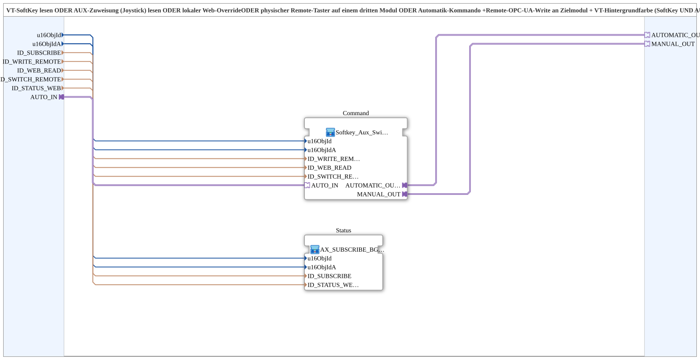

# Softkey_Aux_Switch_Auto_TO_Remote_WRITE_BG_OPC

* * * * * * * * * *

## Einleitung

`Softkey_Aux_Switch_Auto_TO_Remote_WRITE_BG_OPC` kombiniert für einen Befehl an ein Zielmodul: VT-**SoftKey** lesen ODER **AUX-Zuweisung** (Joystick) lesen ODER lokaler **Web-Override** ODER physischer **Remote-Taster** auf einem dritten Modul ODER **Automatik-Kommando**, dazu ein **Remote-OPC-UA-Write** an das Zielmodul und die **VT-Hintergrundfarbe** (SoftKey und AUX) aus einem Remote-Subscribe. Es ist die 5-Quellen-Variante von [`Softkey_Aux_Switch_TO_Remote_WRITE_BG_OPC`](./Softkey_Aux_Switch_TO_Remote_WRITE_BG_OPC.md) mit einem zusätzlichen `AUTO_IN`-Socket, z. B. Füllband Heben: SoftKey/AUX/Web/physischer Taster S08 UND Befüllautomatik-Hysterese.

## Schnittstellenstruktur

### **Ereignis-Eingänge**

Keine.

### **Ereignis-Ausgänge**

Keine.

### **Daten-Eingänge**

- **u16ObjId** (`UINT`): Object ID SoftKey/Hintergrund (VT)
- **u16ObjIdA** (`UINT`): Object ID AuxFunction2/Hintergrund (VT)
- **ID_SUBSCRIBE** (`WSTRING`): Remote-Subscribe-Adresse (Status/Farbe, `ACTION=SUBSCRIBE`)
- **ID_WRITE_REMOTE** (`WSTRING`): Remote-Write-Adresse zum Zielmodul (Befehl, `ACTION=WRITE`, CLIENT)
- **ID_WEB_READ** (`WSTRING`): lokale Subscribe-Adresse für einen Web-Client (z. B. vt-ui-mirror) auf demselben Modul, ODER-verknüpft mit SoftKey und AUX
- **ID_SWITCH_REMOTE** (`WSTRING`): Remote-Subscribe-Adresse eines zusätzlichen physischen Tasters auf einem anderen Modul, ODER-verknüpft mit SoftKey/AUX/Web/Automatik
- **ID_STATUS_WEB** (`WSTRING`): lokale Publish-Adresse (auf diesem Modul) für den vom Zielmodul zurückgemeldeten Zustand, damit ein Web-Client dieselbe Hintergrundfarbe wie das echte VT zeigen kann

### **Daten-Ausgänge**

Keine.

### **Adapter**

Alle Adapter sind vom Typ `adapter::types::unidirectional::AX`.

- **AUTO_IN** (Socket): autonomes Kommando (z. B. Befüllautomatik-Hysterese), ODER-verknüpft mit SoftKey/Aux/Web/physischem Taster
- **AUTOMATIC_OUT** (Plug): optional, lokal gemergter Rohbefehl, durchgereicht von `Command.AUTOMATIC_OUT`; unverdrahtet lassen, wenn nicht gebraucht
- **MANUAL_OUT** (Plug): optional, nur die manuellen Quellen (SoftKey/AUX/Web/Switch) ohne Automatik-Anteil, durchgereicht von `Command.MANUAL_OUT`; unverdrahtet lassen, wenn nicht gebraucht

## Verwendete Funktionsbausteine (FBs)

- **`Command`** (SubApp `MyLib::sys::Softkey_Aux_Switch_Auto_TO_Remote_WRITE`, [Softkey_Aux_Switch_Auto_TO_Remote_WRITE](./Softkey_Aux_Switch_Auto_TO_Remote_WRITE.md)): bildet den Befehl aus allen Quellen und schreibt ihn remote
- **`Status`** (SubApp `MyLib::sys::AX_SUBSCRIBE_BG3_WEB_OPC`, [AX_SUBSCRIBE_BG3_WEB_OPC](./AX_SUBSCRIBE_BG3_WEB_OPC.md)): abonniert den Zustand, färbt den Hintergrund und publiziert ihn für den Web-Client

## Funktionsweise

- `u16ObjId`, `u16ObjIdA`, `ID_WRITE_REMOTE`, `ID_WEB_READ`, `ID_SWITCH_REMOTE` → gleichnamige Eingänge von `Command`
- `AUTO_IN` → `Command.AUTO_IN`
- `Command.AUTOMATIC_OUT` → `AUTOMATIC_OUT`; `Command.MANUAL_OUT` → `MANUAL_OUT`
- `u16ObjId`, `u16ObjIdA`, `ID_SUBSCRIBE`, `ID_STATUS_WEB` → gleichnamige Eingänge von `Status`

## Technische Besonderheiten

- Befehlspfad (`Command`) und Statuspfad (`Status`) sind getrennt: der Befehl geht per Remote-Write zum Zielmodul, die Hintergrundfarbe kommt aus dem vom Zielmodul zurückgemeldeten Zustand
- Optionale Ausgänge `AUTOMATIC_OUT`/`MANUAL_OUT` erlauben die lokale Weiterverwendung des gemergten Befehls bzw. nur des manuellen Anteils

## Anwendungsszenarien

- Gemischter manueller/automatischer Bedienpunkt, z. B. Füllband Heben (SoftKey, AUX, Web, physischer Taster S08 und Befüllautomatik)

## Zusammenfassung

Die SubApp bündelt fünf Befehlsquellen, einen Remote-Write an das Zielmodul und die rückgemeldete VT-Hintergrundfarbe.

---

### 🌐 Passende Themen-Unterseiten auf ms-muc-docs.de

- [🌐 Eclipse 4diac IDE & Farb-Referenz auf ms-muc-docs.de](https://www.ms-muc-docs.de/iec-61499/eclipse-4diac/)
