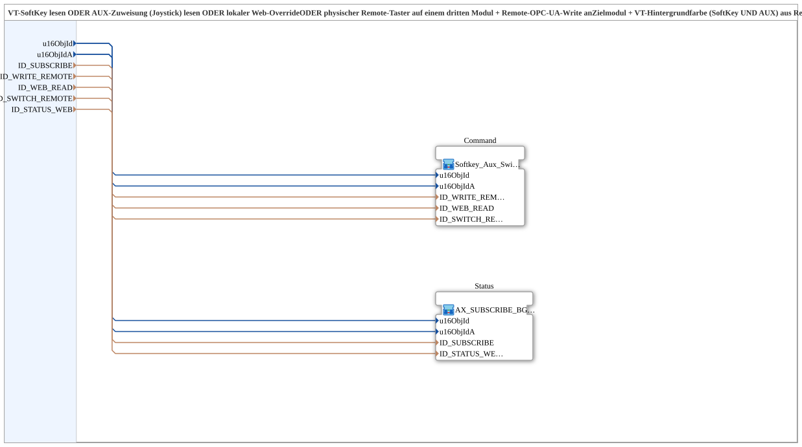

# Softkey_Aux_Switch_TO_Remote_WRITE_BG_OPC

* * * * * * * * * *

## Einleitung

Der Funktionsbaustein (SubApp) **Softkey_Aux_Switch_TO_Remote_WRITE_BG_OPC** ist eine 4‑Quellen‑Variante des Bausteins `Softkey_Aux_IXA_TO_Remote_WRITE_BG_OPC`. Er kombiniert die Zustände von vier verschiedenen Quellen – SoftKey, AUX‑Joystick, lokalem Web‑Override und einem zusätzlichen physischen Taster auf einem dritten Modul – und überträgt diese als OPC‑UA‑Write‑Befehl an ein Zielmodul. Gleichzeitig wird der vom Zielmodul rückgemeldete Status über einen Remote‑Subscribe‑Kanal empfangen und als Hintergrundfarbe für die Visualisierung (SoftKey und AUX) verwendet sowie lokal für Web‑Clients veröffentlicht.

Die SubApp besteht aus zwei internen Bausteinen:

- **Command** (`Softkey_Aux_Switch_TO_Remote_WRITE`): verarbeitet die vier Quellen und erzeugt den Remote‑Write‑Befehl.
- **Status** (`AX_SUBSCRIBE_BG3_WEB_OPC`): abonniert den Remote‑Status und setzt die Hintergrundfarben sowie den lokalen Web‑Republish um.

## Schnittstellenstruktur

### **Ereignis-Eingänge**

- **INIT** (`EInit`): Initialisierungsanforderung; startet die Init-Kette bei `Command.INIT`

### **Ereignis-Ausgänge**

- **INITO** (`EInit`): Initialisierungsbestätigung; kommt von `Status.INITO`, dem Ende der Init-Kette

### **Daten-Eingänge**

| Name | Typ | Kommentar |
|------|-----|-----------|
| `QI` | BOOL | Quality Input, Initialwert `TRUE`; wird an `Command.QI` und `Status.QI` weitergereicht |
| `u16ObjId` | UINT | Object ID SoftKey/Hintergrund (VT) |
| `u16ObjIdA` | UINT | Object ID AuxFunction2/Hintergrund (VT) |
| `ID_SUBSCRIBE` | WSTRING | Remote‑Subscribe‑Adresse (Status/Farbe, ACTION=SUBSCRIBE) |
| `ID_WRITE_REMOTE` | WSTRING | Remote‑Write‑Adresse zum Zielmodul (Befehl, ACTION=WRITE, CLIENT) |
| `ID_WEB_READ` | WSTRING | Lokale Subscribe‑Adresse für einen Web‑Client (z. B. vt‑ui‑mirror) auf demselben Modul, ODER‑verknüpft mit SoftKey und AUX |
| `ID_SWITCH_REMOTE` | WSTRING | Remote‑Subscribe‑Adresse eines zusätzlichen physischen Tasters auf einem ANDEREN Modul, ODER‑verknüpft mit SoftKey/AUX/Web |
| `ID_STATUS_WEB` | WSTRING | Lokale Publish‑Adresse (auf diesem Modul) für den vom Zielmodul zurückgemeldeten Zustand – damit ein Web‑Client (z. B. vt‑ui‑mirror) dieselbe Hintergrundfarbe wie das echte VT zeigen kann |

### **Daten-Ausgänge**

- **QO** (`BOOL`): Quality Output, UND-Verknüpfung (`AND_QO`, `AND_BOOL_2`) aus `Command.QO` und `Status.QO`

### **Adapter**

Keine.

## Funktionsweise

Die SubApp leitet alle Eingabedaten an die beiden internen Bausteine weiter. Der **Command‑Block** erhält die Objekt‑IDs (`u16ObjId`, `u16ObjIdA`), die Remote‑Write‑Adresse (`ID_WRITE_REMOTE`), die lokale Web‑Subscribe‑Adresse (`ID_WEB_READ`) und die Remote‑Switch‑Adresse (`ID_SWITCH_REMOTE`). Er verknüpft die vier Quellen (SoftKey, AUX, Web, Remote‑Taster) per ODER‑Logik und sendet bei einer Zustandsänderung einen OPC‑UA‑Write‑Befehl an das Zielmodul.

Der **Status‑Block** erhält die Objekt‑IDs (`u16ObjId`, `u16ObjIdA`), die Remote‑Subscribe‑Adresse (`ID_SUBSCRIBE`) und die lokale Publish‑Adresse (`ID_STATUS_WEB`). Er abonniert den Status des Zielmoduls (z. B. aktive Hintergrundfarbe) und setzt entsprechend die Hintergrundfarben für SoftKey und AUX in der Visualisierung. Zusätzlich veröffentlicht er den empfangenen Status auf `ID_STATUS_WEB`, sodass Web‑Clients die gleiche Hintergrundfarbe anzeigen können.

Initialisierung und Qualität: `INIT` → `Command.INIT`, `Command.INITO` → `Status.INIT`, `Status.INITO` → `INITO` und `AND_QO.REQ`. `QI` wird an `Command.QI` und `Status.QI` weitergereicht; `Command.QO` → `AND_QO.IN1`, `Status.QO` → `AND_QO.IN2`, `AND_QO.OUT` → `QO`.

Die beiden internen Bausteine arbeiten datenseitig parallel und unabhängig; abgesehen von der Init-Kette und der UND-Verknüpfung der Qualitätsausgänge besteht keine direkte Kommunikation zwischen ihnen.

## Technische Besonderheiten

- **4‑Quellen‑Variante**: Im Unterschied zur 3‑Quellen‑Variante `Softkey_Aux_IXA_TO_Remote_WRITE_BG_OPC` wird hier ein zusätzlicher physischer Taster auf einem dritten Modul über `ID_SWITCH_REMOTE` mit einbezogen.
- **Nur Init-Ereignisse**: Der Baustein arbeitet datengetrieben; als Ereignisse besitzt er nur `INIT`/`INITO` für die Init-Kette, die internen Bausteine besitzen eigene Ereignisbehandlungen.
- **Wrapper‑Struktur**: Als dünner Wrapper werden zwei vorhandene Bausteine kombiniert, um die gewünschte Funktionalität zu bündeln.
- **OPC‑UA‑Kommunikation**: Remote‑Write und Remote‑Subscribe werden über OPC‑UA realisiert; die Adressen sind als WSTRING‑Parameter konfigurierbar.

## Zustandsübersicht

Da es sich um eine SubApp ohne eigenen Zustandsautomaten handelt, gibt es auf dieser Ebene keine definierten Zustände. Die Funktionalität wird durch die internen Bausteine erbracht. Der Command‑Block besitzt vermutlich Zustände für die Quellenverarbeitung und das Senden des Remote‑Writes, während der Status‑Block Zustände für das Abonnement und die Aktualisierung der Hintergrundfarben hat. Diese internen Zustände sind von außen nicht sichtbar.

## Anwendungsszenarien

- **Schnittverstellung**: Laut Kommentar ist die 4‑Quellen‑Variante für Funktionen gedacht, die einen zusätzlichen fest verbauten Taster auf einem dritten Modul besitzen, z. B. bei einer Schnittverstellung.
- **Maschinensteuerung**: Wenn eine Maschine über SoftKey, Joystick (AUX), Web‑Override und einen entfernten physischen Taster bedient wird und der aktuelle Zustand (z. B. aktive Funktion, Hintergrundfarbe) auf einem Zielmodul angezeigt und überwacht werden muss.
- **Visualisierungs‑Synchronisation**: Der Baustein stellt sicher, dass die Hintergrundfarben von SoftKey und AUX auf dem lokalen Bedienpanel und auf Web‑Clients konsistent sind, basierend auf dem vom Zielmodul rückgemeldeten Status.

## Vergleich mit ähnlichen Bausteinen

| Baustein | Unterschied |
|----------|-------------|
| `Softkey_Aux_IXA_TO_Remote_WRITE_BG_OPC` | 3‑Quellen‑Variante: SoftKey, AUX, Web – ohne zusätzlichen externen Taster. |
| `Softkey_Aux_Switch_TO_Remote_WRITE_BG_OPC` | 4‑Quellen‑Variante: zusätzlich ein physischer Taster auf einem dritten Modul (über `ID_SWITCH_REMOTE`). |
| `Softkey_Aux_Switch_TO_Remote_WRITE` (ohne BG) | Nur Befehlsteil, ohne Status‑ und Hintergrundfarben‑Verarbeitung. |

## Fazit

Der Funktionsbaustein `Softkey_Aux_Switch_TO_Remote_WRITE_BG_OPC` erweitert die 3‑Quellen‑Logik um eine vierte Quelle (externer Taster) und kombiniert die Befehlsübertragung per Remote‑Write mit der Status‑Rückmeldung per Remote‑Subscribe. Als modularer Wrapper nutzt er bewährte Bausteine und ermöglicht eine flexible Integration in Steuerungssysteme. Durch die klare Trennung von Befehl und Status eignet er sich besonders für Anwendungen, bei denen eine konsistente Visualisierung über mehrere Bedienorte hinweg erforderlich ist.
