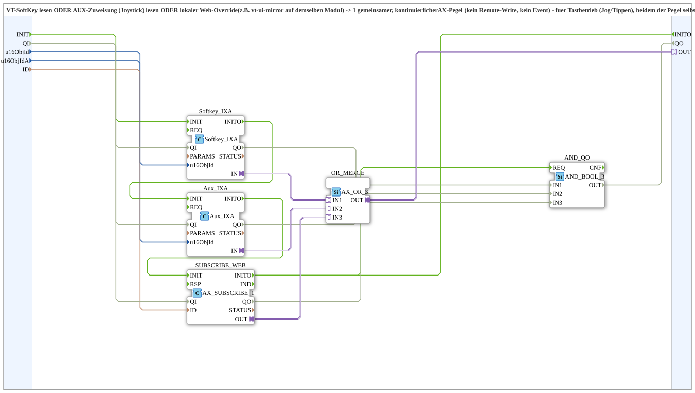

# Softkey_Aux_Web_IXA

* * * * * * * * * *

## Einleitung

`Softkey_Aux_Web_IXA` führt einen VT-SoftKey, eine AUX-Zuweisung (Joystick) und einen lokalen Web-Override (z. B. `vt-ui-mirror` auf demselben Modul) zu **einem gemeinsamen, kontinuierlichen AX-Pegel** zusammen – ohne Remote-Write und ohne Ereignis. Er ist für den Tastbetrieb (Jog/Tippen) gedacht, bei dem der Pegel selbst (nicht eine Flanke) weiterverarbeitet werden soll, z. B. als `G`-Eingang eines `AX_AX_SEL_AR` oder als `DI1` einer GreenWhiteBackground-Rückmeldung. Er entspricht der Kommandohälfte von `Softkey_Aux_IXA_TO_Remote_WRITE`, liefert aber `OUT` statt eines Remote-Writes.

## Schnittstellenstruktur

### **Ereignis-Eingänge**

*Keine direkten Ereignis-Eingänge vorhanden*

### **Ereignis-Ausgänge**

*Keine direkten Ereignis-Ausgänge vorhanden – Ereignisse laufen über den Adapter-Plug*

### **Daten-Eingänge**

- **u16ObjId** (`UINT`, Vorgabe `ID_NULL`): Object-ID des SoftKeys (VT)
- **u16ObjIdA** (`UINT`, Vorgabe `ID_NULL`): Object-ID der AuxFunction2 (VT)
- **ID** (`WSTRING`): Lokale Subscribe-Adresse für einen Web-Client (z. B. `vt-ui-mirror`) auf demselben Modul, ODER-verknüpft mit SoftKey und AUX

### **Daten-Ausgänge**

*Keine Daten-Ausgänge vorhanden*

### **Adapter**

- **OUT** (Plug, `adapter::types::unidirectional::AX`): SoftKey ODER Aux ODER Web-Override, kontinuierlicher Pegel (`TRUE`, solange gehalten/aktiv)

## Verwendete Funktionsbausteine (FBs)

- **Softkey_IXA**: `isobus::UT::io::Softkey::Softkey_IXA` (`QI=TRUE`)
- **Aux_IXA**: `isobus::UT::io::Auxiliary::IN::Aux_IXA` (`QI=TRUE`)
- **SUBSCRIBE_WEB**: `adapter::net::AX_SUBSCRIBE_1` (`QI=TRUE`)
- **OR_MERGE**: `adapter::booleanOperators::AX_OR_3`

## Programmablauf und Verbindungen

- `u16ObjId` → `Softkey_IXA.u16ObjId`; `u16ObjIdA` → `Aux_IXA.u16ObjId`; `ID` → `SUBSCRIBE_WEB.ID`
- `Softkey_IXA.IN` → `OR_MERGE.IN1`
- `Aux_IXA.IN` → `OR_MERGE.IN2`
- `SUBSCRIBE_WEB.OUT` → `OR_MERGE.IN3`
- `OR_MERGE.OUT` → `OUT`

## Technische Besonderheiten

- Kontinuierlicher Pegel statt Flanke: `OUT` bleibt `TRUE`, solange mindestens eine Quelle aktiv ist.
- Kein Remote-Write und kein Ereignis-Ausgang.

## Anwendungsszenarien

- Tastbetrieb (Jog/Tippen), bei dem der Pegel an einen Selektor oder eine Hintergrundfarben-Rückmeldung gehen soll

## Fazit

`Softkey_Aux_Web_IXA` verodert SoftKey, Aux und Web-Override zu einem AX-Pegel.
