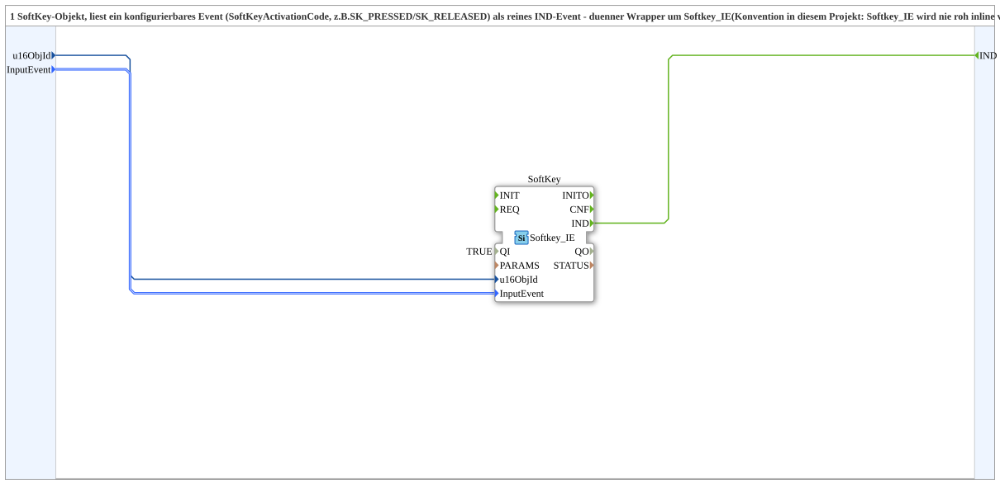

# Softkey_IE_1

* * * * * * * * * *

## Einleitung

`Softkey_IE_1` liest ein SoftKey-Objekt und gibt ein konfigurierbares Ereignis (`SoftKeyActivationCode`, z. B. `SK_PRESSED`/`SK_RELEASED`) als reines `IND`-Ereignis aus. Der Baustein ist ein dünner Wrapper um `isobus::UT::io::Softkey::Softkey_IE`, analog zu [`Aux_IE_1`](Aux_IE_1.md) und [`Button_IE_1`](Button_IE_1.md). Konvention in diesem Projekt: `Softkey_IE` wird nie roh inline verwendet, sondern immer gewrappt.

## Schnittstellenstruktur

### **Ereignis-Eingänge**

- **INIT** (`EInit`): Initialization Request

### **Ereignis-Ausgänge**

- **INITO** (`EInit`): Initialization Confirm
- **IND**: feuert, wenn das konfigurierte `InputEvent` auftritt

### **Daten-Eingänge**

- **QI** (`BOOL`, Vorgabe `TRUE`): Quality Input, TRUE aktiviert den Dienst
- **u16ObjId** (UINT): Object ID des SoftKeys (Default `ID_NULL`)
- **InputEvent** (`isobus::UT::io::Softkey::SoftKeyActivationCode_S`): z. B. `SK_PRESSED`, `SK_RELEASED` (Default `Invalid`)

### **Daten-Ausgänge**

- **QO** (`BOOL`): Quality Output, direkt von `SoftKey.QO`

### **Adapter**

Es werden keine Adapter verwendet.

## Funktionsweise

Das Netzwerk enthält genau eine Instanz `SoftKey` des Typs `isobus::UT::io::Softkey::Softkey_IE` (`QI` kommt vom SubApp-Eingang `QI`). `u16ObjId` und `InputEvent` werden unverändert auf die gleichnamigen Eingänge der Instanz geführt, und deren Ereignis `IND` wird direkt als `IND` der SubApp ausgegeben. Zusätzlich gilt: `INIT` → `SoftKey.INIT`, `SoftKey.INITO` → `INITO`, `QI` → `SoftKey.QI`, `SoftKey.QO` → `QO`.

## Technische Besonderheiten

- Reine Durchreichung ohne eigene Logik oder Zustand
- `QI` ist als Eingang herausgeführt (Vorgabe `TRUE`) und `QO` kommt direkt von `SoftKey.QO`; unbeschaltet ist der Baustein also aktiv
- Weil `InputEvent` ein Parameter ist, kann dieselbe SubApp für unterschiedliche Ereignisarten (z. B. Drücken oder Loslassen) verwendet werden

## Anwendungsszenarien

- Einlesen einer einzelnen VT-Bedienung als Ereignis, ohne den rohen IE-Baustein direkt im Netzwerk zu verwenden

## ⚖️ Vergleich mit ähnlichen Bausteinen

Gleichartige Wrapper sind [`Aux_IE_1`](Aux_IE_1.md) und [`Button_IE_1`](Button_IE_1.md); sie unterscheiden sich nur im VT-Objekttyp und im Aufzählungstyp des `InputEvent`.

## Fazit

`Softkey_IE_1` ist ein minimaler Wrapper, der ein konfigurierbares SoftKey-Ereignis als `IND` bereitstellt.
