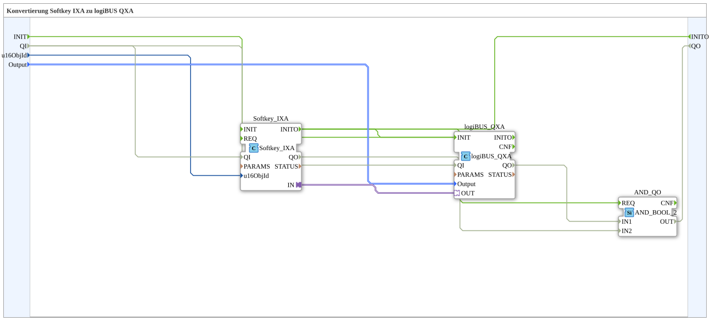

# Softkey_IXA_TO_logiBUS_QXA

* * * * * * * * * *

## Einleitung

`Softkey_IXA_TO_logiBUS_QXA` verbindet einen VT-Softkey (`Softkey_IXA`) direkt mit einem physischen digitalen Ausgang (`logiBUS_QXA`) — funktional identisch zu [`Button_IXA_TO_logiBUS_QXA`](./Button_IXA_TO_logiBUS_QXA.md), aber für Softkeys statt Buttons.

## Verwendete Funktionsbausteine (FBs)

### Sub-Bausteine: Softkey_IXA_TO_logiBUS_QXA

- **Typ**: SubAppType
- **Verwendete interne FBs**:
    - **Softkey_IXA**: `isobus::UT::io::Softkey::Softkey_IXA` — VT-Softkey-Adapter.
    - **logiBUS_QXA**: `logiBUS::io::DQ::logiBUS_QXA` — physischer digitaler Ausgang.
    - **AND_QO**: `iec61131::booleanOperators::AND_BOOL_2` — verknüpft `logiBUS_QXA.QO` und `Softkey_IXA.QO` zum SubApp-Ausgang `QO`.
- **Schnittstelle**: Ereigniseingang `INIT`, Ereignisausgang `INITO`, Dateneingang `QI` (Vorgabe `TRUE`, an beide FBs durchgereicht), Datenausgang `QO`.
- **Funktionsweise**: Direkte Adapterverbindung `Softkey_IXA.IN` → `logiBUS_QXA.OUT`, keine Zwischenlogik (außer der `AND_QO`-Verknüpfung der Qualitätssignale).

## Programmablauf und Verbindungen

1. `u16ObjId` → `Softkey_IXA.u16ObjId`; `Output` → `logiBUS_QXA.Output`.
2. `Softkey_IXA.IN` → `logiBUS_QXA.OUT`.
3. Initialisierung: `INIT` → `logiBUS_QXA.INIT`; `logiBUS_QXA.INITO` → `Softkey_IXA.INIT`; `Softkey_IXA.INITO` → `INITO` und → `AND_QO.REQ`.
4. Qualität: `QI` → `logiBUS_QXA.QI` und `Softkey_IXA.QI`; `logiBUS_QXA.QO` → `AND_QO.IN1`, `Softkey_IXA.QO` → `AND_QO.IN2`; `AND_QO.OUT` → `QO`.

## Anwendungsszenarien

- Minimaler Softkey-zu-Ausgang-Baustein ohne Statusanzeige oder Fernbedienung.

## Zusammenfassung

Softkey-Pendant zu `Button_IXA_TO_logiBUS_QXA` — identisches Muster, anderer Tastertyp.

---

### 🌐 Passende Themen-Unterseiten auf ms-muc-docs.de

- [🌐 Eclipse 4diac IDE & Farb-Referenz auf ms-muc-docs.de](https://www.ms-muc-docs.de/iec-61499/eclipse-4diac/)
