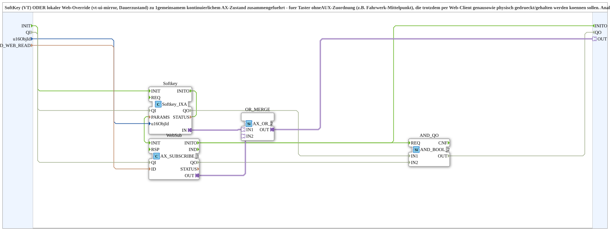

# Softkey_Web_IXA

* * * * * * * * * *

## Einleitung

`Softkey_Web_IXA` führt einen **SoftKey (VT)** ODER einen lokalen **Web-Override** (vt-ui-mirror, Dauerzustand) zu **einem** gemeinsamen kontinuierlichen `AX`-Zustand zusammen. Er ist für Taster ohne AUX-Zuordnung gedacht (z. B. Fahrwerk-Mittelpunkt), die trotzdem per Web-Client genauso wie physisch gedrückt oder gehalten werden können sollen. Analog zu [`Softkey_Aux_IXA_TO_Remote_WRITE`](./Softkey_Aux_IXA_TO_Remote_WRITE.md), dort zusätzlich mit AUX und Remote-Write; hier nur der reine Merge ohne AUX und ohne Schreiben. Der Aufrufer verarbeitet den gemergten Zustand selbst weiter (z. B. mit [`SoftKey_Kurz_Lang`](./SoftKey_Kurz_Lang.md)).

## Schnittstellenstruktur

### **Ereignis-Eingänge**

Keine.

### **Ereignis-Ausgänge**

Keine.

### **Daten-Eingänge**

- **u16ObjId** (`UINT`): Object ID SoftKey
- **ID_WEB_READ** (`WSTRING`): lokale Subscribe-Adresse für den Web-Client (vt-ui-mirror): down/up wie ein gehaltener physischer Taster

### **Daten-Ausgänge**

Keine.

### **Adapter**

- **OUT** (Plug, `adapter::types::unidirectional::AX`): SoftKey ODER Web-Override als ein gemeinsamer kontinuierlicher Zustand

## Verwendete Funktionsbausteine (FBs)

- **`Softkey`** (`isobus::UT::io::Softkey::Softkey_IXA`, `QI = TRUE`): liest den SoftKey-Zustand
- **`WebSub`** (`adapter::net::AX_SUBSCRIBE_1`, `QI = TRUE`): abonniert den Web-Override
- **`OR_MERGE`** (`adapter::booleanOperators::AX_OR_2`): ODER-Verknüpfung beider Zustände

## Funktionsweise

- `u16ObjId` → `Softkey.u16ObjId`; `ID_WEB_READ` → `WebSub.ID`
- `Softkey.IN` → `OR_MERGE.IN1`; `WebSub.OUT` → `OR_MERGE.IN2`
- `OR_MERGE.OUT` → `OUT`

## Technische Besonderheiten

- Dauerzustand (nicht Ereignis): Der Web-Client kann die Taste halten wie eine physische
- Kein AUX, kein Remote-Write

## Anwendungsszenarien

- Taster ohne AUX-Zuordnung, die auch per Web-Client bedienbar sein sollen und deren Zustand z. B. von `SoftKey_Kurz_Lang` weiterverarbeitet wird

## Zusammenfassung

`Softkey_Web_IXA` verodert SoftKey und Web-Override zu einem kontinuierlichen `AX`-Zustand.

---

### 🌐 Passende Themen-Unterseiten auf ms-muc-docs.de

- [🌐 Eclipse 4diac IDE & Farb-Referenz auf ms-muc-docs.de](https://www.ms-muc-docs.de/iec-61499/eclipse-4diac/)
