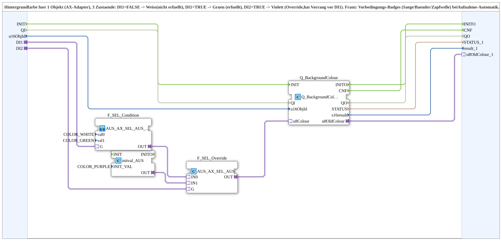

# WhiteGreenPurpleBackground1_AX

* * * * * * * * * *

## Einleitung

`WhiteGreenPurpleBackground1_AX` setzt die Hintergrundfarbe für **ein Objekt** (`AX`-Adapter) mit drei Zuständen:

- `DI1=FALSE` → **Weiß** (nicht erfüllt)
- `DI1=TRUE` → **Grün** (erfüllt)
- `DI2=TRUE` → **Violett** (Override, hat Vorrang vor `DI1`)

Verwendet wird er z. B. für Vorbedingungs-Badges (Säge/Bänder/Zapfwelle) bei der Aufnahme-Automatik. Der Baustein ist analog zu [`GreenWhiteBackground1_AX`](./GreenWhiteBackground1_AX.md) aufgebaut.

## Verwendete Funktionsbausteine (FBs)

### Sub-Bausteine: WhiteGreenPurpleBackground1_AX

- **Typ**: SubAppType
- **Verwendete interne Bausteine**:
    - **F_SEL_Condition**: SubApp [`MyLib::sys::AUS_AX_SEL_AUS_2_VAL`](./AUS_AX_SEL_AUS_2_VAL.md) mit `val0=COLOR_WHITE`, `val1=COLOR_GREEN` – wählt anhand von `DI1` Weiß oder Grün
    - **F_SEL_Override**: `adapter::iec61131::selection::AUS_AX_SEL_AUS` – wählt anhand von `DI2` zwischen dem Ergebnis der Bedingung (`IN0`) und Violett (`IN1`)
    - **initval_AUS**: `adapter::types::unidirectional::AUS::initval::initval_AUS` mit `INIT_VAL=COLOR_PURPLE`
    - **Q_BackgroundColour**: `isobus::UT::Q::Q_BackgroundColour_AUS` – schreibt die Farbe auf das VT-Objekt `u16ObjId`
- **Importe**: `ID_NULL`, `COLOR_GREEN`, `COLOR_WHITE`, `COLOR_PURPLE`

## Schnittstellenstruktur

### **Ereignis-Eingänge**

- **INIT** (`EInit`): Initialisierungsanforderung (→ `Q_BackgroundColour.INIT`)

Weitere Ereignisse kommen über die Adapter `DI1` und `DI2`.

### **Ereignis-Ausgänge**

- **INITO** (`EInit`): Initialisierungsbestätigung (von `Q_BackgroundColour.INITO`)
- **CNF**: Ausführungsbestätigung (von `Q_BackgroundColour.CNF`)

### **Daten-Eingänge**

- **QI** (`BOOL`, Vorgabe `TRUE`): Quality Input – `TRUE` aktiviert den Dienst (→ `Q_BackgroundColour.QI`)
- **u16ObjId** (`UINT`, Vorgabe `ID_NULL`): Object-ID Softkey/Button/OutputText

### **Daten-Ausgänge**

- **QO** (`BOOL`): Quality Output – `TRUE`, wenn der Dienst erfolgreich ausgeführt wurde (von `Q_BackgroundColour.QO`)
- **STATUS_1** (`STRING`): Dienststatus (von `Q_BackgroundColour.STATUS`)
- **result_1** (`INT`): Rückgabewert (von `Q_BackgroundColour.s16result`)

### **Adapter**

- **DI1** (Socket, `adapter::types::unidirectional::AX`): Bedingung erfüllt (FALSE = Weiß, TRUE = Grün), ohne Vorrang, siehe `DI2`
- **DI2** (Socket, `adapter::types::unidirectional::AX`): Override aktiv (TRUE = Violett), hat Vorrang vor `DI1`
- **u8OldColour_1** (Plug, `adapter::types::unidirectional::AUS`): Alter Farbwert

## Programmablauf und Verbindungen

- `DI1` → `F_SEL_Condition.G`
- `DI2` → `F_SEL_Override.G`
- `F_SEL_Condition.OUT` → `F_SEL_Override.IN0`; `initval_AUS.OUT` → `F_SEL_Override.IN1`
- `F_SEL_Override.OUT` → `Q_BackgroundColour.u8Colour`
- `u16ObjId` → `Q_BackgroundColour.u16ObjId`
- `INIT` → `Q_BackgroundColour.INIT`; `Q_BackgroundColour.INITO` → `INITO`
- `QI` → `Q_BackgroundColour.QI`; `Q_BackgroundColour.QO` → `QO`
- `Q_BackgroundColour.u8OldColour` → `u8OldColour_1`; `.STATUS` → `STATUS_1`; `.s16result` → `result_1`; `.CNF` → `CNF`

## Technische Besonderheiten

- Zwei verschachtelte Selektoren (nicht ein einzelner `AX_SEL`), da ein einzelner `AX_SEL` nur bei Änderung seines **eigenen** `G` neu auswertet und die zweite Stufe bei einer Änderung von `DI1` sonst nicht nachziehen würde
- Beide Selektoren werden über einen gemeinsamen Trigger (`E_MERGE_2` aus `DI1.E1`/`DI2.E1`) in Reihe neu ausgewertet, damit eine Änderung von `DI1` **oder** `DI2` immer die komplette, korrekte Farbe liefert
- Version 1.0 (2026-10-01)

## Zustandsübersicht

| `DI1` | `DI2` | Farbe |
| :--- | :--- | :--- |
| FALSE | FALSE | Weiß (`COLOR_WHITE`) |
| TRUE | FALSE | Grün (`COLOR_GREEN`) |
| beliebig | TRUE | Violett (`COLOR_PURPLE`) |

## Anwendungsszenarien

- Vorbedingungs-Badges (Säge, Bänder, Zapfwelle) einer Aufnahme-Automatik mit Override-Anzeige

## Zusammenfassung

`WhiteGreenPurpleBackground1_AX` färbt ein VT-Objekt weiß, grün oder violett, wobei der Override `DI2` Vorrang vor der Bedingung `DI1` hat.
