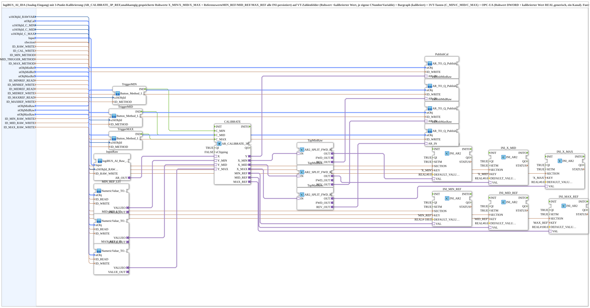

# logiBUS_AI_Calibrate_3P_IDA_OPC

* * * * * * * * * *

## Einleitung

`logiBUS_AI_Calibrate_3P_IDA_OPC` liest einen logiBUS-Analogeingang (`logiBUS_AI_IDA`) und kalibriert ihn mit einer **3-Punkt-Kalibrierung** (`AR_CALIBRATE_3P_REF`): Die drei Rohwerte `X_MIN`/`X_MID`/`X_MAX` und die drei Referenzwerte `MIN_REF`/`MID_REF`/`MAX_REF` werden unabhängig voneinander gespeichert und alle in einer INI-Datei persistiert. Der Roh- und der kalibrierte Wert werden auf VT-Zahlenfelder (je eigene `CNumberVariable`) ausgegeben, drei VT-Tasten (`C_MIN`/`C_MID`/`C_MAX`) lösen die Kalibrierung aus, und die Werte werden per OPC-UA veröffentlicht (Rohwert `DWORD`, kalibrierter Wert `REAL`; generisch, ein Kanal). Der Baustein ist für Sensoren mit definierter Mittelstellung gedacht (z. B. Lenkwinkelsensor: links/geradeaus/rechts) statt einer reinen 2-Punkt-Linearisierung.

## Schnittstellenstruktur

### **Ereignis-Eingänge**

*Keine direkten Ereignis-Eingänge vorhanden*

### **Ereignis-Ausgänge**

*Keine direkten Ereignis-Ausgänge vorhanden*

### **Daten-Eingänge**

Eingang und Anzeige:

- **Input** (`logiBUS::io::AI::logiBUS_AI_S`, Vorgabe `logiBUS_AI::Invalid`): Identifiziert den Analogeingang `AnalogInput_I1..I8`
- **u16ObjId_RAWVAR** (`UINT`, Vorgabe `ID_NULL`): Object-ID der `CNumberVariable` für den unkalibrierten Rohwert (0-4095, reine Diagnose-Anzeige)
- **stObjCal** (`NumericObjectPool_S`): Object-ID + Scale/Offset/Decimals der `CNumberVariable` für den kalibrierten Wert (eigene, unabhängige Variable)
- **sSection** (`STRING`): INI-Sektionsname für die Persistenz von `X_MIN`/`X_MID`/`X_MAX`/`MIN_REF`/`MID_REF`/`MAX_REF`; pro Kanal eindeutig, sonst kollidieren die Kanäle in `settings.ini`

VT-Tasten und Methoden:

- **u16ObjId_C_MIN**, **u16ObjId_C_MID**, **u16ObjId_C_MAX** (`UINT`, Vorgabe `ID_NULL`): Object-IDs der Tasten `C_MIN` (Min-Position anfahren, dann drücken), `C_MID` (Mittelstellung) und `C_MAX` (Max-Position)
- **ID_MIN_METHOD**, **ID_MID_TRIGGER_METHOD**, **ID_MAX_METHOD** (`WSTRING`): Methodenadressen (`ACTION=CREATE_METHOD`) für die argumentlosen Trigger; gleichberechtigt zur lokalen VT-Taste, aufrufbar vom OPC-UA-Dashboard und per `CLIENT_0` von einer anderen Station

Referenzwerte (VT-Eingabefeld + OPC-UA):

- **stObjMinRef**, **stObjMidRef**, **stObjMaxRef** (`NumericObjectPool_S`): Eingabefelder für `MIN_REF`/`MID_REF`/`MAX_REF`
- **ID_MINREF_READ**, **ID_MIDREF_READ**, **ID_MAXREF_READ** (`WSTRING`): Remote-Subscribe-Adressen der Referenzwerte (`REAL`, `ACTION=SUBSCRIBE`)
- **ID_MINREF_WRITE**, **ID_MIDREF_WRITE**, **ID_MAXREF_WRITE** (`WSTRING`): Remote-Echo-Adressen der Referenzwerte (`REAL`, `ACTION=PUBLISH`)

Rohwerte an den Kalibrierpunkten (reine Diagnose-Anzeige):

- **stObjMinRaw**, **stObjMidRaw**, **stObjMaxRaw** (`NumericObjectPool_S`): Anzeigefelder für den Rohwert am MIN-/MID-/MAX-Kalibrierpunkt
- **ID_MIN_RAW_WRITE**, **ID_MID_RAW_WRITE**, **ID_MAX_RAW_WRITE** (`WSTRING`): Publish-Adressen (`REAL`, `ACTION=PUBLISH`)

OPC-UA-Ausgänge:

- **ID_RAW_WRITE** (`WSTRING`): Rohwert-Rückmelde-Adresse (`DWORD` 0-4095, `ACTION=PUBLISH`)
- **ID_CAL_WRITE** (`WSTRING`): Rückmelde-Adresse des kalibrierten Werts (`REAL`, `ACTION=PUBLISH`)

### **Daten-Ausgänge**

*Keine Daten-Ausgänge vorhanden*

### **Adapter**

Dieser Funktionsblock hat keine Adapter an der Schnittstelle; intern werden `AR`-Adapter verwendet.

## Verwendete Funktionsbausteine (FBs)

- **InputRaw**: SubApp `MyLib::sys::logiBUS_AI_Raw_VT_AR_OPC` – liest den Analogeingang, zeigt den Rohwert an und publiziert ihn
- **CALIBRATE**: `adapter::Engineering::measurements::AR_CALIBRATE_3P_REF` (`QI=TRUE`, `xClipping=FALSE`) – 3-Punkt-Kalibrierung
- **MIN_REF_LIT**, **MID_REF_LIT**, **MAX_REF_LIT**: SubApp `MyLib::sys::NumericValue_TO_AR2_OPC` – Referenzwerte aus VT-Eingabefeld bzw. OPC-UA
- **TriggerMIN**, **TriggerMID**, **TriggerMAX**: SubApp `MyLib::sys::Button_Method_IE` – Taste ODER lokale Methode → `IND`
- **INI_X_MIN**, **INI_X_MID**, **INI_X_MAX**: `eclipse4diac::storage::INI_AR2` (Schlüssel `X_MIN`/`X_MID`/`X_MAX`, Vorgabe `0.0`)
- **INI_MIN_REF**, **INI_MID_REF**, **INI_MAX_REF**: `INI_AR2` (Schlüssel `MIN_REF`/`MID_REF`/`MAX_REF`, Vorgaben `-100.0`/`0.0`/`100.0`)
- **TapMinRaw**, **TapMidRaw**, **TapMaxRaw**: `adapter::events::bidirectional::AR2_SPLIT_FWD_REV`
- **PublishCal**, **PublishMinRaw**, **PublishMidRaw**, **PublishMaxRaw**: SubApp `MyLib::sys::AR_TO_Q_Publish_OPC` – VT-Anzeige und OPC-UA-Publish

Alle `INI_AR2` verwenden `QI=TRUE` und `SETM=TRUE`; `sSection` ist ihre gemeinsame `SECTION`.

## Programmablauf und Verbindungen

1. `InputRaw.AR_OUT` → `CALIBRATE.X` (Rohwert).
2. `TriggerMIN.IND`/`TriggerMID.IND`/`TriggerMAX.IND` → `CALIBRATE.C_MIN`/`C_MID`/`C_MAX`.
3. Referenzwerte: `MIN_REF_LIT.VALUEO`/`MID_REF_LIT.VALUEO`/`MAX_REF_LIT.VALUEO` → `CALIBRATE.Y_MIN`/`Y_MID`/`Y_MAX`.
4. Gespeicherte Rohwerte: `CALIBRATE.X_MIN`/`X_MID`/`X_MAX` → `TapMinRaw.IN`/`TapMidRaw.IN`/`TapMaxRaw.IN`; deren `OUT` → `INI_X_MIN.VAL`/`INI_X_MID.VAL`/`INI_X_MAX.VAL`; `REV_OUT` → `PublishMinRaw`/`PublishMidRaw`/`PublishMaxRaw.AR_IN`.
5. Referenzwerte (Persistenz): `CALIBRATE.MIN_REF`/`MID_REF`/`MAX_REF` → `INI_MIN_REF.VAL`/`INI_MID_REF.VAL`/`INI_MAX_REF.VAL`.
6. Kalibrierter Wert: `CALIBRATE.Y` → `PublishCal.AR_IN`.

## Technische Besonderheiten

- Alle sechs Kalibrier-Eckwerte (drei Rohwerte, drei Referenzwerte) sind unabhängig voneinander über je einen `INI_AR2` INI-persistiert.
- `xClipping=FALSE`: Der kalibrierte Wert wird nicht begrenzt.
- `sSection` muss pro Kanal eindeutig sein.

## Anwendungsszenarien

- Sensoren mit definierter Mittelstellung, z. B. Lenkwinkelsensor (links/geradeaus/rechts)
- Kalibrierung per VT-Taste, OPC-UA-Dashboard oder Remote-Aufruf von einer anderen Station

## Fazit

`logiBUS_AI_Calibrate_3P_IDA_OPC` bündelt Analogeingang, 3-Punkt-Kalibrierung, INI-Persistenz, VT-Anzeige und OPC-UA-Anbindung eines Kanals in einer SubApp.
