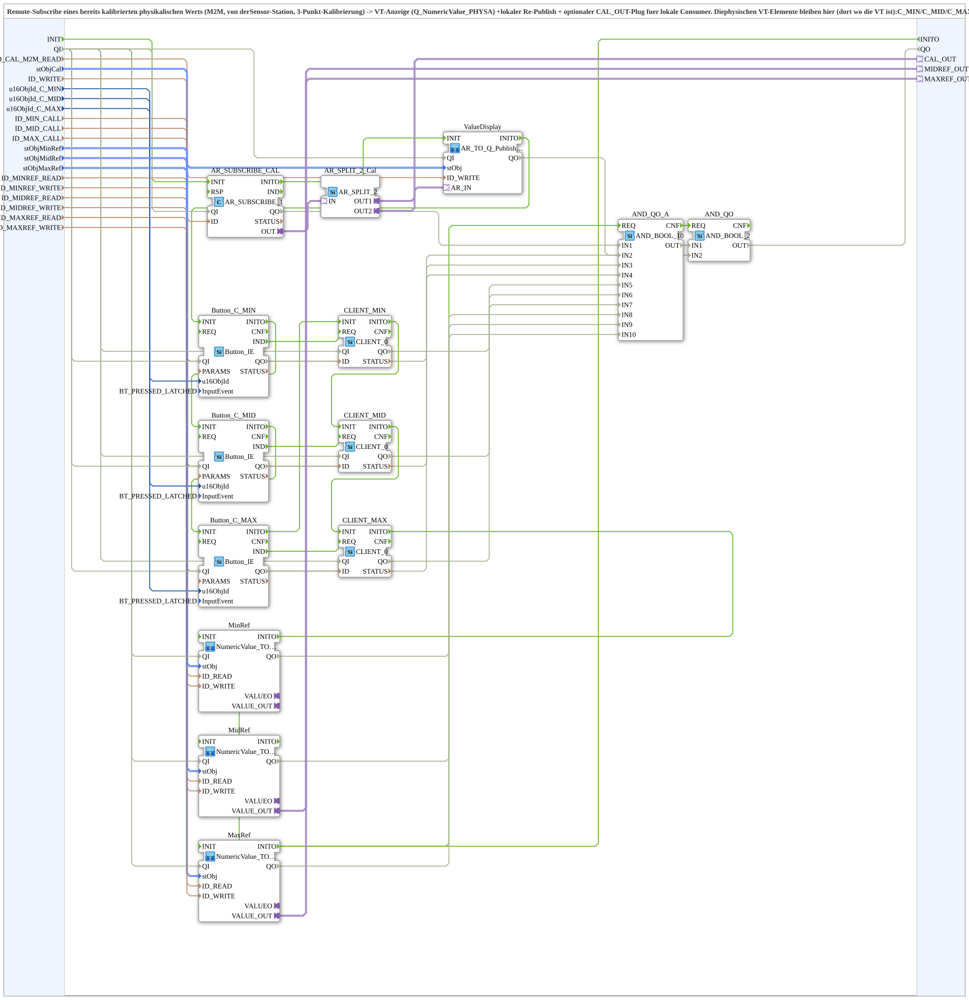

# logiBUS_AI_Calibrate_3P_Subscribe_VT_OPC

* * * * * * * * * *

## Einleitung

`logiBUS_AI_Calibrate_3P_Subscribe_VT_OPC` ist die VT-seitige Gegenstelle zur Sensor-Station [`logiBUS_AI_Calibrate_3P_IDA_OPC`](./logiBUS_AI_Calibrate_3P_IDA_OPC.md): Die SubApp abonniert per OPC-UA (M2M) den **bereits kalibrierten** physikalischen Wert der 3-Punkt-Kalibrierung, zeigt ihn in der VT an, publiziert ihn lokal erneut und stellt ihn optional über den Plug `CAL_OUT` für lokale Consumer bereit. Die physischen VT-Elemente bleiben hier (dort, wo die VT ist): Die Tasten `C_MIN`/`C_MID`/`C_MAX` rufen per `CLIENT_0` direkt die entsprechenden Methoden auf der Sensor-Station auf (echter Ereignis-zu-Ereignis-Methodenaufruf, kein Toggle/Publish/Subscribe-Umweg). Die drei Referenzwert-Eingabefelder `MIN_REF`/`MID_REF`/`MAX_REF` (`NumericValue_TO_AR2_OPC`) werden weiterhin **lokal** publiziert und von der Sensor-Station remote abonniert; `MID_REF` und `MAX_REF` werden zusätzlich als plain-`AR`-Plugs (`MIDREF_OUT`/`MAXREF_OUT`) re-exponiert. Genutzt vom 3-Punkt-Kalibrierungs-Trainingsbeispiel [InputOutputTesterButton_AI_Calibrate_3P_OPC_UA](https://meisterschulen-am-ostbahnhof-munchen-docs.readthedocs.io/projects/4diac-exercises-docs/de/latest/Uebungen/test_AX/Meins/InputOutputTester/Button_AI_Calibrate_3P_OPC_UA/InputOutputTesterButton_AI_Calibrate_3P_OPC_UA/).

## Schnittstellenstruktur

### **Ereignis-Eingänge**

- **INIT** (`EInit`): Initialisierungsanforderung

### **Ereignis-Ausgänge**

- **INITO** (`EInit`): Initialisierungsbestätigung (von `MaxRef.INITO`)

### **Daten-Eingänge**

- **QI** (`BOOL`, Vorgabe `TRUE`): Quality Input – TRUE gibt die Dienste frei
- **ID_CAL_M2M_READ** (`WSTRING`): Remote-Subscribe-Adresse des bereits kalibrierten physikalischen Werts (`REAL`), Gegenstück zu `ID_CAL_WRITE` auf der Sensor-Station
- **stObjCal** (`NumericObjectPool_S`): Object ID + Scale/Offset/Decimals der `CNumberVariable` für den kalibrierten Wert
- **ID_WRITE** (`WSTRING`): lokale Re-Publish-Adresse (`REAL`, `ACTION=PUBLISH`) für weitere lokale Konsumenten
- **u16ObjId_C_MIN**, **u16ObjId_C_MID**, **u16ObjId_C_MAX** (`UINT`, Vorgabe `ID_NULL`): Object IDs der Tasten `C_MIN`/`C_MID`/`C_MAX` auf der VT
- **ID_MIN_CALL**, **ID_MID_CALL**, **ID_MAX_CALL** (`WSTRING`): Remote-Methodenadressen (`ACTION=CALL_METHOD`) für die drei Kalibrier-Trigger auf der Sensor-Station
- **stObjMinRef**, **stObjMidRef**, **stObjMaxRef** (`NumericObjectPool_S`): Object ID + Scale/Offset/Decimals der Referenzwert-Eingabefelder auf dieser Station
- **ID_MINREF_READ**, **ID_MIDREF_READ**, **ID_MAXREF_READ** (`WSTRING`): optionale Subscribe-Adressen, falls der Referenzwert extern (Dashboard) überschrieben werden soll; unbenutzt zulässig
- **ID_MINREF_WRITE**, **ID_MIDREF_WRITE**, **ID_MAXREF_WRITE** (`WSTRING`): lokale Publish-Adressen (`REAL`, `ACTION=PUBLISH`) der Referenzwerte, werden von der Sensor-Station remote abonniert

### **Daten-Ausgänge**

- **QO** (`BOOL`): Quality Output – zusammengefasster Status der beteiligten Funktionsbausteine (UND aus `AND_QO_A.OUT` und `ValueDisplay.QO`). `QO` = TRUE bestätigt **nicht**, dass die Methodenaufrufe erfolgreich waren; die Ausführung der Anfrage bestätigt `CLIENT_0.CNF`, das dieser Wrapper nicht nach außen führt

### **Adapter**

- **CAL_OUT** (Plug, `adapter::types::unidirectional::AR`): optional, kalibrierter Wert (plain-`AR`-Spiegel des Remote-Subscribe) für externe lokale Consumer; unverdrahtet lassen, wenn nicht gebraucht
- **MIDREF_OUT** (Plug, `adapter::types::unidirectional::AR`): optional, live `MID_REF`-Referenzwert
- **MAXREF_OUT** (Plug, `adapter::types::unidirectional::AR`): optional, live `MAX_REF`-Referenzwert

## Verwendete Funktionsbausteine (FBs)

- **`AR_SUBSCRIBE_CAL`** (`adapter::net::AR_SUBSCRIBE_1`): abonniert den kalibrierten Wert von der Sensor-Station (`ID_CAL_M2M_READ`).
- **`AR_SPLIT_2_Cal`** (`adapter::events::unidirectional::AR_SPLIT_2`): verteilt den Wert auf `ValueDisplay` und `CAL_OUT`.
- **`ValueDisplay`** (SubApp [`AR_TO_Q_Publish_OPC`](./AR_TO_Q_Publish_OPC.md)): VT-Anzeige und lokaler Re-Publish (`stObjCal`, `ID_WRITE`).
- **`Button_C_MIN`**, **`Button_C_MID`**, **`Button_C_MAX`** (`isobus::UT::io::Button::Button_IE`, `InputEvent = BT_PRESSED_LATCHED`): lesen die drei VT-Tasten.
- **`CLIENT_MIN`**, **`CLIENT_MID`**, **`CLIENT_MAX`** (`iec61499::net::CLIENT_0`): rufen die Methoden auf der Sensor-Station auf (`ID_MIN_CALL`/`ID_MID_CALL`/`ID_MAX_CALL`).
- **`MinRef`**, **`MidRef`**, **`MaxRef`** (SubApp [`NumericValue_TO_AR2_OPC`](./NumericValue_TO_AR2_OPC.md)): VT-Eingabefelder der Referenzwerte, lokal publiziert.
- **`AND_QO_A`** (`iec61131::booleanOperators::AND_BOOL_10`) und **`AND_QO`** (`iec61131::booleanOperators::AND_BOOL_2`): verknüpfen die `QO`-Ausgänge aller Teilbausteine zum `QO` der SubApp.

## Funktionsweise

- **Kalibrierter Wert:** `AR_SUBSCRIBE_CAL.OUT` → `AR_SPLIT_2_Cal.IN`; `AR_SPLIT_2_Cal.OUT1` → `ValueDisplay.AR_IN`; `AR_SPLIT_2_Cal.OUT2` → `CAL_OUT`.
- **Kalibriertasten:** `Button_C_MIN.IND` → `CLIENT_MIN.REQ`, `Button_C_MID.IND` → `CLIENT_MID.REQ`, `Button_C_MAX.IND` → `CLIENT_MAX.REQ`.
- **Referenzwerte:** `MinRef`/`MidRef`/`MaxRef` erhalten `stObjMinRef`/`stObjMidRef`/`stObjMaxRef`, `ID_*REF_READ` und `ID_*REF_WRITE`; `MidRef.VALUE_OUT` → `MIDREF_OUT`, `MaxRef.VALUE_OUT` → `MAXREF_OUT`.
- **Initialisierungskette:** `INIT` → `AR_SUBSCRIBE_CAL` → `ValueDisplay` → `Button_C_MIN` → `Button_C_MID` → `Button_C_MAX` → `CLIENT_MIN` → `CLIENT_MID` → `CLIENT_MAX` → `MinRef` → `MidRef` → `MaxRef` (jeweils `INITO` → nächstes `INIT`); `MaxRef.INITO` → `INITO` und → `AND_QO_A.REQ`; `AND_QO_A.CNF` → `AND_QO.REQ`.
- **Qualität:** `QI` → `.QI` von `AR_SUBSCRIBE_CAL`, `Button_C_MIN`/`_MID`/`_MAX`, `CLIENT_MIN`/`_MID`/`_MAX`, `MinRef`, `MidRef`, `MaxRef` und `ValueDisplay`. `AR_SUBSCRIBE_CAL.QO`, die drei `Button_C_*.QO`, die drei `CLIENT_*.QO` sowie `MinRef.QO`/`MidRef.QO`/`MaxRef.QO` → `AND_QO_A.IN1`..`IN10`; `AND_QO_A.OUT` → `AND_QO.IN1`, `ValueDisplay.QO` → `AND_QO.IN2`; `AND_QO.OUT` → `QO`.

## Zusammenfassung

Remote-Anzeige-Baustein für einen bereits kalibrierten 3-Punkt-Wert: Subscribe des kalibrierten Werts, VT-Anzeige mit lokalem Re-Publish, Kalibriertasten als Methodenaufrufe an die Sensor-Station und lokal publizierte Referenzwert-Eingabefelder in einem Composite.

---

### 🌐 Passende Themen-Unterseiten auf ms-muc-docs.de

- [🌐 Eclipse 4diac IDE & Farb-Referenz auf ms-muc-docs.de](https://www.ms-muc-docs.de/iec-61499/eclipse-4diac/)
