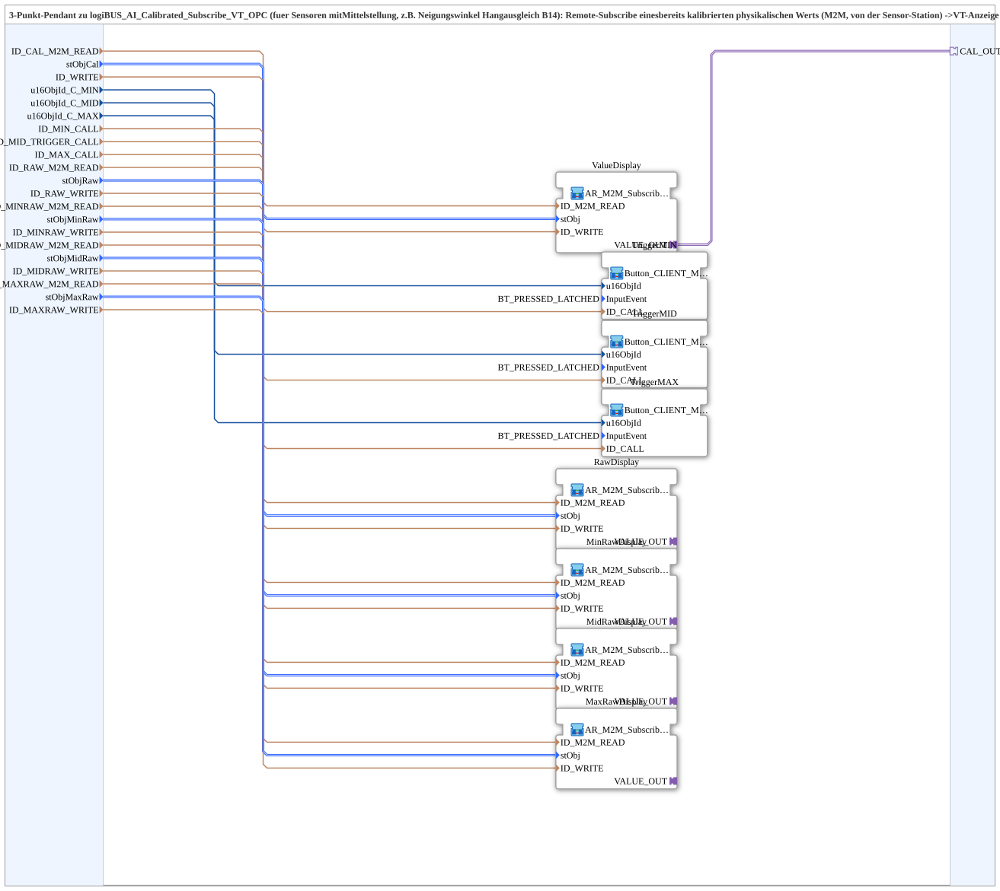

# logiBUS_AI_Calibrated_Subscribe_VT_3P_OPC

* * * * * * * * * *

## Einleitung

`logiBUS_AI_Calibrated_Subscribe_VT_3P_OPC` ist das **3-Punkt-Pendant** zu [`logiBUS_AI_Calibrated_Subscribe_VT_OPC`](./logiBUS_AI_Calibrated_Subscribe_VT_OPC.md) für Sensoren mit Mittelstellung (z. B. Neigungswinkel Hangausgleich B14). Er abonniert per Remote-Subscribe (M2M, von der Sensor-Station) einen **bereits kalibrierten physikalischen Wert**, zeigt ihn auf der VT an und publiziert ihn lokal erneut.

Die physischen VT-Elemente bleiben dort, wo die VT ist: Die Tasten **C_MIN**/**C_MID**/**C_MAX** rufen per `CLIENT_0` direkt die Methoden `ID_MIN_METHOD`/`ID_MID_TRIGGER_METHOD`/`ID_MAX_METHOD` auf der Sensor-Station auf (`logiBUS_AI_Calibrate_3P_IDA_OPC`) – ein echter Event-zu-Event-Methodenaufruf, kein Toggle/Publish/Subscribe-Umweg (siehe `OPC_UA_VERNETZUNG.md`, Punkt 14). Die Referenzwert-Eingabefelder `MIN_REF`/`MID_REF`/`MAX_REF` bleiben bewusst außerhalb dieser SubApp (eigene `NumericValue_TO_CLIENT_1_0_OPC`-Instanzen je Aufrufer).

## Schnittstellenstruktur

### **Ereignis-Eingänge**

- **INIT** (`EInit`): Initialization Request

### **Ereignis-Ausgänge**

- **INITO** (`EInit`): Initialization Confirm

### **Daten-Eingänge**

- **QI** (`BOOL`, Vorgabe `TRUE`): Quality Input - TRUE, um den Dienst freizugeben

Kalibrierter Wert:

- **ID_CAL_M2M_READ** (`WSTRING`): Remote-Subscribe-Adresse des bereits kalibrierten physikalischen Werts (`REAL`); Gegenstück zu `ID_CAL_WRITE` auf der Sensor-Station (`logiBUS_AI_Calibrate_3P_IDA_OPC`)
- **stObjCal** (`NumericObjectPool_S`, Vorgabe `u16ObjId := ID_NULL, r32Scale := 1.0, i32Offset := 0, u8Decimals := 1`): Object-ID + Scale/Offset/Decimals der `CNumberVariable` (kalibrierter Wert)
- **ID_WRITE** (`WSTRING`): Lokale Re-Publish-Adresse (`REAL`, `ACTION=PUBLISH`) für weitere lokale Konsumenten auf dieser Station

Tasten C_MIN/C_MID/C_MAX:

- **u16ObjId_C_MIN**, **u16ObjId_C_MID**, **u16ObjId_C_MAX** (`UINT`, Vorgabe `ID_NULL`): Object-IDs der Tasten „C_MIN“, „C_MID“, „C_MAX“, physisch hier auf der VT
- **ID_MIN_CALL**, **ID_MID_TRIGGER_CALL**, **ID_MAX_CALL** (`WSTRING`): Remote-Methodenadressen (`ACTION=CALL_METHOD`); rufen `ID_MIN_METHOD`, `ID_MID_TRIGGER_METHOD` bzw. `ID_MAX_METHOD` direkt auf der Sensor-Station auf

Rohwert-Anzeigen (reine Diagnose):

- **ID_RAW_M2M_READ** (`WSTRING`): Remote-Subscribe-Adresse des unkalibrierten Rohwerts (`DWORD` 0-4095); Gegenstück zu `ID_RAW_WRITE` auf der Sensor-Station
- **stObjRaw** (`NumericObjectPool_S`, `u8Decimals := 0`): Anzeigefeld Rohwert
- **ID_RAW_WRITE** (`WSTRING`): Lokale Re-Publish-Adresse (`DWORD`, `ACTION=PUBLISH`)
- **ID_MINRAW_M2M_READ** (`WSTRING`): Remote-Subscribe-Adresse des Rohwerts am MIN-Kalibrierpunkt; Gegenstück zu `ID_MIN_RAW_WRITE` auf der Sensor-Station
- **stObjMinRaw** (`NumericObjectPool_S`, `u8Decimals := 0`): Anzeigefeld Rohwert am MIN-Kalibrierpunkt
- **ID_MINRAW_WRITE** (`WSTRING`): Lokale Re-Publish-Adresse (`DWORD`, `ACTION=PUBLISH`)
- **ID_MIDRAW_M2M_READ** (`WSTRING`): Remote-Subscribe-Adresse des Rohwerts am MID-Kalibrierpunkt; Gegenstück zu `ID_MID_RAW_WRITE` auf der Sensor-Station
- **stObjMidRaw** (`NumericObjectPool_S`, `u8Decimals := 0`): Anzeigefeld Rohwert am MID-Kalibrierpunkt
- **ID_MIDRAW_WRITE** (`WSTRING`): Lokale Re-Publish-Adresse (`DWORD`, `ACTION=PUBLISH`)
- **ID_MAXRAW_M2M_READ** (`WSTRING`): Remote-Subscribe-Adresse des Rohwerts am MAX-Kalibrierpunkt; Gegenstück zu `ID_MAX_RAW_WRITE` auf der Sensor-Station
- **stObjMaxRaw** (`NumericObjectPool_S`, `u8Decimals := 0`): Anzeigefeld Rohwert am MAX-Kalibrierpunkt
- **ID_MAXRAW_WRITE** (`WSTRING`): Lokale Re-Publish-Adresse (`DWORD`, `ACTION=PUBLISH`)

### **Daten-Ausgänge**

- **QO** (`BOOL`): Quality Output - TRUE, wenn der Dienst erfolgreich ausgeführt wurde (UND der `QO` von `ValueDisplay`, `TriggerMIN`, `TriggerMID`, `TriggerMAX`, `RawDisplay`, `MinRawDisplay`, `MidRawDisplay` und `MaxRawDisplay`)

### **Adapter**

- **CAL_OUT** (Plug, `adapter::types::unidirectional::AR`): Nur-Lese-Spiegel des kalibrierten Werts (`ValueDisplay.VALUE_OUT`) für weitere lokale Konsumenten auf dieser Station (z. B. [`Fahrwerk_Mittelpunkt_Anzeige`](./Fahrwerk_Mittelpunkt_Anzeige.md) für Bargraph/Status-Center), statt eines eigenen OPC-UA-Self-Subscribe

## Verwendete Funktionsbausteine (FBs)

- **ValueDisplay**: SubApp [`MyLib::sys::AR_M2M_Subscribe_TO_Q_Publish_OPC`](./AR_M2M_Subscribe_TO_Q_Publish_OPC.md) – kalibrierter Wert
- **RawDisplay**, **MinRawDisplay**, **MidRawDisplay**, **MaxRawDisplay**: dieselbe SubApp für den Rohwert und die Rohwerte der drei Kalibrierpunkte
- **TriggerMIN**, **TriggerMID**, **TriggerMAX**: SubApp [`MyLib::sys::Button_CLIENT_Method_IE`](./Button_CLIENT_Method_IE.md) (`InputEvent=BT_PRESSED_LATCHED`) – Taste → Remote-Methodenaufruf (`ID_CALL`)
- **AND_QO**: `iec61131::booleanOperators::AND_BOOL_8` – verknüpft die `QO`-Ausgänge der acht inneren SubApps per UND zum Baustein-Ausgang `QO`
- **Importe**: `ID_NULL`, `BT_PRESSED_LATCHED`, `NumericObjectPool_S`

## Programmablauf und Verbindungen

- `ID_CAL_M2M_READ`, `stObjCal`, `ID_WRITE` → `ValueDisplay` (`ID_M2M_READ`, `stObj`, `ID_WRITE`); `ValueDisplay.VALUE_OUT` → `CAL_OUT`
- `u16ObjId_C_MIN`/`ID_MIN_CALL` → `TriggerMIN` (`u16ObjId`/`ID_CALL`); entsprechend `C_MID` → `TriggerMID`, `C_MAX` → `TriggerMAX`
- `ID_RAW_M2M_READ`, `stObjRaw`, `ID_RAW_WRITE` → `RawDisplay`
- `ID_MINRAW_M2M_READ`, `stObjMinRaw`, `ID_MINRAW_WRITE` → `MinRawDisplay`
- `ID_MIDRAW_M2M_READ`, `stObjMidRaw`, `ID_MIDRAW_WRITE` → `MidRawDisplay`
- `ID_MAXRAW_M2M_READ`, `stObjMaxRaw`, `ID_MAXRAW_WRITE` → `MaxRawDisplay`
- Initialisierungskette: `INIT` → `ValueDisplay.INIT`, `ValueDisplay.INITO` → `TriggerMIN.INIT`, `TriggerMIN.INITO` → `TriggerMID.INIT`, `TriggerMID.INITO` → `TriggerMAX.INIT`, `TriggerMAX.INITO` → `RawDisplay.INIT`, `RawDisplay.INITO` → `MinRawDisplay.INIT`, `MinRawDisplay.INITO` → `MidRawDisplay.INIT`, `MidRawDisplay.INITO` → `MaxRawDisplay.INIT`, `MaxRawDisplay.INITO` → `INITO` und → `AND_QO.REQ`
- `QI` → `QI` aller acht inneren SubApps
- `ValueDisplay.QO`, `TriggerMIN.QO`, `TriggerMID.QO`, `TriggerMAX.QO`, `RawDisplay.QO`, `MinRawDisplay.QO`, `MidRawDisplay.QO`, `MaxRawDisplay.QO` → `AND_QO.IN1`..`IN8`; `AND_QO.OUT` → `QO`

## Technische Besonderheiten

- Die Kalibrierung selbst läuft auf der Sensor-Station; dieser Baustein enthält keine Kalibrierlogik
- Version 1.1 (2026-09-26): Plug `CAL_OUT` ergänzt – spiegelt den bereits remote abonnierten Wert für weitere Konsumenten auf STG1, kein zusätzliches Self-Subscribe nötig
- Version 1.0 (2026-09-26): 3-Punkt-Pendant zu `logiBUS_AI_Calibrated_Subscribe_VT_OPC` v1.8, für Hangausgleich-Winkel B14 (Kalibrierung zieht von STG1 nach STG3 um)

## Anwendungsszenarien

- VT-Station, die den kalibrierten Neigungswinkel (B14) einer anderen Station anzeigt und die 3-Punkt-Kalibrierung (MIN/MID/MAX) per Taste auslöst

## Fazit

`logiBUS_AI_Calibrated_Subscribe_VT_3P_OPC` zeigt remote kalibrierte Werte und Rohwerte der Kalibrierpunkte auf der VT an und leitet die Tasten C_MIN/C_MID/C_MAX per OPC-UA-Methodenaufruf an die Sensor-Station weiter.
