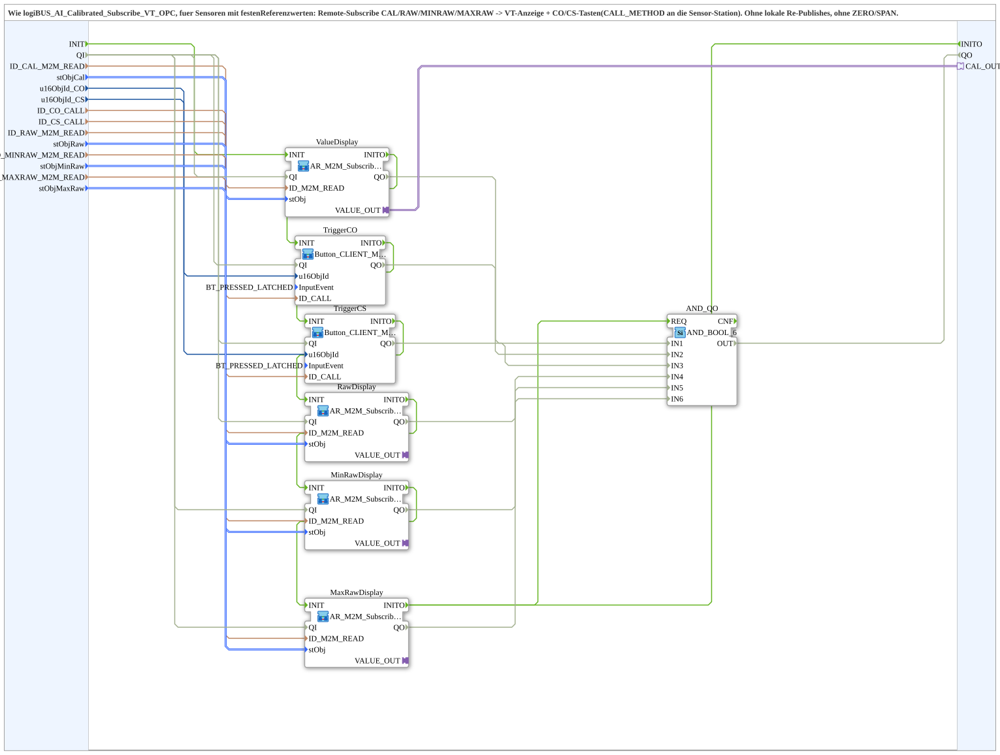

# logiBUS_AI_Calibrated_Subscribe_VT_Lite_OPC

* * * * * * * * * *

## Einleitung

`logiBUS_AI_Calibrated_Subscribe_VT_Lite_OPC` ist die schlanke Variante von [`logiBUS_AI_Calibrated_Subscribe_VT_OPC`](./logiBUS_AI_Calibrated_Subscribe_VT_OPC.md) für Sensoren mit festen Referenzwerten. Per Remote-Subscribe werden kalibrierter Wert, Rohwert sowie die Rohwerte am MIN- und MAX-Kalibrierpunkt von der Sensor-Station abonniert und auf der VT angezeigt; die Tasten **CO**/**CS** rufen per `CALL_METHOD` die Kalibriermethoden auf der Sensor-Station auf. Gegenüber dem Original gibt es keine lokalen Re-Publishes (keine `ID_*_WRITE`-Spiegel) und keine `ZERO`/`SPAN`-Referenzwert-Eingabefelder (`ZeroRef`/`SpanRef` entfallen, die Referenzwerte sind fest auf der Sensor-Station). Statt `AR_M2M_Subscribe_TO_Q_Publish_OPC` kommt viermal [`AR_M2M_Subscribe_TO_Q_OPC`](./AR_M2M_Subscribe_TO_Q_OPC.md) zum Einsatz.

## Schnittstellenstruktur

### **Ereignis-Eingänge**

- **INIT** (`EInit`): Initialisierungsanforderung; startet die Kette `ValueDisplay` → `TriggerCO` → `TriggerCS` → `RawDisplay` → `MinRawDisplay` → `MaxRawDisplay`

### **Ereignis-Ausgänge**

- **INITO** (`EInit`): Initialisierungsbestätigung; kommt von `MaxRawDisplay.INITO`

### **Daten-Eingänge**

| Variable | Typ | Vorgabe | Kommentar |
|----------|-----|---------|-----------|
| `QI` | BOOL | TRUE | Quality Input: Freigabe des Dienstes; wird an alle sechs Instanzen weitergereicht. |
| `ID_CAL_M2M_READ` | WSTRING |  | Remote-Subscribe-Adresse des kalibrierten Werts (`REAL`) der Sensor-Station. |
| `stObjCal` | `logiBUS::utils::conversion::phys::NumericObjectPool_S` | `(u16ObjId := ID_NULL, r32Scale := 1.0, i32Offset := 0, u8Decimals := 1)` | Object ID plus Scale/Offset/Decimals der `CNumberVariable` (kalibrierter Wert). |
| `u16ObjId_CO` | UINT | `ID_NULL` | Object ID Taste „CO“ (Kalibrier-Nullpunkt) auf der VT. |
| `u16ObjId_CS` | UINT | `ID_NULL` | Object ID Taste „CS“ (Kalibrier-Spanne) auf der VT. |
| `ID_CO_CALL` | WSTRING |  | Remote-Methodenadresse (`CALL_METHOD`) für den CO-Trigger auf der Sensor-Station. |
| `ID_CS_CALL` | WSTRING |  | Remote-Methodenadresse (`CALL_METHOD`) für den CS-Trigger auf der Sensor-Station. |
| `ID_RAW_M2M_READ` | WSTRING |  | Remote-Subscribe-Adresse des Rohwerts (Diagnose-Anzeige). |
| `stObjRaw` | `logiBUS::utils::conversion::phys::NumericObjectPool_S` | `(u16ObjId := ID_NULL, r32Scale := 1.0, i32Offset := 0, u8Decimals := 0)` | Object ID plus Scale/Offset/Decimals der `CNumberVariable` (Rohwert). |
| `ID_MINRAW_M2M_READ` | WSTRING |  | Remote-Subscribe-Adresse Rohwert am MIN-Kalibrierpunkt (Diagnose-Anzeige). |
| `stObjMinRaw` | `logiBUS::utils::conversion::phys::NumericObjectPool_S` | `(u16ObjId := ID_NULL, r32Scale := 1.0, i32Offset := 0, u8Decimals := 0)` | Object ID plus Scale/Offset/Decimals der `CNumberVariable` (Rohwert MIN). |
| `ID_MAXRAW_M2M_READ` | WSTRING |  | Remote-Subscribe-Adresse Rohwert am MAX-Kalibrierpunkt (Diagnose-Anzeige). |
| `stObjMaxRaw` | `logiBUS::utils::conversion::phys::NumericObjectPool_S` | `(u16ObjId := ID_NULL, r32Scale := 1.0, i32Offset := 0, u8Decimals := 0)` | Object ID plus Scale/Offset/Decimals der `CNumberVariable` (Rohwert MAX). |

### **Daten-Ausgänge**

| Variable | Typ | Vorgabe | Kommentar |
|----------|-----|---------|-----------|
| `QO` | BOOL |  | Quality Output: `AND` der `QO`-Ausgänge aller sechs Instanzen (über `AND_QO`, `AND_BOOL_6`). |

### **Adapter**

| Adapter | Typ | Richtung | Kommentar |
|---------|-----|----------|-----------|
| `CAL_OUT` | `adapter::types::unidirectional::AR` | Plug | Nur-Lese-Spiegel des kalibrierten Werts (`ValueDisplay.VALUE_OUT`) für weitere lokale Konsumenten. |

## Verwendete Funktionsbausteine (FBs)

- **ValueDisplay** (SubApp `MyLib::sys::AR_M2M_Subscribe_TO_Q_OPC`): kalibrierter Wert
- **TriggerCO**, **TriggerCS** (SubApp [`MyLib::sys::Button_CLIENT_Method_IE`](./Button_CLIENT_Method_IE.md), `InputEvent = BT_PRESSED_LATCHED`): Tasten CO und CS mit Methodenaufruf
- **RawDisplay**, **MinRawDisplay**, **MaxRawDisplay** (SubApp `MyLib::sys::AR_M2M_Subscribe_TO_Q_OPC`): Rohwert sowie Rohwerte der Kalibrierpunkte MIN und MAX
- **AND_QO** (`iec61131::booleanOperators::AND_BOOL_6`): verknüpft die sechs `QO`-Ausgänge

## Programmablauf und Verbindungen

1. Wert: `ID_CAL_M2M_READ` -> `ValueDisplay.ID_M2M_READ`; `stObjCal` -> `ValueDisplay.stObj`; `ValueDisplay.VALUE_OUT` -> `CAL_OUT`.
2. Tasten: `u16ObjId_CO` -> `TriggerCO.u16ObjId`; `ID_CO_CALL` -> `TriggerCO.ID_CALL`; `u16ObjId_CS` -> `TriggerCS.u16ObjId`; `ID_CS_CALL` -> `TriggerCS.ID_CALL`.
3. Rohwert: `ID_RAW_M2M_READ` -> `RawDisplay.ID_M2M_READ`; `stObjRaw` -> `RawDisplay.stObj`.
4. MIN-Rohwert: `ID_MINRAW_M2M_READ` -> `MinRawDisplay.ID_M2M_READ`; `stObjMinRaw` -> `MinRawDisplay.stObj`.
5. MAX-Rohwert: `ID_MAXRAW_M2M_READ` -> `MaxRawDisplay.ID_M2M_READ`; `stObjMaxRaw` -> `MaxRawDisplay.stObj`.
6. Initialisierung: `INIT` -> `ValueDisplay.INIT` -> `TriggerCO.INIT` -> `TriggerCS.INIT` -> `RawDisplay.INIT` -> `MinRawDisplay.INIT` -> `MaxRawDisplay.INIT` (jeweils über `INITO`); `MaxRawDisplay.INITO` -> `INITO` und -> `AND_QO.REQ`.
7. Qualifier: `QI` -> `.QI` der sechs Instanzen.
8. Qualität: `ValueDisplay.QO` -> `AND_QO.IN1`; `TriggerCO.QO` -> `IN2`; `TriggerCS.QO` -> `IN3`; `RawDisplay.QO` -> `IN4`; `MinRawDisplay.QO` -> `IN5`; `MaxRawDisplay.QO` -> `IN6`; `AND_QO.OUT` -> `QO`.

## Technische Besonderheiten

- Ohne lokale Re-Publishes: Es gibt keine `ID_*_WRITE`-Eingänge.
- Ohne `ZERO`/`SPAN`: Die Referenzwerte sind fest auf der Sensor-Station hinterlegt (z. B. Füllband-Winkel).
- Die Kalibrierung selbst läuft auf der Sensor-Station; dieser Baustein enthält keine Kalibrierlogik.

## Anwendungsszenarien

- VT-Station, die kalibrierte Sensorwerte einer anderen Station anzeigt und deren Kalibrierung per Taste auslöst, wenn der Sensor feste Referenzwerte hat (z. B. Füllband-Winkel) und keine lokalen Re-Publishes benötigt werden.

## Zusammenfassung

`logiBUS_AI_Calibrated_Subscribe_VT_Lite_OPC` zeigt remote kalibrierte Werte und Rohwerte auf der VT an und leitet die Kalibriertasten per Methodenaufruf an die Sensor-Station weiter – ohne lokale Re-Publishes und ohne `ZERO`/`SPAN`.

---

### 🌐 Passende Themen-Unterseiten auf ms-muc-docs.de

- [🌐 Eclipse 4diac IDE & Farb-Referenz auf ms-muc-docs.de](https://www.ms-muc-docs.de/iec-61499/eclipse-4diac/)
