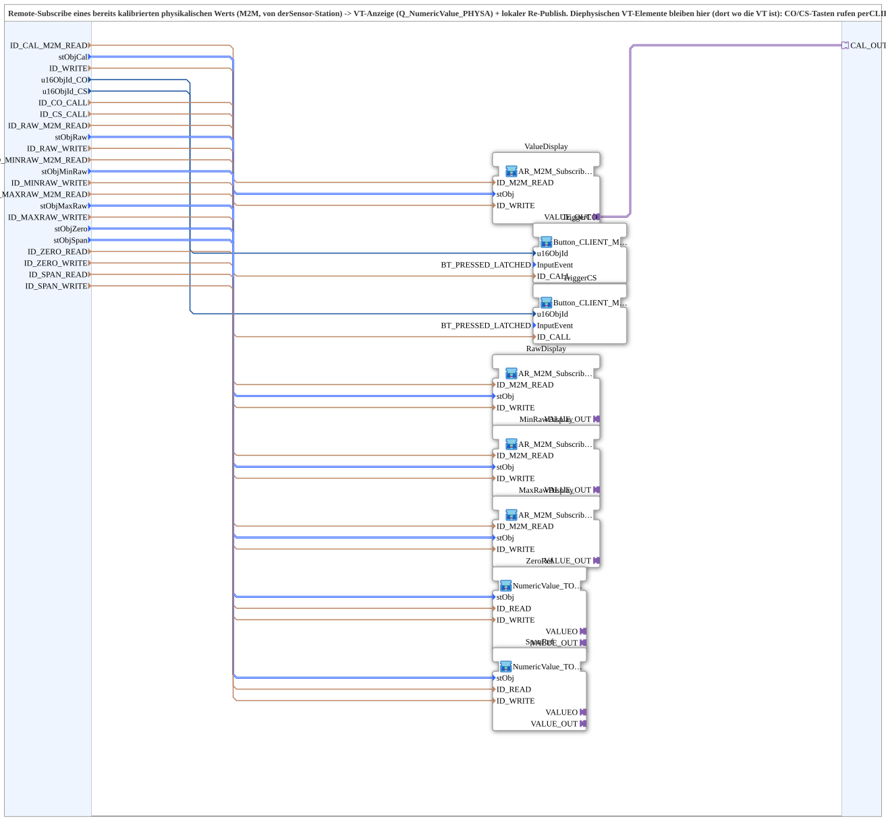

# logiBUS_AI_Calibrated_Subscribe_VT_OPC

* * * * * * * * * *

## Einleitung

`logiBUS_AI_Calibrated_Subscribe_VT_OPC` abonniert per Remote-Subscribe (M2M, von der Sensor-Station) einen **bereits kalibrierten physikalischen Wert** und zeigt ihn auf der VT an (`Q_NumericValue_PHYSA`) mit lokalem Re-Publish. Die physischen VT-Elemente bleiben dort, wo die VT ist: Die Tasten **CO**/**CS** rufen per `CLIENT_0` direkt die Methoden `ID_CO_METHOD`/`ID_CS_METHOD` auf der Sensor-Station auf (`logiBUS_AI_Calibrate_IDA_OPC`) – ein echter Event-zu-Event-Methodenaufruf, kein Toggle/Publish/Subscribe-Umweg (siehe `OPC_UA_VERNETZUNG.md`, Punkt 14).

Der Baustein ersetzt `logiBUS_AI_Calibrate_Remote_IDA_OPC`: Die Kalibrierung selbst läuft jetzt auf der Sensor-Station, hier bleiben nur Anzeige und Weiterleitung der VT-Bedienelemente. Die `ZERO`/`SPAN`-Referenzwert-Eingabefelder (`stObjZero`/`stObjSpan`) sind optional: `ID_NULL` lassen, wenn der Sensor feste Referenzwerte hat (Füllband-Winkel: 0/100 als Literal auf der Sensor-Station), echte Werte durchreichen, wenn der Bediener sie selbst eingibt (Druck: 0/250 bar, kein Kalibrator immer griffbereit).

## Schnittstellenstruktur

### **Ereignis-Eingänge**

*Keine direkten Ereignis-Eingänge vorhanden*

### **Ereignis-Ausgänge**

*Keine direkten Ereignis-Ausgänge vorhanden*

### **Daten-Eingänge**

Kalibrierter Wert:

- **ID_CAL_M2M_READ** (`WSTRING`): Remote-Subscribe-Adresse des bereits kalibrierten physikalischen Werts (`REAL`); Gegenstück zu `ID_CAL_WRITE` auf der Sensor-Station
- **stObjCal** (`NumericObjectPool_S`): Object-ID + Scale/Offset/Decimals der `CNumberVariable` (kalibrierter Wert)
- **ID_WRITE** (`WSTRING`): Lokale Re-Publish-Adresse (`REAL`, `ACTION=PUBLISH`) für weitere lokale Konsumenten

Tasten CO/CS:

- **u16ObjId_CO** (`UINT`, Vorgabe `ID_NULL`): Object-ID der Taste „CO“ (Kalibrier-Nullpunkt), physisch hier auf der VT
- **u16ObjId_CS** (`UINT`, Vorgabe `ID_NULL`): Object-ID der Taste „CS“ (Kalibrier-Spanne), physisch hier auf der VT
- **ID_CO_CALL**, **ID_CS_CALL** (`WSTRING`): Remote-Methodenadressen (`ACTION=CALL_METHOD`); rufen `ID_CO_METHOD`/`ID_CS_METHOD` direkt auf der Sensor-Station auf

Rohwert-Anzeigen (reine Diagnose):

- **ID_RAW_M2M_READ** (`WSTRING`): Remote-Subscribe-Adresse des unkalibrierten Rohwerts (`DWORD` 0-4095); Gegenstück zu `ID_RAW_WRITE` auf der Sensor-Station
- **stObjRaw** (`NumericObjectPool_S`, `u8Decimals := 0`): Anzeigefeld Rohwert
- **ID_RAW_WRITE** (`WSTRING`): Lokale Re-Publish-Adresse (`DWORD`, `ACTION=PUBLISH`)
- **ID_MINRAW_M2M_READ** (`WSTRING`): Remote-Subscribe-Adresse des Rohwerts am MIN-Kalibrierpunkt; Gegenstück zu `ID_ZERO_RAW_WRITE` auf der Sensor-Station
- **stObjMinRaw** (`NumericObjectPool_S`, `u8Decimals := 0`): Anzeigefeld Rohwert am MIN-Kalibrierpunkt
- **ID_MINRAW_WRITE** (`WSTRING`): Lokale Re-Publish-Adresse (`DWORD`, `ACTION=PUBLISH`)
- **ID_MAXRAW_M2M_READ** (`WSTRING`): Remote-Subscribe-Adresse des Rohwerts am MAX-Kalibrierpunkt; Gegenstück zu `ID_SPAN_RAW_WRITE` auf der Sensor-Station
- **stObjMaxRaw** (`NumericObjectPool_S`, `u8Decimals := 0`): Anzeigefeld Rohwert am MAX-Kalibrierpunkt
- **ID_MAXRAW_WRITE** (`WSTRING`): Lokale Re-Publish-Adresse (`DWORD`, `ACTION=PUBLISH`)

Referenzwerte (optional):

- **stObjZero**, **stObjSpan** (`NumericObjectPool_S`): VT-Eingabefelder für den ZERO-/SPAN-Referenzwert; `ID_NULL` lassen, wenn der Sensor feste Referenzwerte hat
- **ID_ZERO_READ**, **ID_SPAN_READ** (`WSTRING`): Remote-Subscribe-Adressen (`REAL`, `ACTION=SUBSCRIBE`) – optionaler Web-Override des VT-Eingabefelds, letzter Schreiber gewinnt
- **ID_ZERO_WRITE**, **ID_SPAN_WRITE** (`WSTRING`): Publish-Adressen (`REAL`, `ACTION=PUBLISH`), werden von der Sensor-Station remote abonniert (Gegenstück zu deren `ID_ZERO_READ`/`ID_SPAN_READ`)

### **Daten-Ausgänge**

*Keine Daten-Ausgänge vorhanden*

### **Adapter**

- **CAL_OUT** (Plug, `adapter::types::unidirectional::AR`): Nur-Lese-Spiegel des kalibrierten Werts (`ValueDisplay.VALUE_OUT`) für weitere lokale Konsumenten auf dieser Station, statt eines eigenen OPC-UA-Self-Subscribe

## Verwendete Funktionsbausteine (FBs)

- **ValueDisplay**: SubApp `MyLib::sys::AR_M2M_Subscribe_TO_Q_Publish_OPC` – kalibrierter Wert
- **RawDisplay**, **MinRawDisplay**, **MaxRawDisplay**: dieselbe SubApp für Rohwert und Rohwerte der Kalibrierpunkte
- **TriggerCO**, **TriggerCS**: SubApp [`MyLib::sys::Button_CLIENT_Method_IE`](./Button_CLIENT_Method_IE.md) (`InputEvent=BT_PRESSED_LATCHED`)
- **ZeroRef**, **SpanRef**: SubApp `MyLib::sys::NumericValue_TO_AR2_OPC` – Referenzwert-Eingabefelder

## Programmablauf und Verbindungen

- `ID_CAL_M2M_READ`, `stObjCal`, `ID_WRITE` → `ValueDisplay`; `ValueDisplay.VALUE_OUT` → `CAL_OUT`
- `u16ObjId_CO`/`ID_CO_CALL` → `TriggerCO`; `u16ObjId_CS`/`ID_CS_CALL` → `TriggerCS`
- `ID_RAW_M2M_READ`, `stObjRaw`, `ID_RAW_WRITE` → `RawDisplay`
- `ID_MINRAW_M2M_READ`, `stObjMinRaw`, `ID_MINRAW_WRITE` → `MinRawDisplay`
- `ID_MAXRAW_M2M_READ`, `stObjMaxRaw`, `ID_MAXRAW_WRITE` → `MaxRawDisplay`
- `stObjZero`, `ID_ZERO_READ`, `ID_ZERO_WRITE` → `ZeroRef`
- `stObjSpan`, `ID_SPAN_READ`, `ID_SPAN_WRITE` → `SpanRef`

## Technische Besonderheiten

- Der Button-+-`CLIENT_0`-Aufruf kam hier früher zweimal identisch (CO und CS) vor und wurde in `Button_CLIENT_Method_IE` ausgelagert.
- Die Kalibrierung selbst läuft auf der Sensor-Station; dieser Baustein enthält keine Kalibrierlogik.

## Anwendungsszenarien

- VT-Station, die kalibrierte Sensorwerte einer anderen Station anzeigt und deren Kalibrierung per Taste auslöst (z. B. Füllband-Winkel, Druck)

## Fazit

`logiBUS_AI_Calibrated_Subscribe_VT_OPC` zeigt remote kalibrierte Werte und Rohwerte auf der VT an und leitet die Kalibriertasten per OPC-UA-Methodenaufruf an die Sensor-Station weiter.
