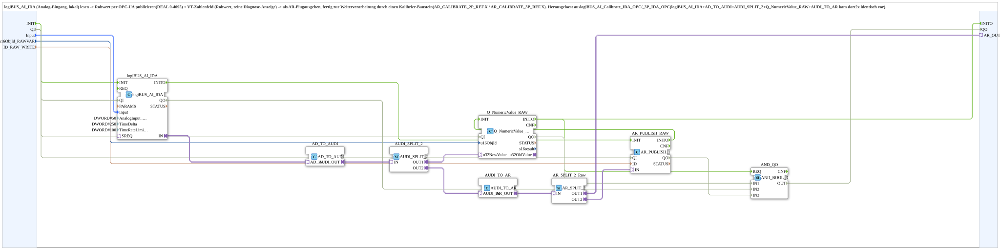

# logiBUS_AI_Raw_VT_AR_OPC

* * * * * * * * * *

## Einleitung

`logiBUS_AI_Raw_VT_AR_OPC` liest einen lokalen logiBUS-Analogeingang (`logiBUS_AI_IDA`), publiziert den Rohwert per OPC-UA (`REAL`, 0..4095) und zeigt ihn in einem VT-Zahlenfeld an (Rohwert, reine Diagnose-Anzeige). Zusätzlich wird er als `AR`-Plug ausgegeben, fertig zur Weiterverarbeitung durch einen Kalibrier-Baustein (`AR_CALIBRATE_2P_REF.X` bzw. `AR_CALIBRATE_3P_REF.X`). Der Baustein wurde aus `logiBUS_AI_Calibrate_IDA_OPC` und `logiBUS_AI_Calibrate_3P_IDA_OPC` herausgelöst, wo die Kombination `logiBUS_AI_IDA` + `AD_TO_AUDI` + `AUDI_SPLIT_2` + `Q_NumericValue_RAW` + `AUDI_TO_AR` zweimal identisch vorkam. Verwandt: [`logiBUS_AI_Raw_Publish_OPC`](./logiBUS_AI_Raw_Publish_OPC.md).

## Schnittstellenstruktur

### **Ereignis-Eingänge**

Keine.

### **Ereignis-Ausgänge**

Keine.

### **Daten-Eingänge**

- **QI** (`BOOL`, Vorgabe `TRUE`): Quality Input – `TRUE` aktiviert den VT-Schreibdienst (→ `Q_NumericValue_RAW.QI`)
- **Input** (`logiBUS::io::AI::logiBUS_AI_S`): Auswahl des Eingangs `AnalogInput_I1`..`I8` (Default `logiBUS_AI::Invalid`)
- **u16ObjId_RAWVAR** (`UINT`): Object ID der `CNumberVariable` (Rohwert 0..4095, unkalibriert, reine Diagnose-Anzeige)
- **ID_RAW_WRITE** (`WSTRING`): Rohwert-Rückmelde-Adresse (`REAL` 0..4095, `ACTION=PUBLISH`)

### **Daten-Ausgänge**

- **QO** (`BOOL`): Quality Output – `TRUE`, wenn der VT-Schreibzugriff erfolgreich war (von `Q_NumericValue_RAW.QO`)

### **Adapter**

- **AR_OUT** (Plug, `adapter::types::unidirectional::AR`): Rohwert als `AR`, fertig für `CALIBRATE.X`

## Verwendete Funktionsbausteine (FBs)

- **`logiBUS_AI_IDA`** (`logiBUS::io::AI::logiBUS_AI_IDA`): Parameter `QI = TRUE`, `AnalogInput_hysteresis = DWORD#50`, `TimeDelta = DWORD#250`, `TimeRateLimit = DWORD#100`
- **`AD_TO_AUDI`** (`adapter::conversion::unidirectional::AD_TO_AUDI`)
- **`AUDI_SPLIT_2`** (`adapter::events::unidirectional::AUDI_SPLIT_2`)
- **`Q_NumericValue_RAW`** (`isobus::UT::Q::Q_NumericValue_AUDI`): VT-Rohwertanzeige
- **`AUDI_TO_AR`** (`adapter::conversion::unidirectional::AUDI_TO_AR`)
- **`AR_SPLIT_2_Raw`** (`adapter::events::unidirectional::AR_SPLIT_2`)
- **`AR_PUBLISH_RAW`** (`adapter::net::AR_PUBLISH_1`, `QI = TRUE`): OPC-UA-Publish

## Funktionsweise

- `Input` → `logiBUS_AI_IDA.Input`
- `logiBUS_AI_IDA.IN` → `AD_TO_AUDI.AD_IN` → `AUDI_SPLIT_2.IN`
- `AUDI_SPLIT_2.OUT1` → `Q_NumericValue_RAW.u32NewValue` (VT-Anzeige); `u16ObjId_RAWVAR` → `Q_NumericValue_RAW.u16ObjId`
- `QI` → `Q_NumericValue_RAW.QI`; `Q_NumericValue_RAW.QO` → `QO`
- `AUDI_SPLIT_2.OUT2` → `AUDI_TO_AR.AUDI_IN` → `AR_SPLIT_2_Raw.IN`
- `AR_SPLIT_2_Raw.OUT1` → `AR_OUT`
- `AR_SPLIT_2_Raw.OUT2` → `AR_PUBLISH_RAW.IN`; `ID_RAW_WRITE` → `AR_PUBLISH_RAW.ID`

## Technische Besonderheiten

- Der Rohwert ist unkalibriert (0..4095); die Kalibrierung erfolgt im nachgeschalteten Baustein
- Zwei Splitter (`AUDI_SPLIT_2`, `AR_SPLIT_2_Raw`), da ein Adapter nicht auf mehrere Ziele verzweigen darf
- Eingangsparameter von `logiBUS_AI_IDA`: Hysterese 50, `TimeDelta` 250, `TimeRateLimit` 100

## Anwendungsszenarien

- Rohwert eines Analogeingangs anzeigen, per OPC-UA veröffentlichen und einem Kalibrier-Baustein zuführen

## Zusammenfassung

`logiBUS_AI_Raw_VT_AR_OPC` liefert den Analog-Rohwert gleichzeitig an VT, OPC-UA und einen `AR`-Ausgang.

---

### 🌐 Passende Themen-Unterseiten auf ms-muc-docs.de

- [🌐 Eclipse 4diac IDE & Farb-Referenz auf ms-muc-docs.de](https://www.ms-muc-docs.de/iec-61499/eclipse-4diac/)
