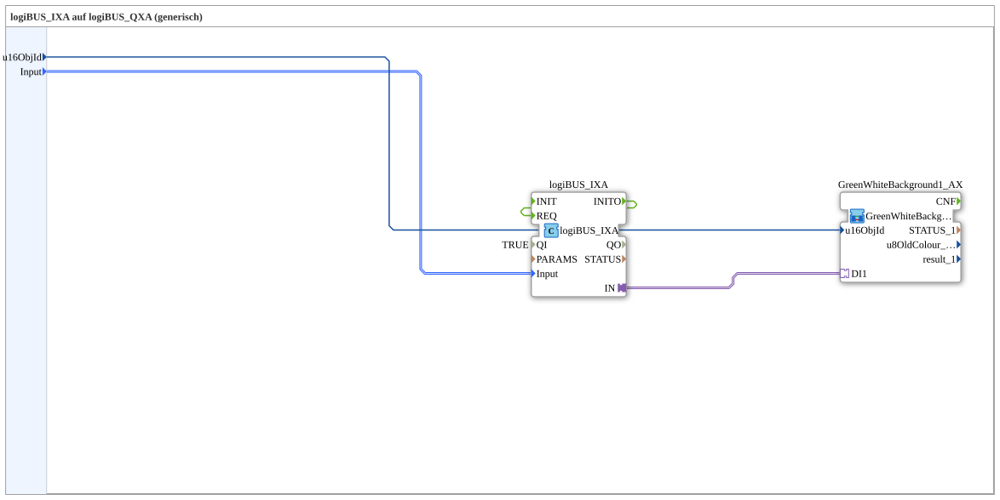

# logiBUS_IXA_BG

* * * * * * * * * *

## Einleitung

`logiBUS_IXA_BG` verbindet einen physischen digitalen Eingang (`logiBUS_IXA`) mit einer VT-Statusanzeige über die Hintergrundfarbfamilie `GreenWhiteBackground1_AX` (siehe [Background-Farbbausteine (gemeinsames Muster)](./Background-Farbbausteine.md)) — der aktuelle Zustand des Eingangs wird als grün/weißer Hintergrund auf dem VT sichtbar gemacht, ohne OPC-UA-Anbindung. Für die Variante mit zusätzlicher OPC-UA-Rückmeldung siehe [`logiBUS_IXA_BG_OPC`](./logiBUS_IXA_BG_OPC.md).

## Verwendete Funktionsbausteine (FBs)

### Sub-Bausteine: logiBUS_IXA_BG

- **Typ**: SubAppType
- **Schnittstelle (zusätzlich)**: Ereignis-Eingang `INIT`, Ereignis-Ausgang `INITO` (je `EInit`), Daten-Eingang `QI` (`BOOL`, Vorgabe `TRUE`), Daten-Ausgang `QO` (`BOOL`).
- **Verwendete interne FBs**:
    - **logiBUS_IXA**: `logiBUS::io::DI::logiBUS_IXA` — physischer digitaler Eingang, Adapter-Ausgang `IN`; `QI` kommt vom SubApp-Eingang `QI`.
    - **GreenWhiteBackground1_AX** (SubApp): `MyLib::sys::GreenWhiteBackground1_AX` — Ein-Objekt-Hintergrundfarbbaustein aus der Background-Farbbaustein-Familie, steuert die VT-Objekthintergrundfarbe anhand von `DI1`.
    - **AND_QO**: `iec61131::booleanOperators::AND_BOOL_2` — verknüpft die `QO`-Ausgänge von `logiBUS_IXA` und `GreenWhiteBackground1_AX` zu `QO`.
- **Funktionsweise**: Der Adapter-Ausgang des physischen Eingangs wird direkt auf den `DI1`-Adaptereingang des Hintergrundfarbbausteins geführt, der die Farbumschaltung eines VT-Objekts übernimmt.

## Programmablauf und Verbindungen

1. `Input` → `logiBUS_IXA.Input`; `u16ObjId` → `GreenWhiteBackground1_AX.u16ObjId`.
2. `logiBUS_IXA.IN` (Adapter) → `GreenWhiteBackground1_AX.DI1` (Adapter).
3. Initialisierung: `INIT` → `logiBUS_IXA.INIT`; `logiBUS_IXA.INITO` → `GreenWhiteBackground1_AX.INIT`; `GreenWhiteBackground1_AX.INITO` → `INITO` und → `AND_QO.REQ`.
4. Qualität: `QI` → `logiBUS_IXA.QI` und `GreenWhiteBackground1_AX.QI`; `logiBUS_IXA.QO` → `AND_QO.IN1`, `GreenWhiteBackground1_AX.QO` → `AND_QO.IN2`; `AND_QO.OUT` → `QO`.

## Anwendungsszenarien

- Rein visuelle Statusanzeige eines physischen digitalen Eingangs auf dem VT (z. B. Endschalter-Zustand), ohne dass der Wert per OPC-UA nach außen gemeldet werden muss.

## Zusammenfassung

Kombiniert einen physischen digitalen Eingang mit der Standard-Hintergrundfarbfamilie zu einer einfachen VT-Statusanzeige.

---

### 🌐 Passende Themen-Unterseiten auf ms-muc-docs.de

- [🌐 Eclipse 4diac IDE & Farb-Referenz auf ms-muc-docs.de](https://www.ms-muc-docs.de/iec-61499/eclipse-4diac/)
