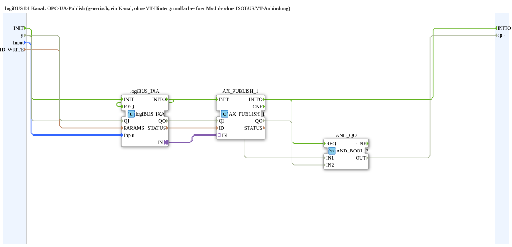

# logiBUS_IXA_OPC

* * * * * * * * * *

## Einleitung

Die SubApp `logiBUS_IXA_OPC` realisiert die OPC-UA-Veröffentlichung eines einzelnen logiBUS-Digital-Eingangskanals (DI) ohne Visualisierungshintergrund (VT) und eignet sich für Module ohne ISOBUS/VT-Anbindung. Sie kombiniert den Baustein `logiBUS_IXA` (Kanalverarbeitung) mit dem Adapter `AX_PUBLISH_1` (OPC-UA-Publishing) zu einer durchgängigen, generischen Ein-Kanal-Lösung.

## Schnittstellenstruktur

### **Ereignis-Eingänge**

- **INIT** (`EInit`): Initialisierungsanforderung; startet die Init-Kette bei `logiBUS_IXA.INIT`

### **Ereignis-Ausgänge**

- **INITO** (`EInit`): Initialisierungsbestätigung; kommt von `AX_PUBLISH_1.INITO`, dem Ende der Init-Kette

### **Daten-Eingänge**

- **`QI`** – Typ: `BOOL` – Quality Input, Initialwert `TRUE`; wird an `logiBUS_IXA.QI` und `AX_PUBLISH_1.QI` weitergereicht.
- **`Input`** – Typ: `logiBUS::io::DI::logiBUS_DI_S` – Identifiziert den Eingangskanal (Input_I1..I8). Initialwert: `logiBUS_DI::Invalid`.
- **`ID_WRITE`** – Typ: `WSTRING` – OPC-UA-Publish-Key (lesbar).

### **Daten-Ausgänge**

- **`QO`** – Typ: `BOOL` – Quality Output, UND-Verknüpfung (`AND_QO`, `AND_BOOL_2`) aus `logiBUS_IXA.QO` und `AX_PUBLISH_1.QO`.

### **Adapter**

Keine an der Schnittstelle. Intern wird der Adapterausgang `IN` von `logiBUS_IXA` mit dem Adaptereingang `IN` von `AX_PUBLISH_1` verbunden.

## Funktionsweise

Die SubApp nimmt über den Dateneingang `Input` die Daten eines logiBUS-DI-Kanals entgegen. Dieses Signal wird dem internen Baustein `logiBUS_IXA` zugeführt, der die Kanalverarbeitung übernimmt und die aufbereiteten Daten über seinen Adapterausgang `IN` bereitstellt. Dieser Ausgang ist mit dem Adaptereingang `IN` des Bausteins `AX_PUBLISH_1` verbunden. `AX_PUBLISH_1` veröffentlicht die empfangenen Daten über OPC-UA unter dem Schlüssel, der über den Eingang `ID_WRITE` gesetzt wird. Somit entsteht eine transparente Datenpipeline: logiBUS-DI → `logiBUS_IXA` → `AX_PUBLISH_1` → OPC-UA.

Initialisierung und Qualität: `INIT` → `logiBUS_IXA.INIT`, `logiBUS_IXA.INITO` → `AX_PUBLISH_1.INIT`, `AX_PUBLISH_1.INITO` → `INITO` und `AND_QO.REQ`. `QI` wird an `logiBUS_IXA.QI` und `AX_PUBLISH_1.QI` weitergereicht; `logiBUS_IXA.QO` → `AND_QO.IN1`, `AX_PUBLISH_1.QO` → `AND_QO.IN2` (`iec61131::booleanOperators::AND_BOOL_2`), `AND_QO.OUT` → `QO`.

## Technische Besonderheiten

- **Generische Ein-Kanal-Lösung** ohne VT-Hintergrundfarbe.
- **OPC-UA-Publishing** über den Adapter `adapter::net::AX_PUBLISH_1`.
- Der Parameter `PARAMS` von `logiBUS_IXA` ist leer und im Editor unsichtbar (`Visible=false`).
- Die internen Bausteine `logiBUS_IXA` und `AX_PUBLISH_1` erhalten ihr `QI` vom Eingang `QI` (Initialwert `TRUE`).
- Die SubApp besitzt als Ereignisse nur `INIT`/`INITO` und als Ausgang nur `QO`; die eigentlichen Messdaten werden ausschließlich per OPC-UA publiziert, nicht über Ausgangsports.

## Zustandsübersicht

Da die SubApp selbst keine expliziten Zustände definiert, sind keine Zustände über die Schnittstelle sichtbar. Die internen Zustände werden durch die Bausteine `logiBUS_IXA` (z. B. Initialisierung, Kanalverarbeitung) und `AX_PUBLISH_1` (z. B. Verbindungsstatus, Veröffentlichung aktiv) bestimmt. Sie sind jedoch nicht nach außen geführt und können nur über die jeweiligen Baustein-Dokumentationen eingesehen werden.

## Anwendungsszenarien

- **Integration in OPC-UA-Steuerungen**: Einbindung eines logiBUS-DI-Kanals in ein übergeordnetes OPC-UA-System zur Überwachung oder Steuerung.
- **Module ohne ISOBUS/VT-Anbindung**: Einsatz in Umgebungen, die ausschließlich OPC-UA unterstützen und keine proprietären Visualisierungslösungen benötigen.
- **Komprimierte Ein-Kanal-Publikation**: Wenn nur ein einzelner digitaler Eingang publiziert werden muss und ein schlanker, ressourcenschonender Baustein gewünscht ist.

## Vergleich mit ähnlichen Bausteinen

Gegenüber anderen logiBUS-Publish-Bausteinen, die mehrere Kanäle oder VT-Hintergrunddarstellung unterstützen, fokussiert `logiBUS_IXA_OPC` bewusst auf eine minimale, einzelne OPC-UA-Schnittstelle ohne Visualisierungsfunktionen. Dies reduziert Komplexität und Speicherbedarf und eignet sich besonders für einfache Anwendungen mit strengen Ressourcengrenzen.

## Fazit

`logiBUS_IXA_OPC` ist eine kompakte SubApp, die einen logiBUS-DI-Kanal nahtlos über OPC-UA publiziert. Sie wurde speziell für Module ohne ISOBUS/VT-Anbindung konzipiert und bietet eine einfache Konfiguration über die beiden Eingänge. Durch die klare Trennung von Datenerfassung (`logiBUS_IXA`) und Veröffentlichung (`AX_PUBLISH_1`) ist eine flexible und zuverlässige Integration in industrielle Netzwerke gewährleistet.
