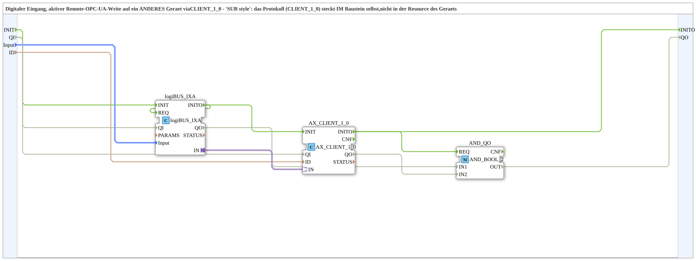

# logiBUS_IXA_TO_CLIENT_OPC

* * * * * * * * * *

## Einleitung

`logiBUS_IXA_TO_CLIENT_OPC` liest einen digitalen Eingang (`logiBUS_IXA`) und schreibt den Wert aktiv per `AX_CLIENT_1_0` auf ein ANDERES Geraet via OPC-UA - "Krauternter-Stil" (laut Quellcode-Kommentar): das Protokoll (`AX_CLIENT_1_0`) steckt IM Baustein selbst, nicht in der Resource des Geraets, im Gegensatz zum "SUB style" der PC_A/PC_B-Bausteine, wo Trigger/Server-Instanzen extra im Composite verkabelt sind.

## Verwendete Funktionsbausteine (FBs)

- **logiBUS_IXA** (`logiBUS::io::DI::logiBUS_IXA`): physischer digitaler Eingang, identifiziert ueber `Input_I1..I8`.
- **AX_CLIENT_1_0** (`adapter::net::AX_CLIENT_1_0`): schreibt den Adapterwert aktiv auf die Remote-Zieladresse `ID` (inkl. `opc.tcp://`-Endpoint des Zielgeraets).

## Initialisierung und Qualität

Der Baustein besitzt den Ereigniseingang `INIT`, den Ereignisausgang `INITO` (je `EInit`), den Dateneingang `QI` (`BOOL`, Default `TRUE`) und den Datenausgang `QO` (`BOOL`). `INIT` → `logiBUS_IXA.INIT`, `logiBUS_IXA.INITO` → `AX_CLIENT_1_0.INIT` (und → `logiBUS_IXA.REQ`), `AX_CLIENT_1_0.INITO` → `INITO` und → `AND_QO.REQ`. `QI` geht an `logiBUS_IXA` und `AX_CLIENT_1_0`. `QO` ist der Ausgang der Instanz `AND_QO` (`iec61131::booleanOperators::AND_BOOL_2`), die `logiBUS_IXA.QO` und `AX_CLIENT_1_0.QO` verknüpft.

## Zusammenfassung

Ein-Baustein-Bruecke von einem physischen digitalen Eingang zu einem aktiven Remote-Write auf ein anderes Geraet - Gegenstueck zu [`logiBUS_QXA_FROM_SUBSCRIBE_OPC`](./logiBUS_QXA_FROM_SUBSCRIBE_OPC.md) auf der Empfaengerseite.

---

### 🌐 Passende Themen-Unterseiten auf ms-muc-docs.de

- [🌐 Eclipse 4diac IDE & Farb-Referenz auf ms-muc-docs.de](https://www.ms-muc-docs.de/iec-61499/eclipse-4diac/)
