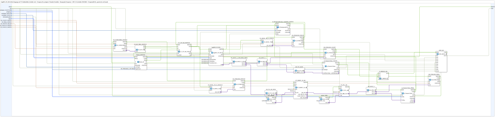

# logiBUS_PI_IDA_OPC

* * * * * * * * * *

## Einleitung

`logiBUS_PI_IDA_OPC` bindet einen physischen Puls-/Zähler-Eingang (`logiBUS_PI_IDA`, ein Kanal) an zwei unabhängige VT-Zahlenfelder (roher Zählerstand und daraus abgeleitete Frequenz in Hz) sowie an OPC-UA an: der rohe Zählerstand (DWORD) wird direkt publiziert, die Frequenz wird per zeitlicher Ableitung (`FT_DERIV_10_AR`) aus dem Zählerstand berechnet, mit einem PT1-Glied (`FT_PT1_AR`) geglättet und separat publiziert (REAL, physikalisch skaliert über `NumericObjectPool_S`). Zusätzlich lässt sich der Kanal per VT-Taste oder per OPC-UA-Schalter ein- und ausschalten (Enable); eine Status-Anzeige (Hintergrundfarbe) und ein OPC-UA-Status melden Deaktiviert/Aktiv/Störung.

## Schnittstellenstruktur

### **Ereignis-Eingänge**

- **INIT** (`EInit`): Initialisierungsanforderung

### **Ereignis-Ausgänge**

- **INITO** (`EInit`): Initialisierungsbestätigung (von `Button_SWITCH.INITO`)

### **Daten-Eingänge**

- **QI** (`BOOL`, Vorgabe `TRUE`): Quality Input – TRUE gibt die Dienste frei
- **u16ObjId_COUNTVAR** (`UINT`, Vorgabe `ID_NULL`): Object ID der `CNumberVariable` für den rohen Zählerstand (unbegrenzt wachsend, Scale=1 im VT-Pool)
- **stObjFreq** (`NumericObjectPool_S`): Object ID + Scale/Offset/Decimals der `CNumberVariable` für die Frequenz in Hz (eigene, unabhängige Variable, keine Reskalierung des Zählers)
- **u16ObjId_SWITCH** (`UINT`, Vorgabe `ID_NULL`): Object ID der Kanal-Ein/Aus-Taste auf der VT (ein Tastendruck togglet das Enable, über `Button_IE`)
- **u16ObjId_STATUS** (`UINT`, Vorgabe `ID_NULL`): Object ID der Status-Anzeige (Hintergrundfarbe Weiß = Kanal deaktiviert, Grün = aktiv und `logiBUS_PI_IDA.QO` TRUE, Rot = aktiv und `QO` FALSE, Störung)
- **bDefaultEnabled** (`BOOL`): Kanal-Zustand beim Start (TRUE = aktiv, z. B. Kanäle 1–4; FALSE = inaktiv, z. B. Kanäle 5–8, da nur 4 Kanäle gleichzeitig verfügbar sind)
- **Input** (`logiBUS::io::PI::logiBUS_PI_S`): Auswahl des Eingangs `PulseInput_I1`..`I8` (Vorgabe `logiBUS_PI::Invalid`)
- **ID_COUNT_WRITE** (`WSTRING`): Zähler-Rückmelde-Adresse (DWORD, roh, `ACTION=PUBLISH`)
- **ID_FREQ_WRITE** (`WSTRING`): Frequenz-Rückmelde-Adresse (REAL Hz, `ACTION=PUBLISH`)
- **ID_SWITCH_READ** (`WSTRING`): Remote-Schalter-Adresse (BOOL, `ACTION=SUBSCRIBE`, togglet das Kanal-Enable wie ein Tastendruck)
- **ID_SWITCH_WRITE** (`WSTRING`): Echo-Rückmelde-Adresse (BOOL, `ACTION=PUBLISH`, aktueller Kanal-Enable-Zustand)
- **ID_STATUS_WRITE** (`WSTRING`): Status-Rückmelde-Adresse (BOOL, `ACTION=PUBLISH`, nur lesend, `logiBUS_PI_IDA.QO`)

### **Daten-Ausgänge**

- **QO** (`BOOL`): Quality Output – TRUE, wenn die Dienste erfolgreich ausgeführt wurden (`AND_QO`, `AND_BOOL_10`: UND aus `Q_NumericValue_COUNT.QO`, `Q_NumericValue_FREQ.QO`, `Q_BackgroundColour_EnableOk_STATUS.QO`, `AD_PUBLISH_COUNT.QO`, `AR_PUBLISH_FREQ.QO`, `E_T_FF_SR_SWITCH.QO`, `Button_SWITCH.QO`, `AX_SUBSCRIBE_SWITCH.QO`, `AX_PUBLISH_SWITCH.QO` und `AX_PUBLISH_STATUS.QO`)

## Verwendete Funktionsbausteine (FBs)

### Sub-Bausteine: logiBUS_PI_IDA_OPC

- **Typ**: SubAppType
- **Verwendete interne FBs**:
    - **logiBUS_PI_IDA**: `logiBUS::io::PI::logiBUS_PI_IDA` — physischer Puls-Eingang, `ImpulseDelta=DWORD#100`, `TimeDelta=DWORD#250`, `TimeRateLimit=DWORD#100`; `QI` kommt vom Kanal-Enable (`E_T_FF_SR_SWITCH.Q`).
    - **AD_SPLIT_2_UNGATED_FREQ**: `adapter::events::unidirectional::AD_SPLIT_2_UNGATED` — verzweigt den DWORD-Zählerwert in den Zähler- und den Frequenzzweig.
    - **AD_SPLIT_2**: `adapter::events::unidirectional::AD_SPLIT_2` — verzweigt den Zählerwert auf OPC-UA-Publish und VT-Anzeige.
    - **AD_PUBLISH_COUNT**: `adapter::net::AD_PUBLISH_1` — publiziert den rohen Zählerstand per OPC-UA, Zieladresse `ID_COUNT_WRITE`.
    - **AD_TO_AUDI**: `adapter::conversion::unidirectional::AD_TO_AUDI` — Bit-Reinterpretation DWORD→UDINT für das VT-Zählerfeld.
    - **Q_NumericValue_COUNT**: `isobus::UT::Q::Q_NumericValue_AUDI` — schreibt den rohen Zählerstand in `u16ObjId_COUNTVAR`.
    - **AD_TO_AR_NUM**: `adapter::conversion::unidirectional::AD_TO_AR_NUM` — numerisch korrekte Umwandlung DWORD-Zählerstand → REAL für die Ableitung.
    - **FT_DERIV_10_AR**: `OSCAT_adapter::Control::FT_DERIV_10_AR` (`Faktor=1.0`, `run=TRUE`) — zeitliche Ableitung, liefert die Änderungsrate des Zählerstands = Frequenz in Hz; der Parameter `K` ist ein AUI-Adapter-Socket und wird von `LIT_DerivK` (`adapter::types::unidirectional::AUI::initval::initval_AUI`, `INIT_VAL=9`) gespeist.
    - **FT_PT1_AR**: `OSCAT_adapter::Control::FT_PT1_AR` (`K=1.0`) — PT1-Glättung der Frequenz; die Zeitkonstante `TM` kommt von `initval_ATM` (`adapter::types::unidirectional::ATM::initval::initval_ATM`, `INIT_VAL=T#2s`).
    - **AR_SPLIT_2**: `adapter::events::unidirectional::AR_SPLIT_2` — verzweigt den geglätteten Frequenzwert auf zwei Ausgänge.
    - **AR_PUBLISH_FREQ**: `adapter::net::AR_PUBLISH_1` — publiziert die Frequenz per OPC-UA, Zieladresse `ID_FREQ_WRITE`.
    - **Q_NumericValue_FREQ**: `isobus::UT::Q::Q_NumericValue_PHYSA` — schreibt die Frequenz physikalisch skaliert (`stObjFreq`: `r32Scale`, `i32Offset`, `u8Decimals`) in das VT-Zahlenfeld/Bargraph.
    - **Button_SWITCH**: `isobus::UT::io::Button::Button_IE` (`InputEvent=BT_PRESSED_LATCHED`) — liest die Kanal-Ein/Aus-Taste (`u16ObjId_SWITCH`).
    - **AX_SUBSCRIBE_SWITCH** / **AX_RF_TRIG_SWITCH**: `adapter::net::AX_SUBSCRIBE_1` und `adapter::events::unidirectional::AX_RF_TRIG` — Remote-Schalter (`ID_SWITCH_READ`) mit Flankenerkennung (`ER` → Set, `EF` → Reset des Enable-Flipflops).
    - **E_T_FF_SR_SWITCH**: `iec61499::events::E_T_FF_SR_SYM_INIT` — Enable-Flipflop (`Q_INIT = bDefaultEnabled`); `Button_SWITCH.IND` taktet `CLK`.
    - **AX_BOOL_TO_X_SWITCH** / **AX_PUBLISH_SWITCH**: `adapter::conversion::unidirectional::AX_BOOL_TO_X` und `adapter::net::AX_PUBLISH_1` — publizieren den Enable-Zustand (`ID_SWITCH_WRITE`).
    - **Q_BackgroundColour_EnableOk_STATUS**: SubApp `MyLib::sys::Q_BackgroundColour_EnableOk_A` — Status-Hintergrundfarbe (`u16ObjId_STATUS`, `bEnable` = Enable, `bOk` = `logiBUS_PI_IDA.QO`).
    - **AX_BOOL_TO_X_STATUS** / **AX_PUBLISH_STATUS**: `adapter::conversion::unidirectional::AX_BOOL_TO_X` und `adapter::net::AX_PUBLISH_1` — publizieren `logiBUS_PI_IDA.QO` (`ID_STATUS_WRITE`).
    - **E_MERGE_QO**: `iec61499::events::E_MERGE_3` — vereint `Q_NumericValue_FREQ.INITO`, `Q_NumericValue_COUNT.CNF` und `Q_NumericValue_FREQ.CNF`; sein Ausgang `EO` ist im Netzwerk nicht weiterverdrahtet.
    - **AND_QO**: `iec61131::booleanOperators::AND_BOOL_10` — bildet `QO` (siehe Daten-Ausgänge).
- **Funktionsweise**: Der rohe Zählerstand wird verzweigt: ein Zweig geht direkt an die OPC-UA-Publikation, ein zweiter über `AD_TO_AUDI` an das VT-Zählerfeld, ein dritter über `AD_TO_AR_NUM`, `FT_DERIV_10_AR` und `FT_PT1_AR` zur Frequenzberechnung, deren Ergebnis wiederum verdoppelt wird (OPC-UA-Publikation und VT-Anzeige). Das Kanal-Enable (Taste, Remote-Schalter) gibt `logiBUS_PI_IDA` frei.

## Programmablauf und Verbindungen

1. `Input` → `logiBUS_PI_IDA.Input`; `u16ObjId_COUNTVAR` → `Q_NumericValue_COUNT.u16ObjId`; `stObjFreq` → `Q_NumericValue_FREQ.stObj`; `ID_COUNT_WRITE` → `AD_PUBLISH_COUNT.ID`; `ID_FREQ_WRITE` → `AR_PUBLISH_FREQ.ID`.
2. `logiBUS_PI_IDA.IN` (Adapter) → `AD_SPLIT_2_UNGATED_FREQ.IN`; `AD_SPLIT_2_UNGATED_FREQ.OUT1` → `AD_SPLIT_2.IN`; `AD_SPLIT_2_UNGATED_FREQ.OUT2` → `AD_TO_AR_NUM.AD_IN`.
3. `AD_SPLIT_2.OUT1` → `AD_PUBLISH_COUNT.IN` (Zählerstand-OPC-UA-Zweig).
4. `AD_SPLIT_2.OUT2` → `AD_TO_AUDI.AD_IN`; `AD_TO_AUDI.AUDI_OUT` → `Q_NumericValue_COUNT.u32NewValue` (VT-Zählerstand-Zweig).
5. `AD_TO_AR_NUM.AR_OUT` → `FT_DERIV_10_AR.AR_IN`; `LIT_DerivK.OUT` → `FT_DERIV_10_AR.K`; `FT_DERIV_10_AR.AR_OUT` → `FT_PT1_AR.AR_IN` (mit `initval_ATM.OUT` → `FT_PT1_AR.TM`); `FT_PT1_AR.AR_OUT` → `AR_SPLIT_2.IN` (Frequenz-Berechnungszweig).
6. `AR_SPLIT_2.OUT1` → `AR_PUBLISH_FREQ.IN` (Frequenz-OPC-UA-Zweig).
7. `AR_SPLIT_2.OUT2` → `Q_NumericValue_FREQ.rPhys` (Frequenz-VT-Zweig).
8. **Kanal-Enable**: `Button_SWITCH.IND` → `E_T_FF_SR_SWITCH.CLK`; `AX_SUBSCRIBE_SWITCH.OUT` → `AX_RF_TRIG_SWITCH.QI`, `AX_RF_TRIG_SWITCH.ER` → `E_T_FF_SR_SWITCH.S`, `AX_RF_TRIG_SWITCH.EF` → `E_T_FF_SR_SWITCH.R`; `bDefaultEnabled` → `E_T_FF_SR_SWITCH.Q_INIT`; `E_T_FF_SR_SWITCH.Q` → `logiBUS_PI_IDA.QI`, `Q_BackgroundColour_EnableOk_STATUS.bEnable` und `AX_BOOL_TO_X_SWITCH.OUT` (→ `AX_PUBLISH_SWITCH.IN`); `E_T_FF_SR_SWITCH.EO` → `logiBUS_PI_IDA.INIT`, `Q_BackgroundColour_EnableOk_STATUS.REQ` und `AX_BOOL_TO_X_SWITCH.REQ`.
9. **Status**: `logiBUS_PI_IDA.QO` → `Q_BackgroundColour_EnableOk_STATUS.bOk` und `AX_BOOL_TO_X_STATUS.OUT` (→ `AX_PUBLISH_STATUS.IN`); `logiBUS_PI_IDA.INITO` → `Q_BackgroundColour_EnableOk_STATUS.REQ` und `AX_BOOL_TO_X_STATUS.REQ`; `u16ObjId_STATUS` → `Q_BackgroundColour_EnableOk_STATUS.u16ObjId`.
10. **Initialisierungskette**: `INIT` → `Q_NumericValue_COUNT.INIT` → `Q_NumericValue_FREQ.INIT` → `Q_BackgroundColour_EnableOk_STATUS.INIT` → `AD_PUBLISH_COUNT.INIT` → `Button_SWITCH.INIT` → `INITO` (und → `AND_QO.REQ`). Parallel läuft von `AD_PUBLISH_COUNT.INITO` die Kette `AR_PUBLISH_FREQ` → `AX_SUBSCRIBE_SWITCH` → `AX_PUBLISH_SWITCH` → `AX_PUBLISH_STATUS` → `E_T_FF_SR_SWITCH` (jeweils `INITO` → nächstes `INIT`); `initval_ATM.INITO` → `FT_PT1_AR.INIT`.
11. **Qualität**: `QI` → `.QI` von `Q_NumericValue_COUNT`, `Q_NumericValue_FREQ`, `AD_PUBLISH_COUNT`, `AR_PUBLISH_FREQ`, `E_T_FF_SR_SWITCH`, `Button_SWITCH`, `AX_SUBSCRIBE_SWITCH`, `AX_PUBLISH_SWITCH`, `AX_PUBLISH_STATUS` und `Q_BackgroundColour_EnableOk_STATUS`; deren `QO`-Ausgänge → `AND_QO.IN1`..`IN10`; `AND_QO.OUT` → `QO`.

## Technische Besonderheiten

- Die Frequenz wird nicht vom Hardware-FB selbst geliefert, sondern rein aus der zeitlichen Ableitung (`FT_DERIV_10_AR`, `Faktor=1.0`, `K=9`) des rohen, monoton wachsenden Zählerstands berechnet und mit `FT_PT1_AR` (`TM=T#2s`) geglättet — der Zähler selbst wird nie zurückgesetzt.
- `K` von `FT_DERIV_10_AR` ist ein AUI-Adapter-Socket und kein Parameter mehr (Version 1.1); der Wert 9 kommt über `LIT_DerivK`.
- `AD_TO_AR_NUM` statt `AD_TO_AR` wird bewusst verwendet, um eine numerisch korrekte DWORD→REAL-Umwandlung zu erhalten statt einer Bit-Reinterpretation (dieselbe Falle wie bei [`F_AI_RAW_TO_PERCENT_AD`](./F_AI_RAW_TO_PERCENT_AD.md) beschrieben).
- Zählerstand und Frequenz nutzen unabhängige VT-Zahlenfelder (`u16ObjId_COUNTVAR` und `stObjFreq`) mit unterschiedlicher Skalierung — die Frequenz-Anzeige nutzt zusätzlich `NumericObjectPool_S` für physikalisches Scaling/Decimals, der Zählerstand nicht.
- Die `QI`-Eingänge der internen Bausteine sind nicht mehr fest auf `TRUE` parametriert, sondern werden über `QI` der SubApp freigegeben (Ausnahme: `logiBUS_PI_IDA.QI` hängt am Kanal-Enable).

## Anwendungsszenarien

- Durchflusszähler oder Drehzahlmesser, bei denen sowohl der rohe (unbegrenzt wachsende) Zählerstand für Diagnosezwecke als auch eine daraus abgeleitete, sofort interpretierbare Frequenz (z. B. Hz, U/min) angezeigt und übertragen werden sollen; der Kanal ist per VT-Taste oder OPC-UA ein- und ausschaltbar.

## Zusammenfassung

Vollständige VT- und OPC-UA-Anbindung eines physischen Puls-Eingangs mit parallelem rohem Zählerstand, daraus per zeitlicher Ableitung und PT1-Glättung berechneter Frequenz sowie schaltbarem Kanal-Enable mit Status-Anzeige; `INIT`/`INITO` sind durch die Dienste gekettet, `QO` ist das UND der Dienste.

---

### 🌐 Passende Themen-Unterseiten auf ms-muc-docs.de

- [🌐 Eclipse 4diac IDE & Farb-Referenz auf ms-muc-docs.de](https://www.ms-muc-docs.de/iec-61499/eclipse-4diac/)
