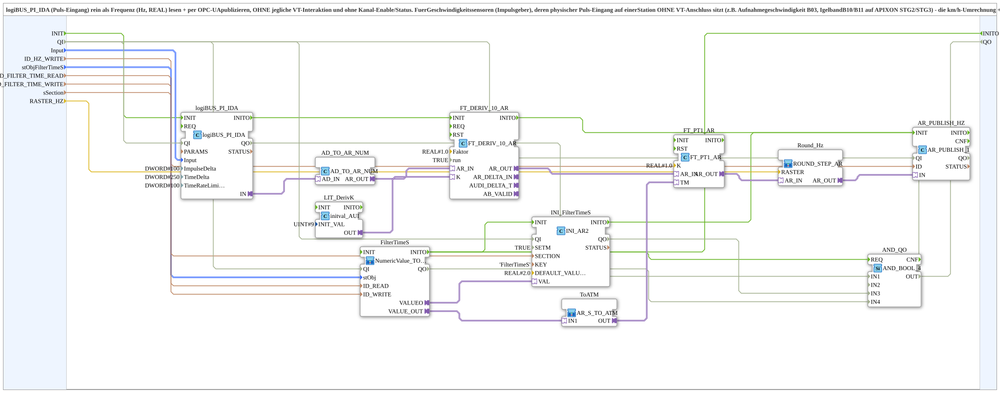
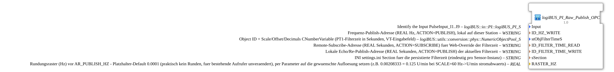

# logiBUS_PI_Raw_Publish_OPC

* * * * * * * * * *

## Einleitung

`logiBUS_PI_Raw_Publish_OPC` liest einen logiBUS-Pulseingang (`logiBUS_PI_IDA`) rein als **Frequenz (Hz, `REAL`)** und veröffentlicht diese per OPC-UA – **ohne jegliche VT-Interaktion** und ohne Kanal-Enable/Status. Er ist für Geschwindigkeitssensoren (Impulsgeber) gedacht, deren physischer Puls-Eingang auf einer Station **ohne VT-Anschluss** sitzt (z. B. Aufnahmegeschwindigkeit B03, Igelband B10/B11 auf APIXON STG2/STG3). Die km/h-Umrechnung und VT-Anzeige laufen dann auf der Station mit VT-Anschluss, gespeist per Remote-Subscribe dieser Frequenz (analog zu `logiBUS_AI_Raw_Publish_OPC`/`logiBUS_AI_Calibrate_Remote_IDA_OPC`).

## Schnittstellenstruktur

### **Ereignis-Eingänge**

- **INIT** (`EInit`): Initialization Request

### **Ereignis-Ausgänge**

- **INITO** (`EInit`): Initialization Confirm

### **Daten-Eingänge**

- **QI** (`BOOL`, Vorgabe `TRUE`): Quality Input, TRUE aktiviert den Dienst
- **Input** (`logiBUS::io::PI::logiBUS_PI_S`, Vorgabe `logiBUS_PI::Invalid`): Identifiziert den Pulseingang `PulseInput_I1..I9`
- **ID_HZ_WRITE** (`WSTRING`): Frequenz-Publish-Adresse (`REAL` Hz, `ACTION=PUBLISH`), lokal auf dieser Station
- **stObjFilterTimeS** (`NumericObjectPool_S`): Object-ID + Scale/Offset/Decimals der `CNumberVariable` für die PT1-Filterzeit in Sekunden (VT-Eingabefeld)
- **ID_FILTER_TIME_READ** (`WSTRING`): Remote-Subscribe-Adresse (`REAL` Sekunden, `ACTION=SUBSCRIBE`) für den Web-Override der Filterzeit
- **ID_FILTER_TIME_WRITE** (`WSTRING`): Lokale Echo-/Re-Publish-Adresse (`REAL` Sekunden, `ACTION=PUBLISH`) der aktuellen Filterzeit
- **sSection** (`STRING`): INI-Sektion in `settings.ini` für die persistierte Filterzeit (eindeutig pro Sensor-Instanz)
- **RASTER_HZ** (`REAL`, Vorgabe `0.0001`): Rundungsraster (Hz) vor `AR_PUBLISH_HZ`. Der Vorgabewert entspricht praktisch keinem Runden (für bestehende Aufrufer unverändert); per Parameter auf die gewünschte Auflösung setzen (z. B. `0.00208333` = 0,125 U/min bei `SCALE=60` Hz → U/min stromabwärts)

### **Daten-Ausgänge**

- **QO** (`BOOL`): Quality Output, UND-Verknüpfung (`AND_QO`, `AND_BOOL_4`) der `QO`-Ausgänge von `logiBUS_PI_IDA`, `AR_PUBLISH_HZ`, `INI_FilterTimeS` und `FilterTimeS`

### **Adapter**

Dieser Funktionsblock hat keine Adapter an der Schnittstelle; intern werden `AR`-/`AD`-Adapter verwendet.

## Verwendete Funktionsbausteine (FBs)

- **logiBUS_PI_IDA**: `logiBUS::io::PI::logiBUS_PI_IDA` (`ImpulseDelta=100`, `TimeDelta=250`, `TimeRateLimit=100`) – Pulseingang als `AD`-Adapter
- **AD_TO_AR_NUM**: `adapter::conversion::unidirectional::AD_TO_AR_NUM` – wandelt den Zählwert in `REAL`
- **FT_DERIV_10_AR**: `OSCAT_adapter::Control::FT_DERIV_10_AR` (`Faktor=1.0`, `run=TRUE`) – Ableitung (Impulse pro Zeit = Frequenz)
- **LIT_DerivK**: `initval_AUI` (`INIT_VAL=9`) – Konstante `K` der Ableitung
- **FT_PT1_AR**: `OSCAT_adapter::Control::FT_PT1_AR` (`K=1.0`) – PT1-Filter
- **Round_Hz**: `OSCAT_adapter::Mathematical::ROUND_STEP_AR` – rundet auf das Raster `RASTER_HZ`
- **AR_PUBLISH_HZ**: [`adapter::net::AR_PUBLISH_1`](../../adapter/net/AR_PUBLISH_1.md) – publiziert die Frequenz
- **FilterTimeS**: SubApp `MyLib::sys::NumericValue_TO_AR2_OPC` – Filterzeit aus VT-Eingabefeld bzw. OPC-UA
- **INI_FilterTimeS**: `eclipse4diac::storage::INI_AR2` (`SETM=TRUE`, `KEY='FilterTimeS'`, Vorgabe `2.0`) – persistiert die Filterzeit
- **ToATM**: SubApp `MyLib::sys::AR_S_TO_ATM` – wandelt Sekunden in einen `ATM`-Zeitwert
- **AND_QO**: `iec61131::booleanOperators::AND_BOOL_4` – verknüpft die `QO`-Ausgänge von `logiBUS_PI_IDA`, `AR_PUBLISH_HZ`, `INI_FilterTimeS` und `FilterTimeS` zu `QO`

## Programmablauf und Verbindungen

1. `Input` → `logiBUS_PI_IDA.Input`; `logiBUS_PI_IDA.IN` → `AD_TO_AR_NUM.AD_IN`.
2. `AD_TO_AR_NUM.AR_OUT` → `FT_DERIV_10_AR.AR_IN`; `LIT_DerivK.OUT` → `FT_DERIV_10_AR.K`.
3. `FT_DERIV_10_AR.AR_OUT` → `FT_PT1_AR.AR_IN`.
4. Filterzeit: `FilterTimeS.VALUEO` → `INI_FilterTimeS.VAL` (Persistenz); `FilterTimeS.VALUE_OUT` → `ToATM.IN1`; `ToATM.OUT` → `FT_PT1_AR.TM`.
5. `FT_PT1_AR.AR_OUT` → `Round_Hz.AR_IN` (`RASTER_HZ` → `Round_Hz.RASTER`) → `AR_PUBLISH_HZ.IN`.
6. `ID_HZ_WRITE` → `AR_PUBLISH_HZ.ID`.
7. Initialisierung: `INIT` → `logiBUS_PI_IDA.INIT`; `logiBUS_PI_IDA.INITO` → `AR_PUBLISH_HZ.INIT`; `AR_PUBLISH_HZ.INITO` → `INI_FilterTimeS.INIT`; `INI_FilterTimeS.INITO` → `FilterTimeS.INIT`; `FilterTimeS.INITO` → `INITO` und → `AND_QO.REQ`.
8. Qualität: `QI` wird an `logiBUS_PI_IDA`, `AR_PUBLISH_HZ`, `INI_FilterTimeS` und `FilterTimeS` verteilt (kein fest verdrahteter `QI`-Parameter mehr); deren `QO` → `AND_QO.IN1` bis `AND_QO.IN4` (in dieser Reihenfolge); `AND_QO.OUT` → `QO`.

## Technische Besonderheiten

- Keine VT-Interaktion für die Frequenz selbst, kein Kanal-Enable und kein Status.
- Die Filterzeit ist INI-persistiert und kann über das VT-Eingabefeld oder OPC-UA geändert werden.
- Mit `RASTER_HZ` lässt sich die Auflösung begrenzen, um unnötige Publish-Ereignisse zu vermeiden.

## Anwendungsszenarien

- Geschwindigkeits-/Drehzahlsensoren auf Stationen ohne VT, deren Frequenz per OPC-UA zur VT-Station übertragen wird (z. B. ergänzt durch `AR_HZ_TO_Q_Publish_OPC` auf der VT-Station)

## Fazit

`logiBUS_PI_Raw_Publish_OPC` erzeugt aus einem Pulseingang eine gefilterte, gerundete Frequenz in Hz und publiziert sie per OPC-UA.
