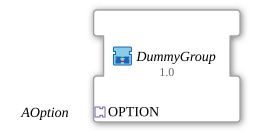

# DummyGroup

* * * * * * * * * *

## Einleitung

`DummyGroup` ist eine Platzhalter-Optionsgruppe ohne reale E/A. Sie quittiert `INIT_REQ` sofort selbst per `INIT_CNF` (kein `QI`-Einfluss, keine Wirkung). Sie dient als neutraler, unbelegter Slot in einem `AOption_AUI_DEMUX`, z. B. für "nichts ausgewählt" bei `K=1`, wenn echte Optionen erst ab `K=2` beginnen. So entfällt ein Override-Literal für "welcher Zahlenwert bedeutet Aus".

## Verwendete Funktionsbausteine (FBs)

### Sub-Bausteine: DummyGroup

- **Typ**: SubAppType
- **Schnittstelle**: Socket `OPTION` vom Typ `Option::AOption`.
- **Verwendete interne FBs**:
    - **AOption_X_TO_EVENT**: `Option::conversion::AOption_X_TO_EVENT`.

## Programmablauf und Verbindungen

- `OPTION` -> `AOption_X_TO_EVENT.AOption_IN`
- `AOption_X_TO_EVENT.INIT_REQ` -> `AOption_X_TO_EVENT.INIT_CNF` (Selbstquittung)

`QI_OUT` bleibt unbenutzt.

## Technische Besonderheiten

- Keine E/A-Bausteine, keine Wirkung auf die Anwendung.

## Anwendungsszenarien

- Neutraler Slot in einem Option-DEMUX, z. B. `AOption_AUI_DEMUX_n`.

## Zusammenfassung

`DummyGroup` ist eine wirkungslose Optionsgruppe, die Anforderungen sofort bestätigt.

## 🛠️ Zugehörige Übungen

- [Uebung_094b2_AX](https://meisterschulen-am-ostbahnhof-munchen-docs.readthedocs.io/projects/4diac-exercises-docs/de/latest/Uebungen/test_AX/Uebungen_doc/Uebung_094b2_AX/)
- [Uebung_094b3_AX](https://meisterschulen-am-ostbahnhof-munchen-docs.readthedocs.io/projects/4diac-exercises-docs/de/latest/Uebungen/test_AX/Uebungen_doc/Uebung_094b3_AX/)
- [Uebung_094b3b_AX](https://meisterschulen-am-ostbahnhof-munchen-docs.readthedocs.io/projects/4diac-exercises-docs/de/latest/Uebungen/test_AX/Uebungen_doc/Uebung_094b3b_AX/)

