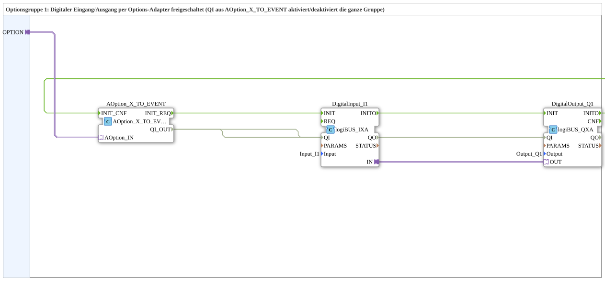
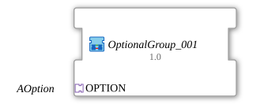

# OptionalGroup_001

* * * * * * * * * *

## Einleitung

`OptionalGroup_001` ist eine SubApp (Bibliothek `MyLib_AX_Option`): Optionsgruppe 1, deren digitaler Eingang `Input_I1` und digitaler Ausgang `Output_Q1` (logiBUS) per Options-Adapter freigeschaltet werden. Das `QI` aus [`AOption_X_TO_EVENT`](../../Option/conversion/AOption_X_TO_EVENT.md) aktiviert bzw. deaktiviert die ganze Gruppe.

## Verwendete Funktionsbausteine (FBs)

### Sub-Bausteine: OptionalGroup_001

- **Typ**: SubAppType
- **Schnittstelle**: Socket `AOption_IN` vom Typ `Option::AOption`.
- **Verwendete interne FBs**:
    - **AOption_X_TO_EVENT**: `Option::conversion::AOption_X_TO_EVENT`, setzt den Adapter in `INIT_REQ`/`QI_OUT`/`INIT_CNF` um.
    - **DigitalInput_I1**: `logiBUS::io::DI::logiBUS_IXA`, Parameter `Input = Input_I1`.
    - **DigitalOutput_Q1**: `logiBUS::io::DQ::logiBUS_QXA`, Parameter `Output = Output_Q1`.

## Programmablauf und Verbindungen

- `AOption_IN` -> `AOption_X_TO_EVENT.AOption_IN`
- Init-Kette: `AOption_X_TO_EVENT.INIT_REQ` -> `DigitalInput_I1.INIT`; `DigitalInput_I1.INITO` -> `DigitalOutput_Q1.INIT`; `DigitalOutput_Q1.INITO` -> `AOption_X_TO_EVENT.INIT_CNF`
- `AOption_X_TO_EVENT.QI_OUT` -> `DigitalInput_I1.QI` und `DigitalOutput_Q1.QI`
- Adapterverbindung `DigitalInput_I1.IN` -> `DigitalOutput_Q1.OUT`: der Eingang wird auf den Ausgang durchgeschaltet.

## Technische Besonderheiten

- Die Initialisierung (Eingang, dann Ausgang) wird erst dann an den Plug quittiert, wenn beide Bausteine fertig sind.
- Das `QI` der Gruppe wird an `QI` von Eingang und Ausgang weitergegeben.

## Anwendungsszenarien

- Optionaler digitaler Ein-/Ausgang, der über einen Auswahlbaustein wie [`AOption_AD_DEMUX_2`](../../Option/selection/AOption_AD_DEMUX_2.md) zu- oder abgeschaltet wird.

## Zusammenfassung

`OptionalGroup_001` bündelt `Input_I1` und `Output_Q1` zu einer per `AOption` ein- und ausschaltbaren Optionsgruppe.

## 🛠️ Zugehörige Übungen

- [Uebung_094b2_AX](https://meisterschulen-am-ostbahnhof-munchen-docs.readthedocs.io/projects/4diac-exercises-docs/de/latest/Uebungen/test_AX/Uebungen_doc/Uebung_094b2_AX/)
- [Uebung_094b3_AX](https://meisterschulen-am-ostbahnhof-munchen-docs.readthedocs.io/projects/4diac-exercises-docs/de/latest/Uebungen/test_AX/Uebungen_doc/Uebung_094b3_AX/)
- [Uebung_094b3b_AX](https://meisterschulen-am-ostbahnhof-munchen-docs.readthedocs.io/projects/4diac-exercises-docs/de/latest/Uebungen/test_AX/Uebungen_doc/Uebung_094b3b_AX/)
- [Uebung_094b4_AX](https://meisterschulen-am-ostbahnhof-munchen-docs.readthedocs.io/projects/4diac-exercises-docs/de/latest/Uebungen/test_AX/Uebungen_doc/Uebung_094b4_AX/)
- [Uebung_094b4b_AX](https://meisterschulen-am-ostbahnhof-munchen-docs.readthedocs.io/projects/4diac-exercises-docs/de/latest/Uebungen/test_AX/Uebungen_doc/Uebung_094b4b_AX/)
- [Uebung_094b5_AX](https://meisterschulen-am-ostbahnhof-munchen-docs.readthedocs.io/projects/4diac-exercises-docs/de/latest/Uebungen/test_AX/Uebungen_doc/Uebung_094b5_AX/)
- [Uebung_094b5b_AX](https://meisterschulen-am-ostbahnhof-munchen-docs.readthedocs.io/projects/4diac-exercises-docs/de/latest/Uebungen/test_AX/Uebungen_doc/Uebung_094b5b_AX/)
- [Uebung_094b_AX](https://meisterschulen-am-ostbahnhof-munchen-docs.readthedocs.io/projects/4diac-exercises-docs/de/latest/Uebungen/test_AX/Uebungen_doc/Uebung_094b_AX/)
- [Uebung_094c2_AX](https://meisterschulen-am-ostbahnhof-munchen-docs.readthedocs.io/projects/4diac-exercises-docs/de/latest/Uebungen/test_AX/Uebungen_doc/Uebung_094c2_AX/)
- [Uebung_094c2b_AX](https://meisterschulen-am-ostbahnhof-munchen-docs.readthedocs.io/projects/4diac-exercises-docs/de/latest/Uebungen/test_AX/Uebungen_doc/Uebung_094c2b_AX/)
- [Uebung_094c_AX](https://meisterschulen-am-ostbahnhof-munchen-docs.readthedocs.io/projects/4diac-exercises-docs/de/latest/Uebungen/test_AX/Uebungen_doc/Uebung_094c_AX/)

