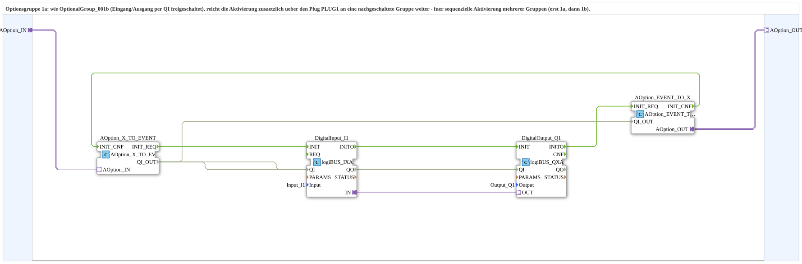

# OptionalGroup_001a

* * * * * * * * * *

## Einleitung

`OptionalGroup_001a` ist eine SubApp (Bibliothek `MyLib_AX_Option`): Optionsgruppe 1a. Wie [`OptionalGroup_001b`](OptionalGroup_001b.md) werden digitaler Eingang `Input_I1` und digitaler Ausgang `Output_Q1` (logiBUS) per Options-Adapter freigeschaltet. Zusätzlich reicht die Gruppe die Aktivierung über den Plug `PLUG1` an eine nachgeschaltete Gruppe weiter - für die sequenzielle Aktivierung mehrerer Gruppen (erst 1a, dann 1b).

## Verwendete Funktionsbausteine (FBs)

### Sub-Bausteine: OptionalGroup_001a

- **Typ**: SubAppType
- **Schnittstelle**: Socket `OPTION` vom Typ `Option::AOption` (Adapter-Eingang) und Plug `PLUG1` vom Typ `Option::AOption` (Adapter-Ausgang).
- **Verwendete interne FBs**:
    - **AOption_X_TO_EVENT**: `Option::conversion::AOption_X_TO_EVENT`, setzt den Adapter am Socket in `INIT_REQ`/`QI_OUT`/`INIT_CNF` um.
    - **DigitalInput_I1**: `logiBUS::io::DI::logiBUS_IXA`, Parameter `Input = Input_I1`.
    - **DigitalOutput_Q1**: `logiBUS::io::DQ::logiBUS_QXA`, Parameter `Output = Output_Q1`.
    - **AOption_EVENT_TO_X**: `Option::conversion::AOption_EVENT_TO_X`, setzt `INIT_REQ`/`QI_OUT` in den Adapter am Plug `PLUG1` um und meldet `INIT_CNF` zurück.

## Programmablauf und Verbindungen

- `OPTION` -> `AOption_X_TO_EVENT.AOption_IN`
- Init-Kette: `AOption_X_TO_EVENT.INIT_REQ` -> `DigitalInput_I1.INIT`; `DigitalInput_I1.INITO` -> `DigitalOutput_Q1.INIT`; `DigitalOutput_Q1.INITO` -> `AOption_EVENT_TO_X.INIT_REQ`; `AOption_EVENT_TO_X.INIT_CNF` -> `AOption_X_TO_EVENT.INIT_CNF`
- `AOption_X_TO_EVENT.QI_OUT` -> `DigitalInput_I1.QI`, `DigitalOutput_Q1.QI` und `AOption_EVENT_TO_X.QI_OUT`
- `AOption_EVENT_TO_X.AOption_OUT` -> `PLUG1`
- Adapterverbindung `DigitalInput_I1.IN` -> `DigitalOutput_Q1.OUT`: der Eingang wird auf den Ausgang durchgeschaltet.

## Technische Besonderheiten

- `PLUG1` wird erst ausgelöst, wenn `DigitalOutput_Q1` selbst initialisiert ist (`DigitalOutput_Q1.INITO` -> `AOption_EVENT_TO_X.INIT_REQ`).
- Dessen `INIT_CNF` wird an den eigenen Socket `OPTION` zurückgemeldet. Der aufrufende DEMUX sieht die Gruppe daher erst als fertig, wenn die gesamte Kette (inklusive nachgeschalteter Gruppen an `PLUG1`) bestätigt hat.
- Das `QI` der Gruppe wird an Eingang, Ausgang und den Plug `PLUG1` weitergegeben.

## Anwendungsszenarien

- Erstes Glied einer Daisy-Chain: `PLUG1` wird mit dem Socket einer nachgeschalteten Gruppe wie [`OptionalGroup_001b`](OptionalGroup_001b.md) verbunden, sodass beide Gruppen nacheinander (erst a, dann b) aktiviert werden.

## Zusammenfassung

`OptionalGroup_001a` bündelt `Input_I1` und `Output_Q1` zu einer per `AOption` schaltbaren Optionsgruppe und reicht die Aktivierung über `PLUG1` an die nächste Gruppe weiter.

## 🛠️ Zugehörige Übungen

- [Uebung_094b3c_AX](https://meisterschulen-am-ostbahnhof-munchen-docs.readthedocs.io/projects/4diac-exercises-docs/de/latest/Uebungen/test_AX/Uebungen_doc/Uebung_094b3c_AX/)
