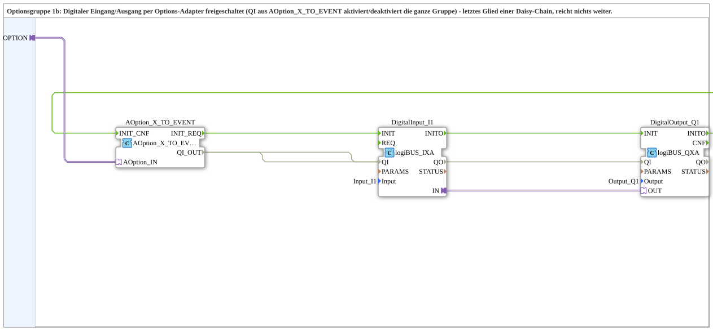
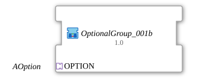

# OptionalGroup_001b

* * * * * * * * * *

## Einleitung

`OptionalGroup_001b` ist eine SubApp (Bibliothek `MyLib_AX_Option`): Optionsgruppe 1b, deren digitaler Eingang `Input_I1` und digitaler Ausgang `Output_Q1` (logiBUS) per Options-Adapter freigeschaltet werden. Das `QI` aus [`AOption_X_TO_EVENT`](../../Option/conversion/AOption_X_TO_EVENT.md) aktiviert bzw. deaktiviert die ganze Gruppe. Sie ist das letzte Glied einer Daisy-Chain und reicht nichts weiter.

## Verwendete Funktionsbausteine (FBs)

### Sub-Bausteine: OptionalGroup_001b

- **Typ**: SubAppType
- **Schnittstelle**: Socket `OPTION` vom Typ `Option::AOption`.
- **Verwendete interne FBs**:
    - **AOption_X_TO_EVENT**: `Option::conversion::AOption_X_TO_EVENT`, setzt den Adapter in `INIT_REQ`/`QI_OUT`/`INIT_CNF` um.
    - **DigitalInput_I1**: `logiBUS::io::DI::logiBUS_IXA`, Parameter `Input = Input_I1`.
    - **DigitalOutput_Q1**: `logiBUS::io::DQ::logiBUS_QXA`, Parameter `Output = Output_Q1`.

## Programmablauf und Verbindungen

- `OPTION` -> `AOption_X_TO_EVENT.AOption_IN`
- Init-Kette: `AOption_X_TO_EVENT.INIT_REQ` -> `DigitalInput_I1.INIT`; `DigitalInput_I1.INITO` -> `DigitalOutput_Q1.INIT`; `DigitalOutput_Q1.INITO` -> `AOption_X_TO_EVENT.INIT_CNF`
- `AOption_X_TO_EVENT.QI_OUT` -> `DigitalInput_I1.QI` und `DigitalOutput_Q1.QI`
- Adapterverbindung `DigitalInput_I1.IN` -> `DigitalOutput_Q1.OUT`: der Eingang wird auf den Ausgang durchgeschaltet.

## Technische Besonderheiten

- Baugleich zu [`OptionalGroup_001a`](OptionalGroup_001a.md), aber ohne Plug `PLUG1`.
- Die Initialisierung (Eingang, dann Ausgang) wird erst dann an den Socket quittiert, wenn beide Bausteine fertig sind.

## Anwendungsszenarien

- Wird typischerweise an `PLUG1` einer vorgeschalteten [`OptionalGroup_001a`](OptionalGroup_001a.md) angehängt, damit beide Gruppen nacheinander (erst a, dann b) aktiviert werden, bevor der ursprüngliche Aufrufer seine Bestätigung erhält.

## Zusammenfassung

`OptionalGroup_001b` bündelt `Input_I1` und `Output_Q1` zu einer per `AOption` schaltbaren Optionsgruppe und bildet das Ende einer Daisy-Chain.

## 🛠️ Zugehörige Übungen

- [Uebung_094b3c_AX](https://meisterschulen-am-ostbahnhof-munchen-docs.readthedocs.io/projects/4diac-exercises-docs/de/latest/Uebungen/test_AX/Uebungen_doc/Uebung_094b3c_AX/)
