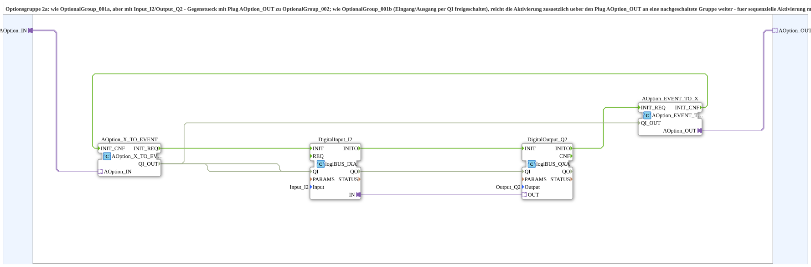
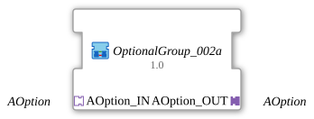

# OptionalGroup_002a

* * * * * * * * * *

## Einleitung

`OptionalGroup_002a` ist eine SubApp (Bibliothek `MyLib_AX_Option`): Optionsgruppe 2a. Wie [`OptionalGroup_001b`](OptionalGroup_001b.md) werden digitaler Eingang `Input_I2` und digitaler Ausgang `Output_Q2` (logiBUS) per Options-Adapter freigeschaltet. Zusätzlich reicht die Gruppe die Aktivierung über den Plug `AOption_OUT` an eine nachgeschaltete Gruppe weiter - für die sequenzielle Aktivierung mehrerer Gruppen (erst 2a, dann die nachgeschaltete Gruppe).

## Verwendete Funktionsbausteine (FBs)

### Sub-Bausteine: OptionalGroup_002a

- **Typ**: SubAppType
- **Schnittstelle**: Socket `AOption_IN` vom Typ `Option::AOption` (Adapter-Eingang) und Plug `AOption_OUT` vom Typ `Option::AOption` (Adapter-Ausgang).
- **Verwendete interne FBs**:
    - **AOption_X_TO_EVENT**: `Option::conversion::AOption_X_TO_EVENT`, setzt den Adapter am Socket in `INIT_REQ`/`QI_OUT`/`INIT_CNF` um.
    - **DigitalInput_I2**: `logiBUS::io::DI::logiBUS_IXA`, Parameter `Input = Input_I2`.
    - **DigitalOutput_Q2**: `logiBUS::io::DQ::logiBUS_QXA`, Parameter `Output = Output_Q2`.
    - **AOption_EVENT_TO_X**: `Option::conversion::AOption_EVENT_TO_X`, setzt `INIT_REQ`/`QI_OUT` in den Adapter am Plug `AOption_OUT` um und meldet `INIT_CNF` zurück.

## Programmablauf und Verbindungen

- `AOption_IN` -> `AOption_X_TO_EVENT.AOption_IN`
- Init-Kette: `AOption_X_TO_EVENT.INIT_REQ` -> `DigitalInput_I2.INIT`; `DigitalInput_I2.INITO` -> `DigitalOutput_Q2.INIT`; `DigitalOutput_Q2.INITO` -> `AOption_EVENT_TO_X.INIT_REQ`; `AOption_EVENT_TO_X.INIT_CNF` -> `AOption_X_TO_EVENT.INIT_CNF`
- `AOption_X_TO_EVENT.QI_OUT` -> `DigitalInput_I2.QI`, `DigitalOutput_Q2.QI` und `AOption_EVENT_TO_X.QI_OUT`
- `AOption_EVENT_TO_X.AOption_OUT` -> `AOption_OUT`
- Adapterverbindung `DigitalInput_I2.IN` -> `DigitalOutput_Q2.OUT`: der Eingang wird auf den Ausgang durchgeschaltet.

## Technische Besonderheiten

- `AOption_OUT` wird erst ausgelöst, wenn `DigitalOutput_Q2` selbst initialisiert ist (`DigitalOutput_Q2.INITO` -> `AOption_EVENT_TO_X.INIT_REQ`).
- Dessen `INIT_CNF` wird an den eigenen Socket `AOption_IN` zurückgemeldet. Der aufrufende DEMUX sieht die Gruppe daher erst als fertig, wenn die gesamte Kette (inklusive nachgeschalteter Gruppen an `AOption_OUT`) bestätigt hat.
- Das `QI` der Gruppe wird an Eingang, Ausgang und den Plug `AOption_OUT` weitergegeben.

## Anwendungsszenarien

- Erstes Glied einer Daisy-Chain: `AOption_OUT` wird mit dem Socket einer nachgeschalteten Gruppe wie [`OptionalGroup_001b`](OptionalGroup_001b.md) verbunden, sodass beide Gruppen nacheinander (erst a, dann b) aktiviert werden.

## Zusammenfassung

`OptionalGroup_002a` bündelt `Input_I2` und `Output_Q2` zu einer per `AOption` schaltbaren Optionsgruppe und reicht die Aktivierung über `AOption_OUT` an die nächste Gruppe weiter.

## 🛠️ Zugehörige Übungen

- [Uebung_094b3f_AX](https://meisterschulen-am-ostbahnhof-munchen-docs.readthedocs.io/projects/4diac-exercises-docs/de/latest/Uebungen/test_AX/Uebungen_doc/Uebung_094b3f_AX/)

