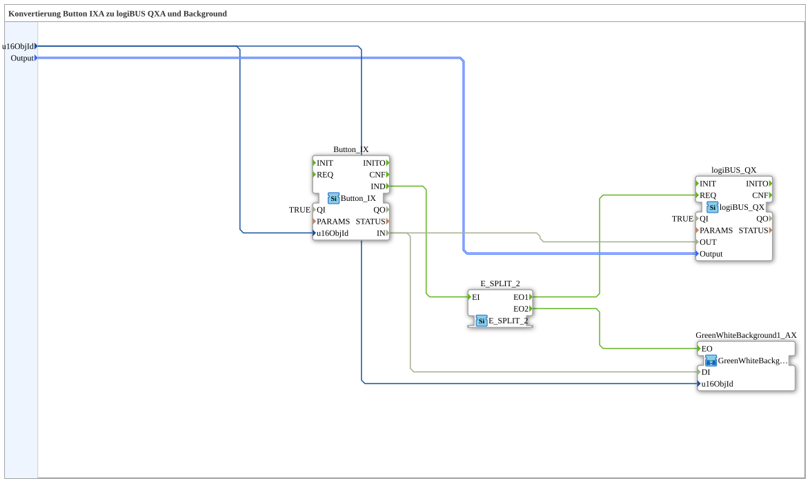

# Button_IX_TO_logiBUS_QX_BG

* * * * * * * * * *

## Einleitung

`Button_IX_TO_logiBUS_QX_BG` erweitert [`Button_IX_TO_logiBUS_QX`](./Button_IX_TO_logiBUS_QX.md) um eine VT-Statusfarbe — das test_B-Gegenstück zu [`Button_IXA_TO_logiBUS_QXA_BG`](../../MyLib_AX/sys/Button_IXA_TO_logiBUS_QXA_BG.md).

## Verwendete Funktionsbausteine (FBs)

### Sub-Bausteine: Button_IX_TO_logiBUS_QX_BG

- **Typ**: SubAppType
- **Schnittstelle (zusätzlich)**: Ereignis-Eingang `INIT`, Ereignis-Ausgang `INITO` (je `EInit`), Daten-Eingang `QI` (`BOOL`, Vorgabe `TRUE`), Daten-Ausgang `QO` (`BOOL`).
- **Verwendete interne FBs**:
    - **Button_IX**: `isobus::UT::io::Button::Button_IX` — VT-Taster.
    - **logiBUS_QX**: `logiBUS::io::DQ::logiBUS_QX` — physischer digitaler Ausgang.
    - **E_SPLIT_2**: `iec61499::events::E_SPLIT_2` — verzweigt das Tasterereignis.
    - **GreenWhiteBackground1_AX** (SubApp, tatsächlich vom Typ `MyLib::sys::GreenWhiteBackground1C` — kompakter Wrapper der test_B-Basisvariante, siehe [Background-Farbbausteine](../../MyLib_AX/sys/Background-Farbbausteine.md)): setzt die Statusfarbe.
    - **AND_QO**: `iec61131::booleanOperators::AND_BOOL_3` — verknüpft die `QO`-Ausgänge von `logiBUS_QX`, `Button_IX` und `GreenWhiteBackground1_AX` zu `QO`.
- **Funktionsweise**: `Button_IX.IND` wird über `E_SPLIT_2` an `logiBUS_QX.REQ` und an den Farbwechsel-Baustein verteilt; der Datenwert `Button_IX.IN` geht sowohl an `logiBUS_QX.OUT` als auch an `GreenWhiteBackground1_AX.DI`.

## Programmablauf und Verbindungen

1. `u16ObjId` → `Button_IX.u16ObjId` und (Farbbaustein-Instanz) `.u16ObjId`; `Output` → `logiBUS_QX.Output`.
2. `Button_IX.IND` → `E_SPLIT_2.EI` → `E_SPLIT_2.EO1` → `logiBUS_QX.REQ`, `E_SPLIT_2.EO2` → Farbbaustein `.EO`.
3. `Button_IX.IN` → `logiBUS_QX.OUT` und → Farbbaustein `.DI`.
4. Initialisierung: `INIT` → `logiBUS_QX.INIT`; `logiBUS_QX.INITO` → `Button_IX.INIT`; `Button_IX.INITO` → `GreenWhiteBackground1_AX.INIT`; `GreenWhiteBackground1_AX.INITO` → `INITO` und → `AND_QO.REQ`.
5. Qualität: `QI` → `.QI` von `logiBUS_QX`, `Button_IX` und `GreenWhiteBackground1_AX`; deren `QO` → `AND_QO.IN1` bis `AND_QO.IN3` (in dieser Reihenfolge); `AND_QO.OUT` → `QO`.

## Anwendungsszenarien

- VT-Taster mit optischer Statusrückmeldung für test_B, ohne OPC-UA.

## Zusammenfassung

test_B-Pendant zu `Button_IXA_TO_logiBUS_QXA_BG`, mit `E_SPLIT_2` statt `AX_SPLIT_2` und der Kompakt-Wrapper-Variante des Background-Bausteins.

---

### 🌐 Passende Themen-Unterseiten auf ms-muc-docs.de

- [🌐 Eclipse 4diac IDE & Farb-Referenz auf ms-muc-docs.de](https://www.ms-muc-docs.de/iec-61499/eclipse-4diac/)
