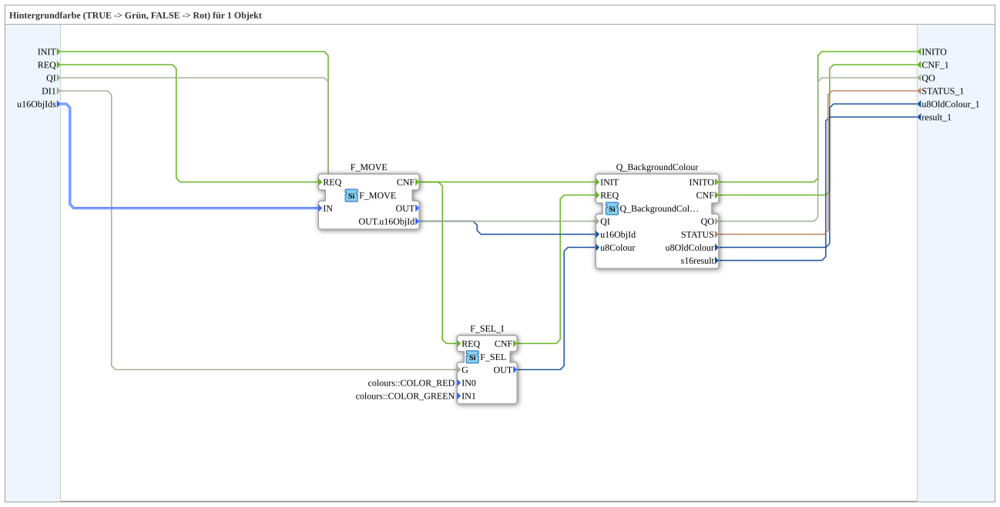

# GreenRedBackground1S

* * * * * * * * * *

## Einleitung

`GreenRedBackground1S` schaltet die VT-Hintergrundfarbe eines Objekts anhand eines booleschen Selector-Signals: `TRUE` → **Grün**, `FALSE` → **Rot**. Das Selector-Signal kommt als einfacher `BOOL`-Dateneingang (`DI1`). Die Objekt-ID wird über den strukturierten Typ `s1ObjectID` (`u16ObjIds`) übergeben.

Allgemeines Muster (Selector → `AX_SEL`/`F_SEL` → `Q_BackgroundColour`) siehe [Background-Farbbausteine (gemeinsames Muster)](../../MyLib_AX/sys/Background-Farbbausteine.md).

## Schnittstelle: Initialisierung und Qualität

- **INIT** (Ereignis-Eingang, `EInit`) → `Q_BackgroundColour.INIT`; `Q_BackgroundColour.INITO` → **INITO** (Ereignis-Ausgang, `EInit`).
- **QI** (Daten-Eingang, `BOOL`, Vorgabe `TRUE`): Quality Input – `TRUE` aktiviert den Dienst; durchgereicht an `Q_BackgroundColour.QI`.
- **QO** (Daten-Ausgang, `BOOL`): Quality Output – `TRUE`, wenn der Dienst erfolgreich ausgeführt wurde; kommt von `Q_BackgroundColour.QO`.

## Zusammenfassung

Eine von vielen Varianten der Background-Farbbausteine-Familie: Farbpaar Grün/Rot, 1 Objekt, BOOL-Selector, struct. Objekt-ID.

---

### 🌐 Passende Themen-Unterseiten auf ms-muc-docs.de

- [🌐 Eclipse 4diac IDE & Farb-Referenz auf ms-muc-docs.de](https://www.ms-muc-docs.de/iec-61499/eclipse-4diac/)
