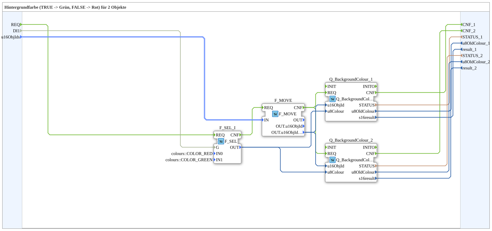

# GreenRedBackground2S

* * * * * * * * * *

## Einleitung

`GreenRedBackground2S` schaltet die VT-Hintergrundfarbe von 2 Objekten anhand eines booleschen Selector-Signals: `TRUE` → **Grün**, `FALSE` → **Rot**. Das Selector-Signal kommt als einfacher `BOOL`-Dateneingang (`DI1`). Die Objekt-ID wird über den strukturierten Typ `s1ObjectID` (`u16ObjIds`) übergeben.

| Position | Objekt-ID-Quelle       | Baustein                                            |
| -------- | ---------------------- | --------------------------------------------------- |
| 1        | `F_MOVE.OUT.u16ObjIdA` | `Q_BackgroundColour` (normales Objekt)              |
| 2        | `F_MOVE.OUT.u16ObjIdA` | `Q_BackgroundColourAux` (Auxiliary-Function-Objekt) |

Schnittstelle (Quality-Muster): Ereignis-Eingang `INIT` und Ereignis-Ausgang `INITO` (je `EInit`), Dateneingang `QI` (`BOOL`, Vorgabe `TRUE`) und Datenausgang `QO` (`BOOL`, UND aller Instanzen). Initialisierung: `INIT` → `Q_BackgroundColour_1.INIT`; `Q_BackgroundColour_1.INITO` → `Q_BackgroundColour_2.INIT`; `Q_BackgroundColour_2.INITO` → `INITO`. Qualität: `QI` → `Q_BackgroundColour_1.QI`, `Q_BackgroundColour_2.QI`; `Q_BackgroundColour_1.QO`, `Q_BackgroundColour_2.QO` → `AND_QO.IN1` bis `AND_QO.IN2` (`AND_QO`: `iec61131::booleanOperators::AND_BOOL_2`); `AND_QO.OUT` → `QO`. Der Trigger `AND_QO.REQ` kommt über `E_MERGE_QO` (`E_MERGE_3`), der `Q_BackgroundColour_2.INITO` sowie die `CNF` von `Q_BackgroundColour_1` und `_2` zusammenführt; `E_MERGE_QO.EO` → `AND_QO.REQ`.

Allgemeines Muster (Selector → `AX_SEL`/`F_SEL` → `Q_BackgroundColour`) siehe [Background-Farbbausteine (gemeinsames Muster)](../../MyLib_AX/sys/Background-Farbbausteine.md).

## Zusammenfassung

Eine von vielen Varianten der Background-Farbbausteine-Familie: Farbpaar Grün/Rot, 2 Objekte, BOOL-Selector, struct. Objekt-ID.

---

### 🌐 Passende Themen-Unterseiten auf ms-muc-docs.de

* [🌐 Eclipse 4diac IDE & Farb-Referenz auf ms-muc-docs.de](https://www.ms-muc-docs.de/iec-61499/eclipse-4diac/)
