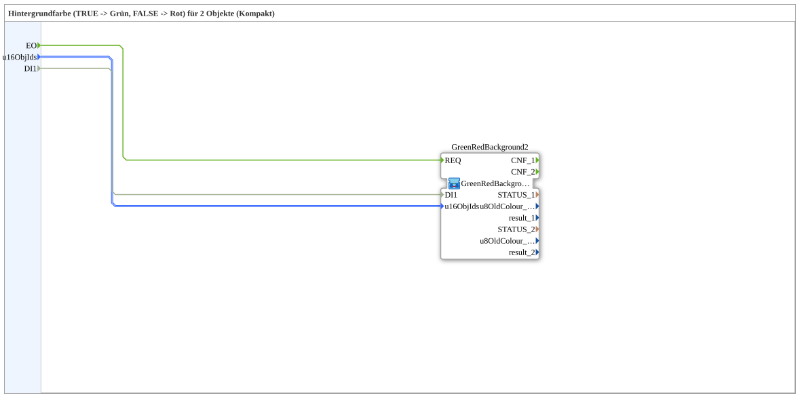

# GreenRedBackground2SC

* * * * * * * * * *

## Einleitung

`GreenRedBackground2SC` ist ein **Kompakt-Wrapper** um [`GreenRedBackground2S`](GreenRedBackground2S.md) — reicht `u16ObjId`s und den Selector durch, ohne die `CNF`-Ereignisausgänge und Diagnosewerte (`STATUS_n`, `u8OldColour_n`, `result_n`) nach außen zu führen.

Details zum gemeinsamen Muster siehe [Background-Farbbausteine (gemeinsames Muster)](../../MyLib_AX/sys/Background-Farbbausteine.md).

## Initialisierung und Status (INIT/INITO, QI/QO)

- **Ereignis-Eingang** `INIT` (`EInit`, Initialization Request) und **Ereignis-Ausgang** `INITO` (`EInit`, Initialization Confirm)
- **Daten-Eingang** `QI` (`BOOL`, Vorgabe `TRUE`, Quality Input) wird an `GreenRedBackground2.QI` weitergegeben
- **Daten-Ausgang** `QO` (`BOOL`, Quality Output): durchgereicht von `GreenRedBackground2.QO`
- **Initialisierungskette**: `INIT` → `GreenRedBackground2.INIT`, `GreenRedBackground2.INITO` → `INITO`

## Zusammenfassung

Reine Weiterleitung an `GreenRedBackground2S` für den Regelfall, in dem die Diagnosewerte nicht gebraucht werden.

---

### 🌐 Passende Themen-Unterseiten auf ms-muc-docs.de

- [🌐 Eclipse 4diac IDE & Farb-Referenz auf ms-muc-docs.de](https://www.ms-muc-docs.de/iec-61499/eclipse-4diac/)
