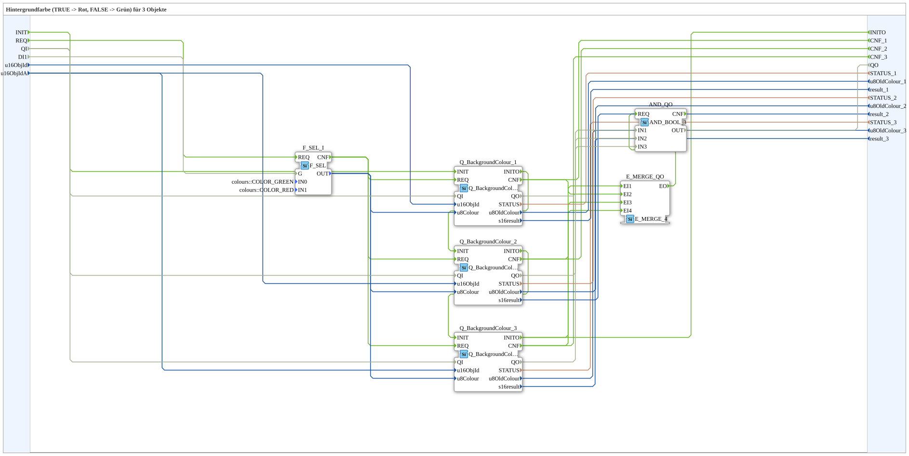

# GreenRedBackground3

* * * * * * * * * *

## Einleitung

`GreenRedBackground3` schaltet die VT-Hintergrundfarbe von 3 Objekten anhand eines booleschen Selector-Signals: `TRUE` → **Rot**, `FALSE` → **Grün**. Das Selector-Signal kommt als einfacher `BOOL`-Dateneingang (`DI1`). Die Objekt-ID wird über die Eingänge `u16ObjId, u16ObjIdA` übergeben.

| Position | Objekt-ID-Quelle | Baustein                                            |
| -------- | ---------------- | --------------------------------------------------- |
| 1        | `u16ObjId`       | `Q_BackgroundColour` (normales Objekt)              |
| 2        | `u16ObjIdA`      | `Q_BackgroundColour` (normales Objekt)              |
| 3        | `u16ObjIdA`      | `Q_BackgroundColourAux` (Auxiliary-Function-Objekt) |

Allgemeines Muster (Selector → `AX_SEL`/`F_SEL` → `Q_BackgroundColour`) siehe [Background-Farbbausteine (gemeinsames Muster)](../../MyLib_AX/sys/Background-Farbbausteine.md).

**Initialisierung und Qualität:** Die SubApp besitzt `INIT`/`INITO` sowie `QI`/`QO`. `INIT` → `Q_BackgroundColour_1.INIT` → `Q_BackgroundColour_2.INIT` → `Q_BackgroundColour_3.INIT` (jeweils über `INITO`), `Q_BackgroundColour_3.INITO` → `INITO`. `QI` geht an alle drei Instanzen. `QO` ist das `AND` (`AND_QO`, `AND_BOOL_3`) der drei `QO`-Ausgänge; `AND_QO.REQ` wird über `E_MERGE_QO` (`E_MERGE_4`: `Q_BackgroundColour_3.INITO`, `Q_BackgroundColour_1.CNF`, `_2.CNF`, `_3.CNF`) ausgelöst.

## Zusammenfassung

Eine von vielen Varianten der Background-Farbbausteine-Familie: Farbpaar Rot/Grün, 3 Objekte, BOOL-Selector.

---

### 🌐 Passende Themen-Unterseiten auf ms-muc-docs.de

* [🌐 Eclipse 4diac IDE & Farb-Referenz auf ms-muc-docs.de](https://www.ms-muc-docs.de/iec-61499/eclipse-4diac/)
