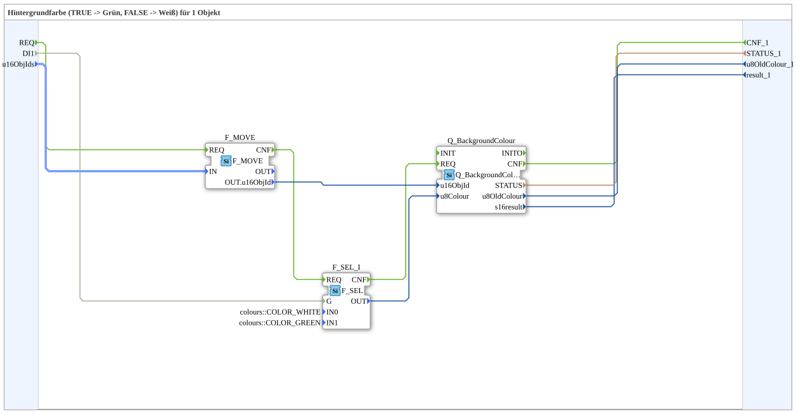

# GreenWhiteBackground1S

* * * * * * * * * *

## Einleitung

`GreenWhiteBackground1S` schaltet die VT-Hintergrundfarbe eines Objekts anhand eines booleschen Selector-Signals: `TRUE` → **Grün**, `FALSE` → **Weiß**. Das Selector-Signal kommt als einfacher `BOOL`-Dateneingang (`DI1`). Die Objekt-ID wird über den strukturierten Typ `s1ObjectID` (`u16ObjIds`) übergeben.

Allgemeines Muster (Selector → `AX_SEL`/`F_SEL` → `Q_BackgroundColour`) siehe [Background-Farbbausteine (gemeinsames Muster)](../../MyLib_AX/sys/Background-Farbbausteine.md).

**Quality-Anschlüsse:** Der Baustein besitzt zusätzlich das Ereignis `INIT` (Eingang) und `INITO` (Ausgang) sowie den Dateneingang `QI` (BOOL, Standard `TRUE`, „Quality Input – TRUE, um den Dienst freizugeben“) und den Datenausgang `QO` (BOOL, „Quality Output – TRUE, wenn der Dienst erfolgreich ausgeführt wurde“). `INIT` wird an `Q_BackgroundColour.INIT` weitergereicht, `Q_BackgroundColour.INITO` an `INITO`; `QI` ist mit `Q_BackgroundColour.QI` und `Q_BackgroundColour.QO` mit `QO` verbunden.

## Zusammenfassung

Eine von vielen Varianten der Background-Farbbausteine-Familie: Farbpaar Grün/Weiß, 1 Objekt, BOOL-Selector, struct. Objekt-ID.

---

### 🌐 Passende Themen-Unterseiten auf ms-muc-docs.de

* [🌐 Eclipse 4diac IDE & Farb-Referenz auf ms-muc-docs.de](https://www.ms-muc-docs.de/iec-61499/eclipse-4diac/)
