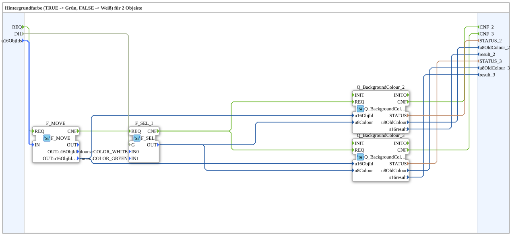

# GreenWhiteBackground2S

* * * * * * * * * *

## Einleitung

`GreenWhiteBackground2S` schaltet die VT-Hintergrundfarbe von 2 Objekten anhand eines booleschen Selector-Signals: `TRUE` → **Grün**, `FALSE` → **Weiß**. Das Selector-Signal kommt als einfacher `BOOL`-Dateneingang (`DI1`). Die Objekt-ID wird über den strukturierten Typ `s1ObjectID` (`u16ObjIds`) übergeben.

| Position | Objekt-ID-Quelle       | Baustein                                            |
| -------- | ---------------------- | --------------------------------------------------- |
| 1        | `F_MOVE.OUT.u16ObjIdA` | `Q_BackgroundColour` (normales Objekt)              |
| 2        | `F_MOVE.OUT.u16ObjIdA` | `Q_BackgroundColourAux` (Auxiliary-Function-Objekt) |

Allgemeines Muster (Selector → `AX_SEL`/`F_SEL` → `Q_BackgroundColour`) siehe [Background-Farbbausteine (gemeinsames Muster)](../../MyLib_AX/sys/Background-Farbbausteine.md).

## Initialisierung und Status (INIT/INITO, QI/QO)

- **Ereignis-Eingang** `INIT` (`EInit`, Initialization Request) und **Ereignis-Ausgang** `INITO` (`EInit`, Initialization Confirm)
- **Daten-Eingang** `QI` (`BOOL`, Vorgabe `TRUE`, Quality Input) wird an `Q_BackgroundColour_2.QI` und `Q_BackgroundColour_3.QI` weitergegeben
- **Daten-Ausgang** `QO` (`BOOL`, Quality Output): UND (`AND_QO`, Typ `iec61131::booleanOperators::AND_BOOL_2`) der `QO`-Ausgänge von `Q_BackgroundColour_2.QO` und `Q_BackgroundColour_3.QO`
- **Initialisierungskette**: `INIT` → `Q_BackgroundColour_2.INIT`, `Q_BackgroundColour_2.INITO` → `Q_BackgroundColour_3.INIT`, `Q_BackgroundColour_3.INITO` → `INITO`
- `E_MERGE_QO` (Typ `iec61499::events::E_MERGE_3`) führt `Q_BackgroundColour_3.INITO`, `Q_BackgroundColour_2.CNF` und `Q_BackgroundColour_3.CNF` zusammen und löst `AND_QO.REQ` aus

## Zusammenfassung

Eine von vielen Varianten der Background-Farbbausteine-Familie: Farbpaar Grün/Weiß, 2 Objekte, BOOL-Selector, struct. Objekt-ID.

---

### 🌐 Passende Themen-Unterseiten auf ms-muc-docs.de

- [🌐 Eclipse 4diac IDE & Farb-Referenz auf ms-muc-docs.de](https://www.ms-muc-docs.de/iec-61499/eclipse-4diac/)
