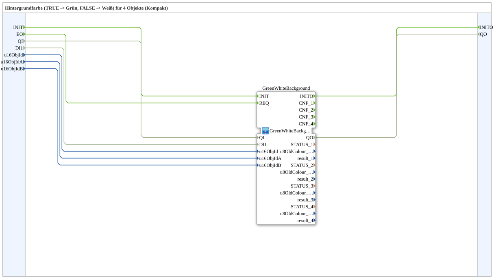

# GreenWhiteBackground4C

* * * * * * * * * *

## Einleitung

`GreenWhiteBackground4C` ist ein **Kompakt-Wrapper** um [`GreenWhiteBackground4`](GreenWhiteBackground4.md) — reicht `u16ObjId` und den Selector durch, ohne die `CNF`-Ereignisausgänge und Diagnosewerte (`STATUS_n`, `u8OldColour_n`, `result_n`) nach außen zu führen. Zusätzlich werden `INIT` → `GreenWhiteBackground.INIT`, `GreenWhiteBackground.INITO` → `INITO`, `QI` → `GreenWhiteBackground.QI` (Initialwert `TRUE`) und `GreenWhiteBackground.QO` → `QO` durchgereicht.

Details zum gemeinsamen Muster siehe [Background-Farbbausteine (gemeinsames Muster)](../../MyLib_AX/sys/Background-Farbbausteine.md).

## Zusammenfassung

Reine Weiterleitung an `GreenWhiteBackground4` für den Regelfall, in dem die Diagnosewerte nicht gebraucht werden.

---

### 🌐 Passende Themen-Unterseiten auf ms-muc-docs.de

* [🌐 Eclipse 4diac IDE & Farb-Referenz auf ms-muc-docs.de](https://www.ms-muc-docs.de/iec-61499/eclipse-4diac/)
