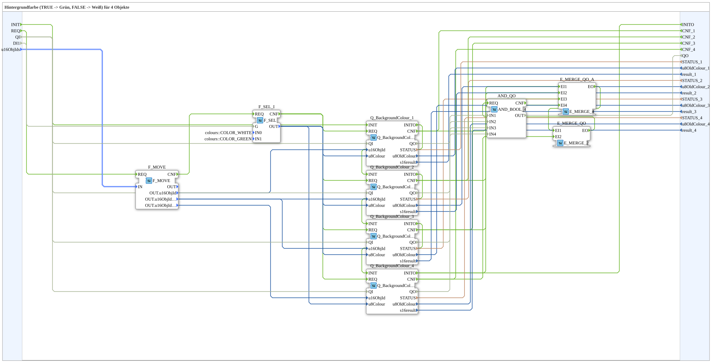

# GreenWhiteBackground4S

* * * * * * * * * *

## Einleitung

`GreenWhiteBackground4S` schaltet die VT-Hintergrundfarbe von 4 Objekten anhand eines booleschen Selector-Signals: `TRUE` → **Grün**, `FALSE` → **Weiß**. Das Selector-Signal kommt als einfacher `BOOL`-Dateneingang (`DI1`). Die Objekt-ID wird über den strukturierten Typ `s1ObjectID` (`u16ObjIds`) übergeben.

| Position | Objekt-ID-Quelle       | Baustein                                            |
| -------- | ---------------------- | --------------------------------------------------- |
| 1        | `F_MOVE.OUT.u16ObjId`  | `Q_BackgroundColour` (normales Objekt)              |
| 2        | `F_MOVE.OUT.u16ObjIdA` | `Q_BackgroundColour` (normales Objekt)              |
| 3        | `F_MOVE.OUT.u16ObjIdA` | `Q_BackgroundColourAux` (Auxiliary-Function-Objekt) |
| 4        | `F_MOVE.OUT.u16ObjIdB` | `Q_BackgroundColour` (normales Objekt)              |

**Initialisierung und Qualität:** Zusätzlich zu den bisherigen Ereignissen besitzt der Baustein den Ereigniseingang `INIT`, den Ereignisausgang `INITO` sowie `QI` (BOOL, Eingang, Initialwert `TRUE`) und `QO` (BOOL, Ausgang, UND aller Instanzen). Init-Kette: `INIT` → `Q_BackgroundColour_1` → `Q_BackgroundColour_2` → `Q_BackgroundColour_3` → `Q_BackgroundColour_4` → `INITO` (jeweils `INITO` → nächstes `INIT`). `QI` wird an alle `Q_BackgroundColour_n.QI` weitergereicht. `QO` bildet `AND_QO` (`iec61131::booleanOperators::AND_BOOL_4`): `Q_BackgroundColour_1.QO` → `AND_QO.IN1`, `Q_BackgroundColour_2.QO` → `AND_QO.IN2`, `Q_BackgroundColour_3.QO` → `AND_QO.IN3`, `Q_BackgroundColour_4.QO` → `AND_QO.IN4`, `AND_QO.OUT` → `QO`. `E_MERGE_QO_A` (`E_MERGE_4`) führt `Q_BackgroundColour_4.INITO` und die `CNF`-Ausgänge von `Q_BackgroundColour_1`, `Q_BackgroundColour_2` und `Q_BackgroundColour_3` zusammen, `E_MERGE_QO` (`E_MERGE_2`) fügt `Q_BackgroundColour_4.CNF` hinzu; `E_MERGE_QO.EO` triggert `AND_QO.REQ`.

Allgemeines Muster (Selector → `AX_SEL`/`F_SEL` → `Q_BackgroundColour`) siehe [Background-Farbbausteine (gemeinsames Muster)](../../MyLib_AX/sys/Background-Farbbausteine.md).

## Zusammenfassung

Eine von vielen Varianten der Background-Farbbausteine-Familie: Farbpaar Grün/Weiß, 4 Objekte, BOOL-Selector, struct. Objekt-ID.

---

### 🌐 Passende Themen-Unterseiten auf ms-muc-docs.de

* [🌐 Eclipse 4diac IDE & Farb-Referenz auf ms-muc-docs.de](https://www.ms-muc-docs.de/iec-61499/eclipse-4diac/)
